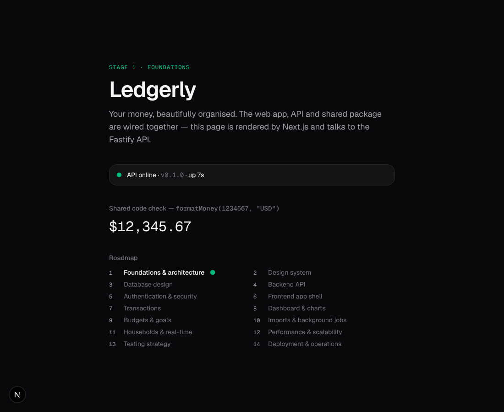
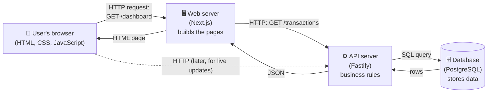
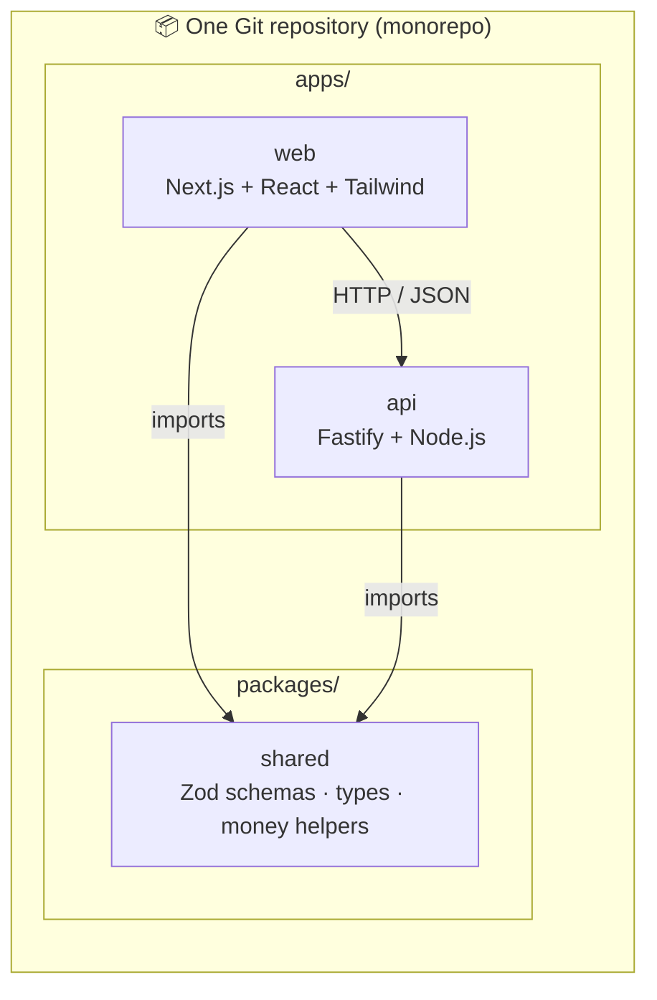
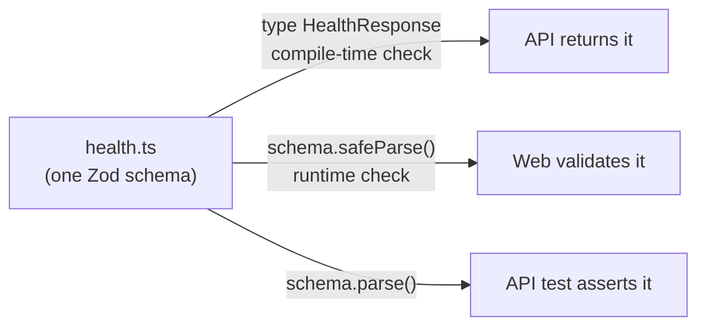
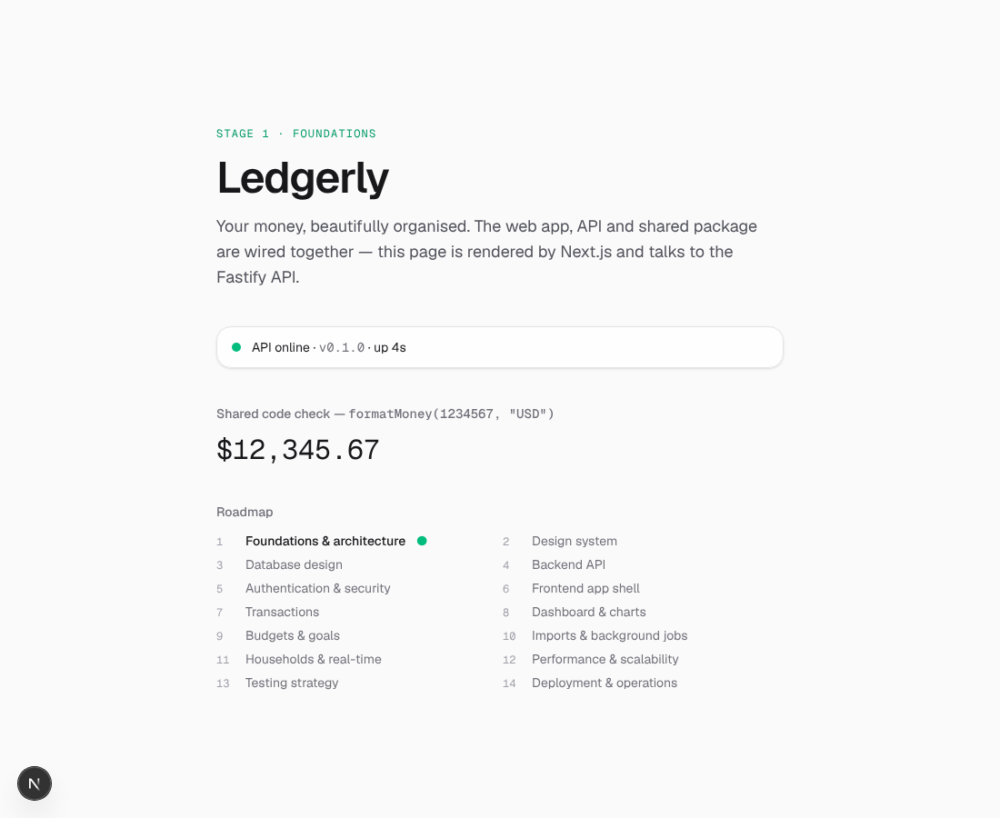
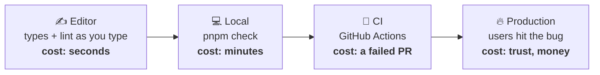

# Stage 1 — Foundations & Architecture

> **Goal of this stage:** before writing a single feature, set up a professional foundation: a clear architecture, a carefully chosen tech stack, a repository layout that scales, and automated "quality gates" that catch mistakes before they reach users.
>
> **What you can see at the end:** a web page (Next.js) that talks to a running API (Fastify), using code shared between them, all checked automatically on every push.



---

## Table of contents

1. [How a web app actually works (the big picture)](#1-how-a-web-app-actually-works-the-big-picture)
2. [Our architecture and why](#2-our-architecture-and-why)
3. [The tech stack, one decision at a time](#3-the-tech-stack-one-decision-at-a-time)
4. [A tour of the repository](#4-a-tour-of-the-repository)
5. [Code walkthrough: the important ideas](#5-code-walkthrough-the-important-ideas)
6. [Quality gates: formatting, linting, types, tests, CI](#6-quality-gates-formatting-linting-types-tests-ci)
7. [Dependency management (the unglamorous part pros care about)](#7-dependency-management-the-unglamorous-part-pros-care-about)
8. [Seeds of scalability we planted today](#8-seeds-of-scalability-we-planted-today)
9. [Run it yourself](#9-run-it-yourself)
10. [Exercises](#10-exercises)
11. [Glossary](#11-glossary)
12. [What's next](#12-whats-next)

---

## 1. How a web app actually works (the big picture)

Before choosing tools, you need a mental model of the moving parts. Almost every modern web app — Linear, Notion, your bank's website — is made of the same four pieces:



| Piece                      | Its job                                                                                                            | Analogy                                  |
| -------------------------- | ------------------------------------------------------------------------------------------------------------------ | ---------------------------------------- |
| **Browser (client)**       | Shows the interface, reacts to clicks, runs animations.                                                            | The restaurant's dining room.            |
| **Web / front-end server** | Produces the HTML pages and sends them to the browser. Can fetch data first so the page arrives already filled in. | The waiter who brings you a plated meal. |
| **API (back end)**         | Owns the _rules_: "a user can only see their own transactions", "a budget can't be negative". Talks to the DB.     | The kitchen.                             |
| **Database**               | Stores everything permanently and answers questions about it.                                                      | The pantry and the recipe book.          |

They talk to each other using **HTTP**, the language of the web. A request is basically a short message:

```http
GET /health HTTP/1.1
Host: localhost:4000
Accept: application/json
```

…and the response comes back with a **status code** (200 = OK, 404 = Not Found, 500 = server crashed), some **headers** (metadata), and a **body**, which in APIs is usually **JSON**:

```json
{ "status": "ok", "service": "ledgerly-api", "version": "0.1.0", "uptimeSeconds": 4 }
```

That's literally what our `/health` endpoint returns today. Everything we build in the next 13 stages is a more sophisticated version of this conversation.

> **Key idea:** the browser is _untrusted_. Anyone can open DevTools and send any request they like. That's why business rules and security checks live on the **server**, never only in the browser. You'll see this principle again and again.

---

## 2. Our architecture and why

### 2.1 What we chose



- **A separate front end and back end.** `apps/web` is only responsible for the user interface. `apps/api` is only responsible for data and business rules.
- **A shared package** (`packages/shared`) with code both sides need — most importantly the _contracts_ (the exact shape of the data they exchange).
- **All of it in one repository** — a _monorepo_.

### 2.2 Why separate the front end and the back end?

Next.js can actually do both jobs by itself (it has "API routes" and "server actions"). For a small app that's a perfectly good choice. We deliberately didn't, because you want to learn how apps are built **to scale**, and separation buys us:

1. **Independent scaling.** Imagine 10,000 people import bank statements at the start of the month. That's heavy API/worker work but light page-rendering work. Separate services let us run 20 API instances and 3 web instances instead of 20 of everything.
2. **Multiple clients.** One day you might want a mobile app or a CLI. They can all use the same API. If the business rules lived inside the web app, you'd have to duplicate them.
3. **Clear boundaries teach clear thinking.** When the only way the front end can touch data is through a well-defined HTTP API, you're forced to design that API properly (Stage 4). This is exactly how most mid-size and large companies work.
4. **Long-running connections.** In Stage 11 we'll add WebSockets for live updates. Those need a long-lived server process, which fits naturally in a dedicated API and awkwardly in serverless page-rendering platforms.

**The trade-off (be honest about it):** two services means two things to deploy, and a network hop between them. For a beginner it's a little more setup. We accept that cost because learning how the pieces fit together is the whole point of this project.

### 2.3 Why _not_ microservices?

You may have heard "big companies use microservices" — dozens of tiny services (an auth service, a transactions service, a notification service…). We are **not** doing that. Microservices solve _organizational_ problems (hundreds of engineers who need to deploy independently) and bring huge complexity: distributed transactions, network failures between every piece, harder debugging.

The industry consensus today is: **start with a "modular monolith"** — one API service, but internally organized in clean modules (users, transactions, budgets…). If one module someday needs to be its own service, clean module boundaries make that split easy. Shopify, GitHub and Basecamp all famously run large modular monoliths.

### 2.4 Why a monorepo?

| Option                                | Pros                                                                                                             | Cons                                                                                                           |
| ------------------------------------- | ---------------------------------------------------------------------------------------------------------------- | -------------------------------------------------------------------------------------------------------------- |
| **Monorepo** (one repo, many apps) ✅ | One pull request can change the API and the UI together. Shared code without publishing packages. One CI config. | Needs a tool (Turborepo) to stay fast as it grows.                                                             |
| **Polyrepo** (one repo per app)       | Total independence per team.                                                                                     | Shared code must be published as versioned packages; changes that span apps need coordinated PRs across repos. |

Google, Meta, Vercel, and most startups use monorepos for exactly the first reason: when you add a "category" field to transactions, the database, API, shared schema and UI should all change **in one atomic, reviewable commit**.

---

## 3. The tech stack, one decision at a time

For each tool: what it is, why we picked it, and what we rejected.

### 3.1 TypeScript (everywhere)

**What:** JavaScript plus _types_. You describe what shape your data has, and the compiler checks every use of it _before_ the code runs.

```ts
function formatMoney(amount: number, currency: string): string { … }
formatMoney("12.50", "USD"); // ❌ compile error: string is not a number
```

**Why it's best practice:** In large codebases, most bugs are "I thought this was X but it was Y". Types catch these in your editor, instantly. They also act as always-up-to-date documentation, and they make refactoring safe — rename something and the compiler tells you every place that broke. TypeScript is now the default for professional JavaScript work; surveys consistently show it as one of the most used and loved languages.

**Why one language for front and back end:** you learn one language deeply, and you can _share code_ between both sides (our `packages/shared`). Rejected alternatives for the API — Python (FastAPI), Go, Java — are all excellent, but they'd force you to learn two languages and lose code sharing.

**Our strict settings** (`tsconfig.base.json`): `strict: true` turns on all the important checks. `noUncheckedIndexedAccess` makes `array[5]` typed as "maybe undefined", which is the truth and prevents a classic crash. Strict from day one is far easier than trying to turn it on in a big codebase later.

### 3.2 Node.js (the runtime)

**What:** the program that runs JavaScript/TypeScript on a server. We require version 22.12+ (an LTS — "Long-Term Support" — release, meaning it gets security fixes for years).

**Why:** huge ecosystem, excellent at I/O-heavy workloads (APIs mostly wait on databases and networks, which Node handles very efficiently with its event loop). The file `.nvmrc` pins the version so every developer and CI use the same one.

### 3.3 pnpm (package manager)

**What:** installs third-party libraries ("dependencies") from the npm registry.

**Why pnpm over npm/yarn:** it's faster, uses much less disk (it stores each package version once and links to it), and it's **strict**: your code can only import packages it explicitly declares. With npm, code can accidentally import a package that's only there because something _else_ depended on it — it works on your machine, then breaks mysteriously later. pnpm has first-class "workspace" support, which is what makes our monorepo work (`pnpm-workspace.yaml`).

### 3.4 Turborepo (monorepo task runner)

**What:** runs tasks (`build`, `test`, `lint`…) across all packages in the right order, in parallel, with caching.

Look at `turbo.json`:

```json
"build": { "dependsOn": ["^build"], "outputs": ["dist/**", ".next/**"] }
```

`^build` means "first build the packages I depend on". So `web` and `api` wait for `shared` to build, then build **in parallel** with each other. And if nothing in a package changed since last time, Turbo **replays the cached result** in milliseconds instead of rebuilding. In large monorepos this turns 20-minute CI runs into 2-minute ones.

### 3.5 Next.js + React (front end)

**React** is the most widely used library for building user interfaces out of _components_ — reusable pieces like `<ApiStatus />`. **Next.js** is the most popular framework on top of React, adding routing, server rendering, image/font optimization and a production build pipeline.

**Why Next.js is a strong choice for a finance dashboard:**

- **Server Components:** components that run on the server, fetch data, and send finished HTML. Faster first load (no blank screen while JavaScript downloads), and secrets/internal URLs never reach the browser. Our `ApiStatus` component is one.
- **Streaming with Suspense:** the page shell arrives instantly, and slower parts (like data from the API) "pop in" when ready, showing a skeleton meanwhile. That's the polished feel you see in top apps.
- **Huge ecosystem & hiring market:** whatever you need (charts, animations, auth), there's a well-trodden path.

**Rejected:** Vite + React SPA (simpler, but everything renders in the browser, so slower first paint and worse SEO for public pages); Remix/React Router (excellent, smaller ecosystem); SvelteKit/Nuxt (great, but React skills transfer to far more jobs).

### 3.6 Tailwind CSS (styling)

**What:** instead of writing separate CSS files with class names you invent, you compose small utility classes directly in markup: `rounded-2xl border px-4 py-3 text-sm`.

**Why:** it's become the industry default for product teams (used by OpenAI, Vercel, Shopify, and shadcn/ui, which we'll use in Stage 2). It enforces a **design scale** — you pick from `px-3`, `px-4`, `px-6`, not "13px" one day and "15px" the next — which is what makes a UI look consistent and professional. Unused styles are automatically removed, so the CSS shipped to users stays tiny. Version 4 (what we use) is configured in CSS itself via `@theme`, which you'll see in `globals.css`.

### 3.7 Fastify (API framework)

**What:** a framework for building HTTP servers in Node.

**Why Fastify over Express:** Express is the classic, but it's old (designed in 2010) and slow to evolve. Fastify is:

- **Fast** — one of the highest-throughput Node frameworks, which directly means fewer servers needed at scale.
- **Async-first** — `async/await` and errors in async handlers work correctly out of the box (a long-standing Express pain point).
- **Plugin architecture** — every feature (CORS, security headers, our routes) is a _plugin_ with its own encapsulated scope. That maps perfectly onto the "modular monolith" idea from §2.3.
- **Built-in structured logging** with Pino, the fastest Node logger.
- **Testing without a network** via `app.inject()` (see §5.4).

**Rejected:** NestJS (powerful, but heavy on Angular-style decorators and abstractions — a lot to absorb as a beginner, and it hides the fundamentals we want you to learn); Hono (excellent and modern, aimed more at edge/serverless runtimes).

### 3.8 Zod (validation and contracts)

**What:** a library to describe the shape of data and check it at runtime.

**Why it matters:** TypeScript types disappear when the code runs. If the API sends `{ status: 200 }` instead of `{ status: "ok" }`, TypeScript can't save you at runtime — but Zod can. Zod lets you write the shape **once** and get **both** a runtime validator and a TypeScript type from it. We use it for API contracts and for validating environment variables. "Validate everything that crosses a trust boundary" is a core security and reliability principle.

### 3.9 Vitest (tests), ESLint (linting), Prettier (formatting)

Covered in detail in [§6](#6-quality-gates-formatting-linting-types-tests-ci).

### 3.10 What's coming later (and why not now)

PostgreSQL + Drizzle ORM (Stage 3), Redis + BullMQ (Stages 10–12), the Motion animation library and shadcn/ui components (Stage 2), Docker (Stage 14). **Adding tools only when you need them** is itself a best practice: every dependency is code you don't control, must keep updated, and could contain vulnerabilities.

---

## 4. A tour of the repository

```
ledgerly/
├── .github/workflows/ci.yml   ← automated checks on every push/PR
├── .vscode/                   ← recommended editor extensions & settings
├── apps/
│   ├── api/
│   │   ├── .env.example       ← documents required config (never the real secrets)
│   │   └── src/
│   │       ├── config/env.ts  ← validates environment variables at startup
│   │       ├── routes/health.ts
│   │       ├── app.ts         ← builds the Fastify app (testable)
│   │       ├── app.test.ts
│   │       └── server.ts      ← starts listening + graceful shutdown
│   └── web/
│       ├── .env.example
│       └── src/
│           ├── app/           ← Next.js routes: layout.tsx, page.tsx, globals.css
│           ├── components/    ← React components (api-status.tsx)
│           └── lib/           ← non-UI helpers (api.ts)
├── packages/
│   └── shared/src/
│       ├── health.ts          ← the /health contract (Zod)
│       ├── money.ts           ← integer-cents money helpers
│       ├── money.test.ts
│       └── index.ts           ← the package's public API
├── docs/                      ← you are here
├── .editorconfig  .prettierrc.json  eslint.config.mjs   ← code style
├── .nvmrc  .npmrc                                        ← Node version & install rules
├── package.json  pnpm-workspace.yaml  pnpm-lock.yaml     ← dependencies & workspaces
├── tsconfig.base.json                                    ← shared TypeScript settings
└── turbo.json                                            ← task pipeline
```

**Pattern to notice — configuration is layered.** There's one root config for ESLint and TypeScript, and each app _extends_ it, adding only what's specific to it (e.g. the web app adds DOM types and Next.js rules). Change a rule once, it applies everywhere. Don't Repeat Yourself (DRY) applied to configuration.

**Pattern to notice — entry points are tiny.** `server.ts` is ~30 lines and only starts things. The real setup lives in `app.ts`. This split matters for testing (§5.4).

---

## 5. Code walkthrough: the important ideas

### 5.1 A single source of truth for the API contract

`packages/shared/src/health.ts`:

```ts
export const HealthResponseSchema = z.object({
  status: z.literal("ok"),
  service: z.string(),
  version: z.string(),
  uptimeSeconds: z.number().nonnegative(),
  timestamp: z.iso.datetime(),
});

export type HealthResponse = z.infer<typeof HealthResponseSchema>;
```

- The **API** uses the _type_ to guarantee it returns the right shape: `async (): Promise<HealthResponse> => { … }`. Forget a field and TypeScript refuses to compile.
- The **web app** uses the _schema_ to validate what it receives: `HealthResponseSchema.safeParse(json)`.
- The **API test** validates its own response with the same schema.



If someone changes the contract, **both sides break at compile time** instead of the bug reaching production. This "shared contract" pattern is how serious teams keep front ends and back ends in sync (larger companies do the same thing with OpenAPI, GraphQL schemas or Protocol Buffers — in Stage 4 we'll also generate OpenAPI documentation from Zod).

### 5.2 Money is never a float

`packages/shared/src/money.ts` is tiny but encodes the most important rule in financial software:

```ts
0.1 + 0.2 === 0.30000000000000004; // true in JavaScript (and almost every language)
```

Computers store decimals in binary floating point, which can't represent most decimal fractions exactly. Over thousands of transactions, these errors produce totals that are visibly off by a cent — and in finance, _a wrong cent destroys trust_.

The industry-standard fix: **store integers in the currency's smallest unit** ("minor units"). $12.50 is stored as `1250`. Integers add exactly. Stripe's API, for example, represents every amount this way. We only convert to a decimal string at the very last moment, for display:

```ts
formatMoney(1234567, "USD"); // "$12,345.67"
formatMoney(1500, "JPY"); // "¥1,500"  (yen has no minor unit)
```

Two more best practices hide in here:

- **Don't hard-code "2 decimals".** Currencies differ (JPY has 0, JOD has 3). We ask the built-in `Intl` API instead.
- **Fail loudly.** `assertMinorUnits` throws if a float sneaks in. A loud error in development is infinitely better than a silent wrong number in production.

The test file `money.test.ts` even _documents_ the float problem with an executable test. Tests are the best documentation because they can't go out of date.

### 5.3 Configuration: validate once, fail fast

`apps/api/src/config/env.ts` reads settings from **environment variables** and validates them with Zod:

```ts
const EnvSchema = z.object({
  NODE_ENV: z.enum(["development", "test", "production"]).default("development"),
  PORT: z.coerce.number().int().min(1).max(65_535).default(4000),
  CORS_ORIGINS: z.string().default("http://localhost:3000").transform(/* split by comma */),
  …
});
```

Why this is best practice:

1. **Config in the environment, not in code** — rule III of the famous [Twelve-Factor App](https://12factor.net/config) methodology. The _same build_ runs on your laptop, in staging and in production; only the environment variables differ. Secrets (database passwords, API keys) are never committed to Git.
2. **`.env.example` is committed, `.env` is not** (see `.gitignore`). New developers know exactly what to configure; real secrets stay private.
3. **Fail fast.** If `PORT=abc`, the server refuses to start with a clear message. Without validation, it might start and fail on the first request at 3 a.m. Crashing at deploy time — when someone is watching — is the safer failure.
4. **Typed config.** After parsing, `env.PORT` is a `number`, not a `string | undefined`. Every use is type-safe.

### 5.4 Build the app separately from starting the server

```ts
// app.ts — builds and configures, but doesn't listen
export async function buildApp(env: Env): Promise<FastifyInstance> { … }

// server.ts — the only file that touches the real network
const app = await buildApp(loadEnv());
await app.listen({ host: env.HOST, port: env.PORT });
```

Because `buildApp` doesn't open a port, tests can create an app and send **in-memory** requests:

```ts
const response = await app.inject({ method: "GET", url: "/health" });
expect(response.statusCode).toBe(200);
```

No real network, no port conflicts, runs in milliseconds. This is called **dependency injection** in its simplest form: `buildApp` _receives_ its config instead of reading global state, so tests can hand it test config. You'll see us lean on this heavily when we add a database.

### 5.5 Logging like a production system

```ts
logger: {
  level: env.LOG_LEVEL,
  ...(env.NODE_ENV === "development" && { transport: { target: "pino-pretty" } }),
  redact: ["req.headers.authorization", "req.headers.cookie"],
},
genReqId: () => crypto.randomUUID(),
```

- **Structured logs.** In production every log line is JSON: `{"level":30,"reqId":"2f25…","msg":"request completed","responseTime":1.2}`. Log platforms can then search and graph them ("show all requests slower than 500 ms"). In development we pretty-print for human eyes. Same logger, different output.
- **Request IDs.** Every request gets a unique ID, attached to every log line it produces, and echoed back in the `x-request-id` response header. When a user reports "it failed at 14:03", support can find _exactly_ that request's logs. This is called **correlation** and it's standard in every serious backend.
- **Redaction.** Passwords and session cookies must never land in logs — logs are often shipped to third parties and kept for months. We redact them at the source.
- **Log levels.** `debug` in development, `info` in production, `silent` in tests (keeps test output readable).

### 5.6 Security from line one

```ts
await app.register(helmet); // security headers
await app.register(cors, { origin: env.CORS_ORIGINS, credentials: true });
```

- **Helmet** sets HTTP headers that close whole classes of attacks: `X-Content-Type-Options: nosniff` (stops browsers guessing file types), `Strict-Transport-Security` (forces HTTPS), a Content-Security-Policy, and more. Our test checks one of them so it can't silently disappear.
- **CORS (Cross-Origin Resource Sharing).** By default browsers block a page on `evil.com` from reading responses from our API. CORS is how we _selectively_ allow our own front end. We use an explicit allow-list from config — never `*` for an API that will handle money and logins.
- **`poweredByHeader: false`** in Next.js stops advertising the framework to attackers scanning for known vulnerabilities.
- **`server-only`** in `apps/web/src/lib/api.ts`: if anyone ever imports that file into browser code, the _build fails_. Internal URLs and (later) secrets physically cannot leak to the client.

Security is much cheaper when it's a habit from the first commit than a retrofit after an incident. Stage 5 goes deep on this.

### 5.7 Graceful shutdown

```ts
for (const signal of ["SIGINT", "SIGTERM"] as const) {
  process.once(signal, async () => {
    await app.close(); // stop accepting, finish in-flight requests
    process.exit(0);
  });
}
```

When you deploy a new version, the platform sends the old process `SIGTERM` ("please stop"). If the process just died instantly, any user in the middle of saving a transaction would get an error. With graceful shutdown, the server stops taking _new_ requests, finishes the current ones, closes connections cleanly, and _then_ exits. That's how you get **zero-downtime deploys** — a requirement for any app people rely on.

### 5.8 The front end: Server Components, Suspense and resilience

`apps/web/src/lib/api.ts`:

```ts
export async function getApiHealth(): Promise<ApiHealth> {
  try {
    const response = await fetch(`${API_URL}/health`, {
      cache: "no-store",
      signal: AbortSignal.timeout(3_000),
    });
    …
    const parsed = HealthResponseSchema.safeParse(await response.json());
    if (!parsed.success) return { ok: false, error: "API sent an unexpected response shape" };
    return { ok: true, data: parsed.data };
  } catch {
    return { ok: false, error: "Can't reach the API…" };
  }
}
```

Four production habits in a dozen lines:

1. **Timeouts on every network call.** Without `AbortSignal.timeout`, a hung API would hang your page forever. Every call that crosses a network needs a timeout. Always.
2. **Never trust data across a boundary** — even from your own API (it might be an older version mid-deploy).
3. **Errors as values.** The function returns `{ ok: false, error }` instead of throwing, so the UI is _forced_ by TypeScript to handle the failure case. Try stopping the API and reloading: you get a friendly red message, not a crashed page.
4. **The API URL is server-side only** (`API_URL`, not `NEXT_PUBLIC_API_URL`). In Next.js, only variables prefixed `NEXT_PUBLIC_` are sent to the browser.

And in `page.tsx`:

```tsx
<Suspense fallback={<ApiStatusSkeleton />}>
  <ApiStatus />
</Suspense>
```

The page is sent immediately with a pulsing **skeleton**, and the status streams in when the API answers. Skeletons (instead of spinners or blank space) are what make apps like Linear, YouTube and Facebook _feel_ fast: the layout doesn't jump, and the user sees structure instantly.

### 5.9 Small design details that already matter

Even in this "plumbing" stage we applied a few UI best practices (Stage 2 builds the full design system):

- **`tabular-nums`** on numbers: every digit gets the same width, so columns of amounts line up and numbers don't "wobble" when they change. Essential for a finance UI.
- **Staggered entrance animation** (`animate-rise` with 0/120/240/360 ms delays) using a custom easing curve `cubic-bezier(0.22, 1, 0.36, 1)` — fast start, gentle settle. Linear-style motion is short (< 600 ms) and eases _out_.
- **`prefers-reduced-motion`** — some people get dizzy or nauseous from motion (vestibular disorders) and turn it off in their OS. We respect that setting globally. This is a WCAG accessibility requirement, not a nice-to-have.
- **Automatic dark mode** via `prefers-color-scheme`, and `text-balance`/`text-pretty` so headings and paragraphs don't leave a single orphaned word on the last line.
- **Self-hosted fonts** via the `geist` package: no request to Google at runtime (faster, more private, works offline), and Next.js preloads them to avoid layout shift.



---

## 6. Quality gates: formatting, linting, types, tests, CI

Professional teams don't rely on "being careful". They build **automated gates** that every change must pass. The earlier a bug is caught, the cheaper it is to fix — this is called **shifting left**:



| Gate           | Tool                       | Catches                                                                                                   | Command          |
| -------------- | -------------------------- | --------------------------------------------------------------------------------------------------------- | ---------------- |
| **Formatting** | Prettier                   | Inconsistent style. Ends all "tabs vs spaces" debates in code review — the tool decides.                  | `pnpm format`    |
| **Linting**    | ESLint + typescript-eslint | Likely bugs: unused variables, `==` instead of `===`, React hook misuse, accessibility issues (jsx-a11y). | `pnpm lint`      |
| **Types**      | TypeScript                 | Wrong shapes, missing fields, possible `undefined`.                                                       | `pnpm typecheck` |
| **Tests**      | Vitest                     | Wrong _behaviour_: does `formatMoney` produce `$1,234.56`? Does `/health` return 200?                     | `pnpm test`      |
| **Build**      | Next.js / tsc              | Anything that would fail to deploy.                                                                       | `pnpm build`     |

`pnpm check` runs all of them, exactly like CI does.

**Why Prettier _and_ ESLint?** They do different jobs. Prettier only cares about _how code looks_; ESLint cares about _what code does_. `eslint-config-prettier` (last in our ESLint config) switches off ESLint's style rules so the two never fight.

**Editor integration** (`.vscode/`, `.editorconfig`): the repo recommends extensions and turns on format-on-save. The cheapest bug fix is the one your editor does before you even notice.

### Continuous Integration (CI)

`.github/workflows/ci.yml` runs on every push to `main` and every pull request:

1. Check out the code, install the exact Node version from `.nvmrc` and pnpm from `package.json`.
2. `pnpm install --frozen-lockfile` — fail if the lockfile is out of date (see §7).
3. Format check, then lint + typecheck + test + build through Turbo.

Notice also: `permissions: contents: read` (the workflow can't push code or touch secrets it doesn't need — **least privilege**), `concurrency` (new commits cancel stale runs, saving time), and `timeout-minutes` (a hung job can't burn CI minutes forever).

The rule professional teams follow: **`main` is always green and always deployable**. A change only merges when CI passes.

---

## 7. Dependency management (the unglamorous part pros care about)

### 7.1 Exact versions + a lockfile

Our `package.json` files list exact versions (`"fastify": "5.12.7"`, not `"^5.12.7"`), and `pnpm-lock.yaml` records the exact version of _every_ package, including dependencies of dependencies (~470 of them!). Result: your laptop, CI and production install **byte-for-byte the same code**. "It works on my machine" bugs disappear. Upgrades become deliberate, reviewable changes (in Stage 14 we'll add Renovate/Dependabot to propose them automatically).

### 7.2 A real-world lesson from today: peer dependencies

The newest TypeScript today is **7.0** (the compiler rewritten in Go, about 10× faster). We still chose **6.0.3**. Why? Because `typescript-eslint` declares it supports `typescript >=4.8.4 <6.1.0`. Similarly, ESLint 10 exists, but the React plugin used by Next's lint config only supports up to ESLint 9.

This is called a **peer dependency** constraint, and checking it is a daily professional habit:

```bash
npm view typescript-eslint peerDependencies
```

**Lesson:** "latest" isn't always "best". The best version is the newest one that your _whole toolchain_ supports. Bleeding-edge upgrades come once the ecosystem catches up.

### 7.3 Supply-chain safety

```yaml
# pnpm-workspace.yaml
onlyBuiltDependencies:
  - esbuild
```

npm packages can run arbitrary scripts when installed — a common attack vector (malicious packages that steal credentials on install have been a recurring real-world problem). pnpm 10 blocks install scripts by default; we explicitly allow only `esbuild`, which needs one to fetch its native binary. And `engine-strict=true` in `.npmrc` refuses to install with an unsupported Node version.

---

## 8. Seeds of scalability we planted today

Scalability isn't a feature you bolt on at the end; it comes from _decisions_ made early. Here's what's already in place:

| Decision                          | Why it matters at scale                                                                                                                                                   |
| --------------------------------- | ------------------------------------------------------------------------------------------------------------------------------------------------------------------------- |
| **Stateless API**                 | The API keeps nothing in memory between requests. So we can run 1 or 100 copies behind a load balancer and any copy can serve any request (horizontal scaling, Stage 12). |
| **Config from environment**       | The same build can be deployed to any number of environments and instances.                                                                                               |
| **Health endpoint**               | Load balancers and orchestrators (Docker, Kubernetes) use it to route traffic only to healthy instances and restart broken ones.                                          |
| **Graceful shutdown**             | Enables rolling, zero-downtime deploys.                                                                                                                                   |
| **Structured logs + request IDs** | When you have 20 instances, you can't SSH into each to read logs. Centralized, searchable, correlated logs are the only way to debug.                                     |
| **Separate web and API**          | Each scales independently based on its own load.                                                                                                                          |
| **Monorepo + Turborepo caching**  | The codebase and CI stay fast as the code grows.                                                                                                                          |
| **Fastify**                       | Higher throughput per instance = fewer servers for the same traffic.                                                                                                      |

---

## 9. Run it yourself

**Prerequisites:** Node.js 22.12 or newer, and pnpm. Enable pnpm via Node's built-in Corepack:

```bash
corepack enable
```

Install everything:

```bash
pnpm install
```

Create your local config files from the examples:

```bash
cp apps/api/.env.example apps/api/.env && cp apps/web/.env.example apps/web/.env.local
```

Start the web app, API and shared package together (Turbo runs them in parallel):

```bash
pnpm dev
```

Then open:

- http://localhost:3000 — the web app
- http://localhost:4000/health — the raw API response

Run all the quality gates exactly like CI:

```bash
pnpm check
```

---

## 10. Exercises

Learning sticks when you break and fix things yourself. Try these (and undo them afterwards with `git checkout .`):

1. **Break the contract.** In `apps/api/src/routes/health.ts`, rename `uptimeSeconds` to `uptime`. Run `pnpm typecheck`. Which files complain, and why? This is §5.1 in action.
2. **Watch fail-fast config.** Start the API with an invalid port and read the error message:
   ```bash
   PORT=banana pnpm --filter @ledgerly/api dev
   ```
3. **Simulate an outage.** Run only the web app (`pnpm --filter @ledgerly/web dev`) and open the page. What do you see instead of a crash?
4. **Find your request.** With the API running, call `curl -i localhost:4000/health`. Find the `x-request-id` header, then find the same ID in the API's terminal logs.
5. **See floating point fail.** Open Node (`node`) and type `0.1 + 0.2`. Then `[19.99, 5.01, 0.1].reduce((a, b) => a + b)`. Now imagine that across 10,000 transactions.
6. **Add a test.** In `packages/shared/src/money.test.ts`, add a test that `formatMoney(-500, "EUR", "de-DE")` returns `"-5,00 €"`. Run `pnpm test`. (Hint: German formatting uses a special non-breaking space before `€` — the test will teach you something about `Intl`!)
7. **Feel Turbo's cache.** Run `pnpm build` twice. Compare the times and look for `FULL TURBO` in the second run.
8. **Reduced motion.** In Chrome DevTools, open the Command Menu (Ctrl/⌘+Shift+P) → "Emulate CSS prefers-reduced-motion: reduce" and reload. The entrance animation disappears.

---

## 11. Glossary

| Term                     | Meaning                                                                                           |
| ------------------------ | ------------------------------------------------------------------------------------------------- |
| **API**                  | Application Programming Interface — here, the set of HTTP URLs our back end exposes.              |
| **CI**                   | Continuous Integration — automatically checking every change on a server.                         |
| **Client / server**      | The browser (client) asks; the server answers.                                                    |
| **CORS**                 | Browser rule controlling which websites may call an API.                                          |
| **Dependency**           | A third-party library your code uses.                                                             |
| **Environment variable** | A setting given to a program by its environment, not written in code.                             |
| **Graceful shutdown**    | Finishing current work before a process exits.                                                    |
| **Horizontal scaling**   | Handling more load by running more copies of a service (vs. a bigger machine = vertical scaling). |
| **JSON**                 | Text format for data: `{ "key": "value" }`.                                                       |
| **Lint**                 | Automated detection of suspicious code patterns.                                                  |
| **Lockfile**             | Exact record of every installed package version.                                                  |
| **Minor units**          | The smallest unit of a currency (cents). How we store money.                                      |
| **Monorepo**             | One repository containing several apps/packages.                                                  |
| **Peer dependency**      | A package that a library expects _you_ to install, within a compatible version range.             |
| **Server Component**     | A React component that runs only on the server and sends HTML.                                    |
| **Skeleton**             | A grey placeholder shaped like content that's still loading.                                      |
| **Stateless**            | A service that remembers nothing between requests — any instance can serve anyone.                |
| **Suspense / streaming** | Sending a page in pieces as each piece's data becomes ready.                                      |

---

## 12. What's next

**Stage 2 — Design system.** Before building real screens, we'll define the visual language of Ledgerly: a colour system that works in light and dark mode, a type scale, spacing, elevation, motion tokens (durations and spring physics with the Motion library), and core accessible components built on Radix/shadcn (buttons, inputs, dialogs, toasts). This is what makes the difference between "a web app that works" and one that feels like Linear or Stripe.
