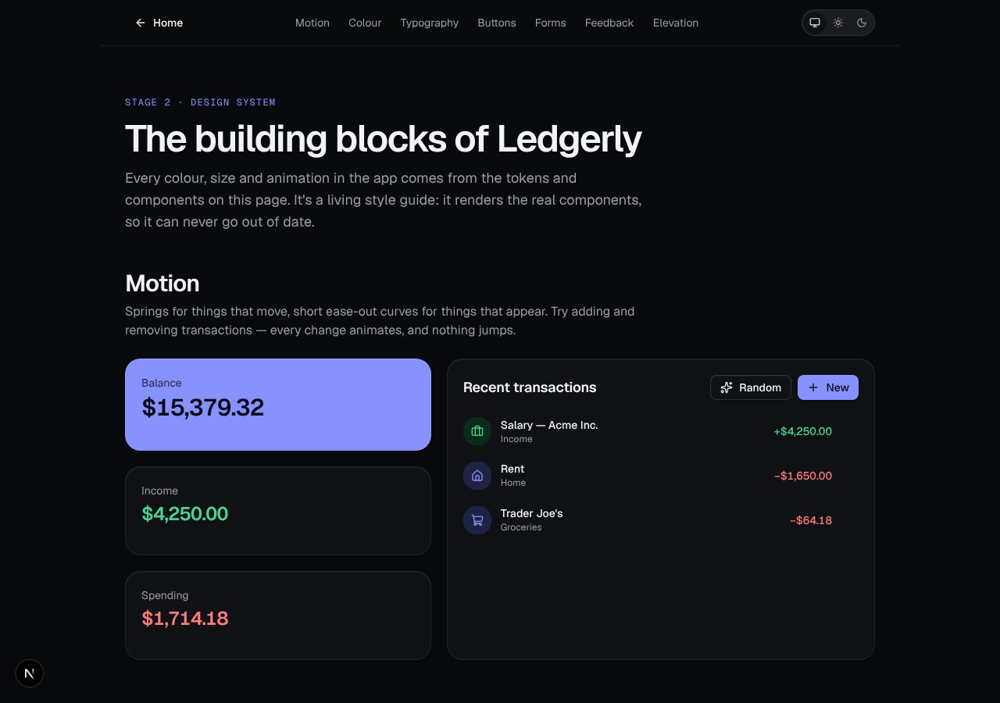
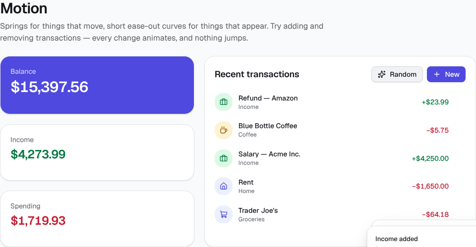
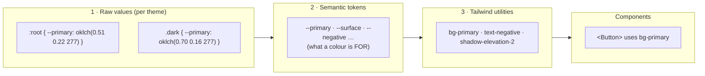
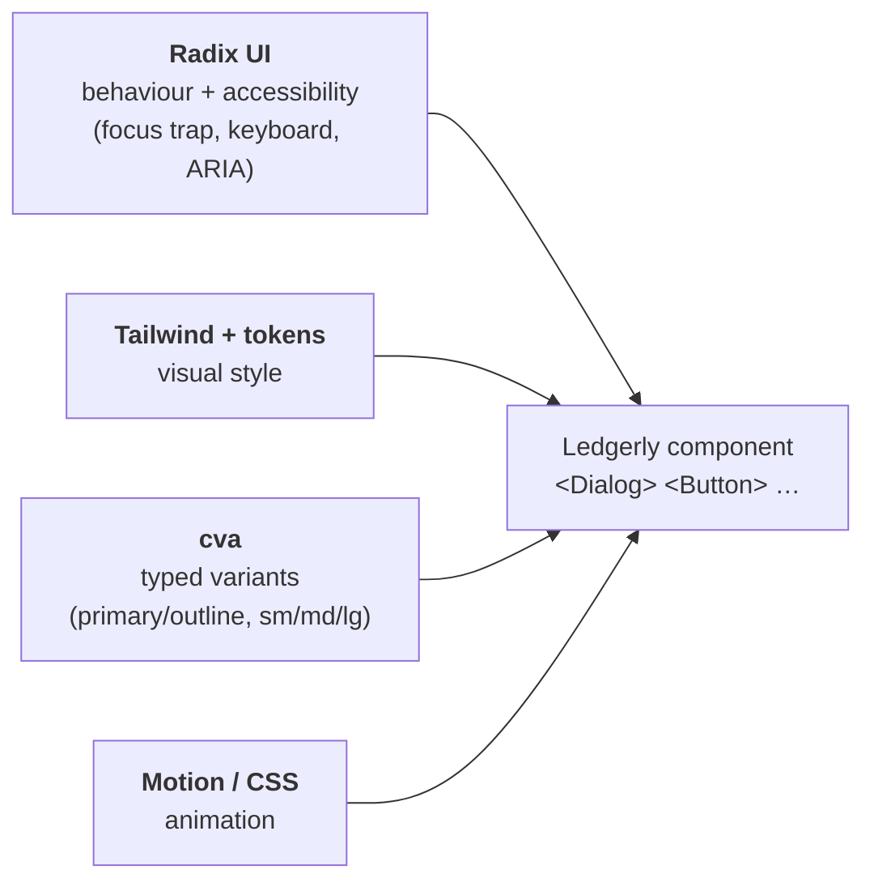

# Stage 2 — Design System

> **Goal of this stage:** define Ledgerly's visual language: colour, type, spacing, depth and motion. Then build a set of accessible components that every future screen will be made from. This is the difference between "a web app that works" and one that feels like Linear, Stripe or Revolut.
>
> **What you can see at the end:** a living style guide at **http://localhost:3000/design**. It includes an interactive mini-ledger where transactions slide in and out, balances count up, a dialog validates your input, and toasts let you undo. Light and dark themes switch instantly.



---

## Table of contents

1. [What is a design system, and why build one first?](#1-what-is-a-design-system-and-why-build-one-first)
2. [What we built](#2-what-we-built)
3. [Design tokens: the three-layer model](#3-design-tokens-the-three-layer-model)
4. [Colour](#4-colour)
5. [Dark mode done properly](#5-dark-mode-done-properly)
6. [Motion: how to make an interface feel fluid](#6-motion-how-to-make-an-interface-feel-fluid)
7. [Typography, spacing, radius and elevation](#7-typography-spacing-radius-and-elevation)
8. [Component architecture](#8-component-architecture)
9. [Component walkthroughs](#9-component-walkthroughs)
10. [Testing a design system](#10-testing-a-design-system)
11. [Decisions we deliberately didn't make (yet)](#11-decisions-we-deliberately-didnt-make-yet)
12. [Run it yourself](#12-run-it-yourself)
13. [Exercises](#13-exercises)
14. [Glossary](#14-glossary)
15. [What's next](#15-whats-next)

---

## 1. What is a design system, and why build one first?

A **design system** is a shared set of decisions about how a product looks and behaves. It has two parts:

1. **Tokens.** These are named values for colours, font sizes, spacing, corner radii, shadows and animation timings. Example: `--primary`, `text-title`, `shadow-elevation-2`, `spring.snappy`.
2. **Components.** These are reusable building blocks made _only_ from those tokens. Example: `<Button>`, `<Field>`, `<Dialog>`, `<Amount>`.

Every serious product company has one. Google has Material, Apple has its Human Interface Guidelines, GitHub has Primer, Shopify has Polaris and IBM has Carbon. Linear and Stripe have internal ones that are just as rigorous.

### Why build it _before_ the features?

Imagine building 30 screens first and designing later. Each screen would invent its own grey ("is it `#6b7280` or `#71717a`?"), its own button padding and its own animation speed. The app would _feel_ slightly wrong everywhere, even if no single screen looks broken. Users can't say why, but they notice. Unifying it afterwards means touching every file.

Building the system first gives you:

| Benefit           | What it means in practice                                                                                                           |
| ----------------- | ----------------------------------------------------------------------------------------------------------------------------------- |
| **Consistency**   | Every screen uses the same 3 elevations, the same type scale and the same motion curves, so the whole app feels like _one_ product. |
| **Speed**         | In Stage 7, building the transactions screen is _assembling_ `Card`, `Field`, `Button` and `Amount`. No pixel-pushing.              |
| **Accessibility** | Focus rings, ARIA wiring and contrast are solved _once_, inside the components. Every screen gets them for free.                    |
| **Theming**       | Dark mode becomes a token swap. No component needs to know about it.                                                                |
| **Changeability** | Want a different brand colour? Change one line. The whole app updates.                                                              |

> **Key idea:** a design system is a _constraint_. Fewer choices means fewer inconsistent choices. Great-looking apps are less about talent per screen and more about strict, well-chosen constraints applied everywhere.

---

## 2. What we built

```
apps/web/src/
├── app/
│   ├── globals.css               ← ALL design tokens (colour, type, radius, elevation, motion)
│   ├── providers.tsx             ← theme, motion and tooltip providers + toaster
│   └── design/                   ← the living style guide (/design)
│       ├── page.tsx
│       └── _components/          ← demo sections (ledger-demo.tsx is the star)
├── components/
│   ├── ui/                       ← the design-system primitives
│   │   ├── button.tsx  card.tsx  badge.tsx  dialog.tsx  field.tsx
│   │   ├── kbd.tsx  skeleton.tsx  toaster.tsx  tooltip.tsx
│   │   └── *.test.tsx
│   ├── money.tsx                 ← <AnimatedMoney> and <Amount> (finance-specific)
│   └── theme-toggle.tsx
├── lib/
│   ├── motion.ts                 ← motion tokens: durations, easings, springs, variants
│   └── utils.ts                  ← cn() class-name helper
└── styles/contrast.test.ts       ← automated WCAG contrast checks
packages/shared/src/money.ts      ← new: parseMoney() (string → cents, no floats)
```

New libraries, each chosen for a reason (more in §8):

| Library                                              | Role                                                          |
| ---------------------------------------------------- | ------------------------------------------------------------- |
| `radix-ui`                                           | Unstyled, accessible behaviour for dialogs, tooltips, labels… |
| `motion`                                             | The animation library (formerly Framer Motion)                |
| `class-variance-authority`, `clsx`, `tailwind-merge` | Typed component variants and safe class merging               |
| `next-themes`                                        | Light/dark/system theme switching with no flash               |
| `sonner`                                             | Toast notifications                                           |
| `lucide-react`                                       | A consistent, tree-shakable icon set                          |
| `vitest`, `@testing-library/*`, `jsdom`, `culori`    | Component tests and colour-contrast maths                     |



---

## 3. Design tokens: the three-layer model

All tokens live in `apps/web/src/app/globals.css`, organised in three layers:



### Why _semantic_ names?

Compare two ways of colouring an expense:

```tsx
<span className="text-red-600 dark:text-red-400">−$54.20</span>   // ❌ raw colour
<span className="text-negative">−$54.20</span>                      // ✅ semantic token
```

The first one hard-codes _what it looks like_, so every expense across the app has to remember the dark-mode variant. If the designer later wants expenses in orange, you search and replace across hundreds of files and inevitably miss some.

The second one says _what it means_. The theme decides what "negative" looks like. Dark mode, rebranding and high-contrast themes all happen in one place. This is exactly how shadcn/ui, GitHub Primer and Material 3 structure their tokens.

### The Tailwind bridge

Tailwind v4 is configured _in CSS_. The `@theme inline` block turns each semantic variable into utility classes:

```css
@theme inline {
  --color-primary: var(--primary); /* → bg-primary, text-primary, border-primary… */
  --color-negative: var(--negative); /* → text-negative, bg-negative… */
  --shadow-elevation-2: var(--elevation-2); /* → shadow-elevation-2 */
}
```

`inline` means Tailwind references the variable instead of copying its value. That's what lets the value change at runtime when `.dark` is applied.

The rule for this codebase is that **components only use layer-3 utilities.** You won't find `zinc-500` or `#hex` values inside `components/ui`. If you ever need a colour that doesn't exist, that's a signal to add a _token_, not a one-off value.

---

## 4. Colour

### 4.1 Why OKLCH?

We define colours as `oklch(L C H)`:

- **L** is lightness, from 0 (black) to 1 (white).
- **C** is chroma, meaning how colourful it is (0 is grey).
- **H** is hue, the angle on the colour wheel (277 is indigo, 155 is green, 22 is red).

The older `hsl()` format has a big flaw: its "lightness" isn't how bright colours _look_ to humans. `hsl(60 100% 50%)` (yellow) and `hsl(240 100% 50%)` (blue) have the same "50% lightness", but the yellow looks far brighter. OKLCH is **perceptually uniform**: equal L means equal perceived brightness. That gives you three benefits:

- You can build a palette by keeping L and C fixed and rotating H. All the colours then feel equally strong, which is exactly what our `--chart-*` palette needs.
- Contrast becomes predictable. Text at L 0.2 on a background at L 0.98 is readable no matter the hue.
- Modern screens (P3) can show more vivid colours than sRGB, and OKLCH can address them.

OKLCH is supported in all modern browsers. Tailwind v4's own default palette is defined in OKLCH, and that's where the industry is heading.

### 4.2 The palette, by role

| Group        | Tokens                                                                | Used for                                     |
| ------------ | --------------------------------------------------------------------- | -------------------------------------------- |
| **Surfaces** | `background`, `surface`, `surface-raised`, `muted`, `border`, `input` | Page, cards, dialogs, subtle fills, dividers |
| **Text**     | `foreground`, `muted-foreground`                                      | Primary and secondary text                   |
| **Brand**    | `primary`, `primary-foreground`, `primary-subtle`, `ring`             | Main actions, selection, focus rings         |
| **Meaning**  | `positive`, `negative`, `warning` (+ `-subtle` backgrounds)           | Income, expenses, budget alerts              |
| **Charts**   | `chart-1` … `chart-5`                                                 | Data visualisation (Stage 8)                 |

**A brand colour that isn't green.** Many finance apps pick green as their brand colour. In a money app, though, green already _means_ "income" or "you're under budget". If the brand is also green, every primary button looks like a positive number. We chose indigo for brand and kept green and red purely for meaning. Keeping one colour for each meaning is a core principle: don't overload a colour with two jobs.

**Mostly neutral.** Look at the screenshots: 90% of the UI is near-white or near-black greys with a hint of blue (hue 270). Colour is reserved for things that _matter_: the primary action, amounts and alerts. When everything is colourful, nothing stands out. Linear, Stripe and Apple all use this restraint.

**Never colour alone (WCAG 1.4.1).** About 1 in 12 men has some form of colour blindness, and red and green are the classic pair that gets confused. That's a real problem for an app built on income versus expenses. So `<Amount>` always shows a sign too (`+$1,200.00`, `−$54.20`), and badges carry icons (↙ Income, ↗ Expense). We also use a real minus sign (`−`, U+2212), not a hyphen. It's the same width as `+`, so columns of amounts line up.

### 4.3 Contrast is tested, not eyeballed

The Web Content Accessibility Guidelines (WCAG) define a **contrast ratio** between two colours, from 1:1 (identical) to 21:1 (black on white). The minimums (level AA, the standard legal and industry target) are:

- **4.5 : 1** for normal text
- **3 : 1** for large text and for UI parts like focus rings and input borders

Instead of trusting our eyes, `apps/web/src/styles/contrast.test.ts` reads `globals.css`, extracts every token, and checks 17 text/background pairs in **both themes** (34 checks):

```ts
const pairs = [
  ["foreground", "background", 4.5],
  ["muted-foreground", "surface", 4.5],
  ["primary-foreground", "primary", 4.5],
  ["negative", "negative-subtle", 4.5],
  ["ring", "background", 3],
  // …
];
```

If someone later "just tweaks" the muted grey to be a little lighter and it drops to 4.3:1, **CI fails** and names the exact pair. This is the "shift left" idea from Stage 1 applied to design. Accessibility regressions are caught like bugs, because they _are_ bugs.

> The muted grey is the classic trap. Designers love very light secondary text, and it's the most common WCAG failure on the web. Ours sits at about 5.6:1 on the muted background, comfortably readable.

---

## 5. Dark mode done properly

Dark mode is _not_ "invert the colours". Look at how ours differs from light mode:

| Principle                                   | What we did                                                                                                                                                                                              |
| ------------------------------------------- | -------------------------------------------------------------------------------------------------------------------------------------------------------------------------------------------------------- |
| **No pure black.**                          | Background is `oklch(0.145 …)`, a very dark blue-grey. Pure `#000` with white text causes eye strain and "smearing" on OLED screens when scrolling.                                                      |
| **Higher surfaces are lighter.**            | `background` (0.145) → `surface` (0.18) → `surface-raised` (0.215). Shadows are almost invisible on dark backgrounds, so depth comes from lightness instead. That's Material's approach and Apple's too. |
| **Accents get lighter and less saturated.** | Primary goes from L 0.51 to L 0.70 and chroma drops. Saturated colours on dark backgrounds "vibrate" and look neon.                                                                                      |
| **Borders become translucent white.**       | `oklch(1 0 0 / 8%)` adapts to whatever surface it's on.                                                                                                                                                  |
| **Shadows get an inner highlight.**         | `inset 0 1px 0 oklch(1 0 0 / 4%)` imitates light catching the top edge of a raised card. That's a subtle detail you'll find in Linear and Vercel's UI.                                                   |

### The mechanics: no flash, three choices

`providers.tsx`:

```tsx
<ThemeProvider attribute="class" defaultTheme="system" enableSystem disableTransitionOnChange>
```

- **`defaultTheme="system"`.** By default we follow the operating system's setting. Users can override it with the toggle (System / Light / Dark), and the choice is remembered in `localStorage`.
- **No "flash of the wrong theme".** A naïve implementation renders light, _then_ JavaScript loads, reads the preference and switches to dark. Users see a white flash on every page load. `next-themes` injects a tiny blocking script that sets `class="dark"` on `<html>` _before_ the first paint. That's why `<html>` has `suppressHydrationWarning`: the server didn't know the class, the browser added it, and that difference is intentional.
- **`disableTransitionOnChange`.** When switching themes, every element with a CSS colour transition would animate separately, which looks messy. This setting switches everything at once.
- **`color-scheme: dark`.** This tells the browser to draw _its own_ UI in dark mode too: scrollbars, form controls and the date picker.

The `dark:` variant is wired to the class with one line: `@custom-variant dark (&:where(.dark, .dark *));`. Because of the semantic tokens, our components barely ever need `dark:`. They just use `bg-surface`.

---

## 6. Motion: how to make an interface feel fluid

Motion is what people usually mean by "this app feels premium". It's also the easiest thing to get wrong. Animations that are too slow, too bouncy or too frequent feel cheap and _slow you down_.

### 6.1 Why animate at all?

Good motion is never decoration. It has a **purpose**:

1. **Feedback.** "Your press registered." Buttons scale to 97% while pressed.
2. **Continuity.** "This thing moved from here to there." When you delete a transaction, the rows below _slide up_ instead of teleporting, so your eye can follow what changed.
3. **Orientation.** "This came from that." The dialog grows from slightly smaller and the toast slides in from its corner.
4. **Causality.** "Your action caused this." The balance counts to its new value when you add a transaction, so you _see_ the effect.

If an animation doesn't serve one of these, remove it.

### 6.2 Our motion tokens

`apps/web/src/lib/motion.ts` (and the CSS equivalents in `globals.css`):

```ts
export const duration = { instant: 0.1, fast: 0.15, base: 0.25, slow: 0.4 };

export const ease = {
  outQuint: [0.22, 1, 0.36, 1], // quick start, long gentle settle
  outExpo: [0.16, 1, 0.3, 1], // even snappier — dialogs, numbers
};

export const spring = {
  snappy: { type: "spring", stiffness: 500, damping: 40 }, // toggles, layout shifts
  smooth: { type: "spring", stiffness: 260, damping: 30 }, // list items, cards
  bouncy: { type: "spring", stiffness: 400, damping: 18 }, // rare, playful moments
};
```

The rules behind those numbers come from decades of UI research and are now industry standard. Apple, Material and Linear all converge on them:

| Rule                                                             | Why                                                                                                                                                                                                                                    |
| ---------------------------------------------------------------- | -------------------------------------------------------------------------------------------------------------------------------------------------------------------------------------------------------------------------------------- |
| **Feedback ≤ 150 ms, transitions 200–400 ms, never > 600 ms.**   | Research on response times puts the "instant" threshold at around 100 ms. Anything longer than about 400 ms starts to feel like waiting.                                                                                               |
| **Enter with _ease-out_, exit with _ease-in_, and exit faster.** | Ease-out (fast start) makes things respond _immediately_. Exits are faster (150 ms vs 280 ms) because the user already wants it gone.                                                                                                  |
| **Springs for things that move position.**                       | Springs are defined by physics (stiffness, damping), not a duration. They feel natural and, crucially, are **interruptible**. Add two transactions in quick succession and the list re-targets smoothly mid-flight instead of jumping. |
| **Subtle distances.**                                            | Items move 8–12 px, dialogs scale from 0.96, not 0.5. Big movements look like a slideshow.                                                                                                                                             |
| **Never linear.**                                                | Nothing in the real world moves at constant speed. Linear motion looks robotic.                                                                                                                                                        |

### 6.3 Performance: only animate `transform` and `opacity`

A browser draws a frame in three steps: **layout** (where is everything?), **paint** (fill in the pixels) and **composite** (stack the layers). Animating `width`, `height`, `top` or `margin` re-runs layout for the whole page on every frame. On a mid-range phone that drops below 60 fps and looks janky.

`transform` (move, scale, rotate) and `opacity` skip layout and paint. The GPU just moves an existing layer. That's why:

- the button press is `transform: scale(0.97)`, not a padding change;
- list items use Motion's `layout` prop. Motion measures the before and after positions, then animates the difference with `transform` (a technique called **FLIP**: First, Last, Invert, Play). You get the _visual_ of a height animation at the _cost_ of a transform.

### 6.4 CSS or JavaScript? Use both, deliberately

| Use CSS for…                                                                 | Use the Motion library for…                                                        |
| ---------------------------------------------------------------------------- | ---------------------------------------------------------------------------------- |
| Hover and press states (`transition`, `active:scale-[0.97]`)                 | **Layout animations**: items reflowing when others are added or removed (`layout`) |
| Enter/exit of Radix components via `data-state` attributes (dialog, tooltip) | **Exit animations** of elements React removes (`AnimatePresence`)                  |
| Looping effects (skeleton shimmer, status ping)                              | **Shared-element** transitions between positions (`layoutId`)                      |
|                                                                              | **Springs** and **animated values** (the counting balance)                         |

CSS animations cost zero JavaScript and run even before React loads. Motion is for things CSS _can't_ do. For example, CSS can't animate an element that React has already removed from the page. `AnimatePresence` keeps it around just long enough to play its exit.

### 6.5 Four techniques from the ledger demo

**① List add/remove with `AnimatePresence` + `layout`** (`ledger-demo.tsx`):

```tsx
<AnimatePresence mode="popLayout" initial={false}>
  {transactions.map((t) => (
    <motion.li
      key={t.id} // stable keys are essential
      layout // siblings slide smoothly (FLIP)
      initial={{ opacity: 0, y: -12, scale: 0.98 }} // enter from slightly above
      animate={{ opacity: 1, y: 0, scale: 1 }}
      exit={{ opacity: 0, x: 24, transition: { duration: 0.15, ease: "easeIn" } }}
      transition={spring.smooth}
    />
  ))}
</AnimatePresence>
```

`mode="popLayout"` pulls the exiting row out of the layout immediately, so the rows below start sliding up _while_ it fades out. Without it, they'd wait for the exit to finish and then jump. `initial={false}` skips the entrance animation for items present on first render, because a page that animates everything on load feels sluggish.

**② The gliding pill with `layoutId`** (`theme-toggle.tsx` and the Expense/Income switch):

```tsx
{
  selected && <motion.span layoutId="theme-toggle-pill" transition={spring.snappy} />;
}
```

Only the selected option renders the pill. Because they share a `layoutId`, Motion sees "the same element moved" and springs it from the old button to the new one. This "magic move" effect is everywhere in Apple's and Linear's UIs, and here it takes one line.

**③ Counting numbers without re-rendering** (`components/money.tsx`):

```tsx
const motionValue = useMotionValue(value);
const text = useTransform(motionValue, (v) => formatMoney(Math.round(v), currency));
useEffect(() => {
  const controls = animate(motionValue, value, { duration: 0.8, ease: [0.16, 1, 0.3, 1] });
  return () => controls.stop();
}, [value]);
return <motion.span>{text}</motion.span>;
```

The naïve version would `setState` 60 times per second, re-rendering React each frame. A **MotionValue** lives outside React. Motion writes the new text straight into the DOM node on each frame, and React doesn't re-render at all. Note `Math.round` too: even mid-animation we never display a fractional cent.

**④ Dialogs animated by CSS via Radix's `data-state`:**

```tsx
className = "data-[state=open]:animate-dialog-in data-[state=closed]:animate-dialog-out";
```

Radix sets `data-state="open" | "closed"` and _waits for the exit animation to finish_ before unmounting. That's full enter/exit animation with zero JavaScript animation code.

### 6.6 Respecting "reduce motion"

Some people get dizzy, nauseous or get migraines from motion on screen (vestibular disorders), and they turn on "Reduce motion" in their OS. Respecting that is WCAG 2.3.3 and simply decent. We handle it in two places:

- **CSS:** a `prefers-reduced-motion: reduce` media query cuts all CSS animations and transitions to almost zero.
- **Motion:** `<MotionConfig reducedMotion="user">` in `providers.tsx` makes every Motion animation skip transform/layout movement while keeping opacity fades. `AnimatedMoney` also checks `useReducedMotion()` and jumps straight to the final number.

Motion should be an enhancement. The app must be complete and usable without it.

---

## 7. Typography, spacing, radius and elevation

### 7.1 A semantic type scale

```css
--text-display: 3rem;
--text-display--letter-spacing: -0.035em; /* hero numbers, page titles */
--text-headline: 1.875rem;
--text-headline--letter-spacing: -0.025em; /* section titles */
--text-title: 1.125rem;
--text-title--font-weight: 600; /* card titles */
--text-caption: 0.75rem;
--text-caption--letter-spacing: 0.01em; /* labels, metadata */
```

Each step bundles size, line height, **letter spacing** and weight, so `text-headline` is one consistent decision instead of four classes that drift apart.

- **Big text gets tighter tracking and small text gets looser.** Fonts are designed for reading sizes around 16 px. Scaled up to 48 px, the gaps between letters look too wide. Scaled down to 12 px, letters crowd together. Every polished product adjusts for this. It's one of the biggest "why does this look professional?" differences.
- **Line height shrinks as size grows.** Body text uses about 1.5 for readability, while display text uses 1.05 so multi-line headings stay compact.
- **Line length is capped.** Paragraphs use `max-w-prose` / `max-w-2xl`, which is about 65 characters. Longer lines make your eye lose its place when jumping back to the next line.
- **`text-balance` / `text-pretty`.** The browser balances heading lines and avoids leaving one orphan word on the last line of a paragraph.

### 7.2 Numbers deserve special care in a finance app

```
proportional:  $1,111.11      tabular:  $1,111.11
               $8,888.88                $8,888.88
```

By default, a "1" is narrower than an "8", so columns of amounts don't line up and a counting number _wobbles_ as its digits change width. `tabular-nums` (the CSS `font-variant-numeric: tabular-nums`) gives every digit the same width. It's used on every amount in Ledgerly, and the `/design` page shows the difference side by side.

**Geist** (by Vercel) is our UI font. It's highly legible at small sizes, has excellent tabular figures, and has a matching mono font. It's self-hosted through the `geist` package (Stage 1), so there are no third-party requests and no layout shift.

### 7.3 Spacing: a 4 px grid

Tailwind's spacing scale is built on 4 px steps (`p-1` = 4 px, `p-4` = 16 px, `p-5` = 20 px). We _only_ use values from the scale. When every gap is a multiple of 4, layouts gain a quiet rhythm, even if no one can say why. Cards use `p-5`, sections are separated by `space-y-24`, and form fields by `gap-4`. Pick a small vocabulary and repeat it.

### 7.4 Radius

There's a defined scale: `sm` (6 px) for tiny elements, `lg` (12 px) for buttons and inputs, `2xl` (20 px) for cards and dialogs. A useful rule when nesting rounded shapes is **inner radius = outer radius − padding**. Otherwise inner corners look "fatter" than outer ones. That's why the theme toggle's pill (`rounded-full` inside `rounded-full` with `p-0.5`) looks so tidy.

### 7.5 Elevation: three levels only

| Level         | Used for                       |
| ------------- | ------------------------------ |
| `elevation-1` | Cards, inputs, buttons         |
| `elevation-2` | Hovered cards, menus, tooltips |
| `elevation-3` | Dialogs, toasts                |

The shadows are **layered**: a tight, darker shadow for the contact edge plus a wide, soft one for ambient light. Real objects cast both, which is why single-shadow designs look flat or "Photoshop drop-shadow". The shadows are also tinted with the background hue (270) instead of pure black, so they blend into the surface rather than looking dirty.

---

## 8. Component architecture

### 8.1 The shadcn/ui approach: own your components

There are two ways to get components:

| Approach                                                             | Example                 | Trade-off                                                                                                                            |
| -------------------------------------------------------------------- | ----------------------- | ------------------------------------------------------------------------------------------------------------------------------------ |
| **Install a styled library** as a dependency                         | MUI, Chakra, Ant Design | Fast start, but you fight its look forever and need overrides on overrides. Your app looks like everyone else's.                     |
| **Copy the component source into your repo** and build on primitives | **shadcn/ui** ✅        | You _own_ every line: change anything and the styling is 100% yours. It's become the dominant approach for product teams since 2023. |

We follow the shadcn/ui philosophy (and its API conventions), written by hand so you understand every line. Each component is assembled from four ingredients:



### 8.2 Radix: accessibility you shouldn't write yourself

A _correct_ dialog has to do all of this:

- trap Tab focus inside it;
- close on Esc;
- return focus to the button that opened it;
- hide the rest of the page from screen readers (`aria-hidden`);
- stop the page behind from scrolling;
- label itself with its title (`aria-labelledby`) and description;
- portal itself to the end of `<body>` so no parent `overflow: hidden` clips it.

Getting all of that right across browsers and screen readers is weeks of work, and it's very easy to get subtly wrong. **Radix UI** is a set of _unstyled_ ("headless") components that implement the WAI-ARIA patterns correctly. It's used under shadcn/ui and by Vercel, Linear, and countless others. We bring the style; Radix brings the behaviour.

### 8.3 `cva`: variants as a typed API

```tsx
export const buttonVariants = cva("…base classes…", {
  variants: {
    variant: { primary: "bg-primary …", outline: "border …", ghost: "…", destructive: "…" },
    size: { sm: "h-8 px-3", md: "h-10 px-4", lg: "h-12 px-6", icon: "size-10" },
  },
  defaultVariants: { variant: "primary", size: "md" },
});
```

Now `<Button variant="outline" size="sm">` is checked by TypeScript. `variant="outlined"` is a compile error, and your editor autocompletes the options. The design system's _choices_ become its _API_. This prevents the slow drift where every developer invents a slightly different button.

### 8.4 `cn()`: safe overrides

```ts
cn("px-4 bg-primary", "px-6"); // → "bg-primary px-6"
```

Components accept a `className` for one-off adjustments. With plain string concatenation you'd get `"px-4 px-6"`, and which one wins depends on the order in Tailwind's stylesheet, _not_ the order you wrote them. That's a nasty source of "my override doesn't work" bugs. `tailwind-merge` understands Tailwind and removes the conflicting class.

### 8.5 Composition with `asChild`

```tsx
<Button asChild>
  <Link href="/design">Explore the design system</Link>
</Button>
```

A link should be an `<a>` (it's navigation, and it works with middle-click, "open in new tab" and screen readers' link lists), but it should _look_ like a button. `asChild` uses Radix's `Slot` to merge the button's classes and props onto its child instead of rendering a `<button>`. This keeps HTML semantics right without duplicating styles. Using the right element for the job is a cornerstone of accessibility.

---

## 9. Component walkthroughs

### 9.1 `Button`: a loading state that doesn't jump

```tsx
<span className={cn("inline-flex items-center gap-2", loading && "invisible")}>{children}</span>;
{
  loading && <Loader2 className="absolute animate-spin" />;
}
```

Most loading buttons swap the label for a spinner, so the button _changes width_ and everything around it shifts. We keep the label in the layout but make it `invisible`, then overlay the spinner absolutely. The width stays identical. While loading, the button is also `disabled` (no double submits, which matters a lot when the action is "transfer money") and has `aria-busy="true"` so screen readers announce it.

### 9.2 `Field` + `Input`: forms that are accessible by default

```tsx
<Field label="Amount" error="Enter an amount like 12.50">
  <Input prefix="$" inputMode="decimal" />
</Field>
```

Behind the scenes, `Field` generates IDs with React's `useId()` and shares them with `Input` through React Context. It produces:

```html
<label for="_r_6_">Amount</label>
<input id="_r_6_" aria-invalid="true" aria-describedby="_r_6_-error" />
<p id="_r_6_-error" role="alert">Enter an amount like 12.50</p>
```

Now clicking the label focuses the input, and a screen reader reads "Amount, invalid entry, Enter an amount like 12.50". Forgetting this wiring on a form is a very common accessibility bug. Putting it inside the component makes it **impossible to forget**.

Other form best practices in the demo:

- **`inputMode="decimal"`** opens the numeric keypad with a decimal point on phones. We avoid `type="number"`, which has well-known usability problems: scroll-wheel changes the value, it rejects `1,234.50`, and browsers handle it inconsistently.
- **Validate on submit and on blur, never on every keystroke.** Showing "invalid amount" while someone is still typing `1` → `12` → `12.` is hostile.
- **Errors appear right below the field** in specific, helpful language ("Enter an amount like 12.50", not "Invalid input").
- **`noValidate`** turns off the browser's built-in validation bubbles, which look different in every browser and can't be styled, so our consistent messages are used instead.

### 9.3 `parseMoney`: user input → cents, with no float in between

Stage 1 established that money is integer cents. But users type _strings_ like `"1,234.5"`. The tempting conversion is wrong:

```js
Math.round(parseFloat("0.29") * 100); // OK here thanks to rounding…
0.29 * 100; // 28.999999999999996  ← the trap
```

`parseMoney` in `packages/shared` never creates a float. It splits the string into whole and fractional _digits_ with a regular expression, pads the fraction to the currency's precision, and combines them with integer maths:

```ts
parseMoney("1,234.5", "USD"); // → 123450
parseMoney("1.234", "USD"); // → null (USD only has 2 decimals)
parseMoney("1500", "JPY"); // → 1500  (yen has none)
```

It lives in the _shared_ package because the API will validate amounts with the same function in Stage 4. One implementation means one behaviour.

### 9.4 `Dialog`, `Tooltip`, `Toaster`

- **Dialog:** Radix with token styling. The overlay uses `bg-overlay` plus a 2 px backdrop blur to separate layers. It enters with scale 0.96 → 1 using `ease-out-expo` and exits faster.
- **Tooltip:** has a 300 ms delay so tooltips don't flicker as the mouse passes over things. A rule we follow: **tooltips are for hints, never essential information.** Touch screens can't hover, so anything important must be visible some other way. The icon button that has a tooltip also has an `aria-label`.
- **Toasts (Sonner):** announced to screen readers via an ARIA live region. They pause when hovered and can be swiped away. Notice the **Undo** action on "Expense added". That pattern is "optimistic action + undo" instead of "Are you sure?" confirmation dialogs. Confirmations interrupt the 99% of times you meant it. Undo only costs you the 1% of times you didn't. Gmail popularised this, and Linear uses it everywhere.

### 9.5 `Skeleton`

Grey shapes that mirror the real content's layout, with a gentle shimmer. Compared with a spinner, skeletons tell the user _what_ is coming and _where_, and they prevent layout shift when content arrives. Perceived speed matters as much as actual speed.

### 9.6 Touch devices

The "remove" × on transaction rows appears on hover, but phones can't hover. `pointer-coarse:opacity-100` shows it whenever the main pointer is a finger. Designing only for the mouse is one of the most common mistakes in desktop-first apps.

---

## 10. Testing a design system

Stage 2 adds 42 tests to the web app. They fall into three kinds:

**1. Contrast tests** (§4.3). These are 34 automated WCAG checks.

**2. Component behaviour tests** with **Testing Library**:

```tsx
it("is disabled, busy and shows a spinner while loading", async () => {
  render(
    <Button loading onClick={onClick}>
      Save
    </Button>,
  );
  const button = screen.getByRole("button", { name: "Save" });
  expect(button).toBeDisabled();
  expect(button).toHaveAttribute("aria-busy", "true");
  await userEvent.click(button);
  expect(onClick).not.toHaveBeenCalled();
});
```

Testing Library's philosophy is to _test the way users use the app_. We find elements by **role and accessible name** (`getByRole("button", { name: "Save" })`, `getByLabelText("Amount")`), the same way a screen reader finds them, not by CSS classes or internal state. Two big consequences:

- If the label isn't correctly linked to the input, `getByLabelText` **fails**. The tests double as accessibility checks.
- You can completely restyle or refactor a component, and the tests keep passing as long as the _behaviour_ is the same. Tests coupled to implementation details break on every refactor and get deleted. Behaviour-level tests survive.

**3. Shared logic tests.** `parseMoney` has tests for valid input, the `0.29` float trap and invalid input (`"-5"`, `"1.234"`, `"abc"`).

We also tightened the quality gates: `eslint --max-warnings=0`. Warnings that are allowed to pile up get ignored. On professional teams, a warning is either fixed or the rule is turned off on purpose.

---

## 11. Decisions we deliberately didn't make (yet)

**A separate `packages/ui`?** Large companies put their design system in its own package so many apps can share it. We have one web app, so a separate package would add build steps and indirection for no benefit. If a second app ever appears (an admin panel, say), moving `components/ui` into `packages/ui` is a mechanical change. That's **YAGNI** ("You Aren't Gonna Need It"): don't build for hypothetical futures, but keep the code clean enough that the future is cheap.

**Storybook?** Storybook is the industry-standard workshop for developing components in isolation, and big teams should use it. For us, a `/design` route that renders the real components inside the real app gives 80% of the value with zero extra tooling. It also ships, so you can check it in production. We may add Storybook or visual regression testing in Stage 13.

**Figma?** Professional teams usually design in Figma first, with tokens that mirror the code. Here _the code is the source of truth_, and `/design` is our "Figma file".

---

## 12. Run it yourself

```bash
pnpm install
```

```bash
pnpm dev
```

Then open http://localhost:3000/design. Things to try:

- Click **Random** a few times quickly. Rows spring in, the list reflows, and all three balances count.
- Hover a row and click **×**. The rows below slide up while it leaves.
- Click **New**, then submit the empty form to see validation. Then add a real expense and press **Undo** in the toast.
- Use only the keyboard: **Tab** through the page (notice the focus rings), open the dialog with **Enter**, and close it with **Esc**. Focus returns to the "New" button.
- Switch the theme toggle in the header and watch the pill glide.

Run all checks:

```bash
pnpm check
```

---

## 13. Exercises

1. **Rebrand in one line.** In `globals.css`, change the hue of `--primary` (and `--ring`, `--primary-subtle`) from `277` to `200` in both themes. Reload `/design`. Every button, badge and focus ring updates, and no component changed. Then run `pnpm --filter @ledgerly/web test` to check that your new colour still passes contrast.
2. **Break accessibility on purpose.** Change `--muted-foreground` in `:root` to `oklch(0.65 0.014 270)` and run the tests. Read the failure message and find the actual ratio. Revert.
3. **Feel the timing.** In `ledger-demo.tsx`, change the row's transition to `{ duration: 1.5 }` and add a few transactions. Notice how a slow animation makes the _app_ feel slow. Then try `spring.bouncy`. Fun once, tiring the tenth time, which is why it's "use sparingly".
4. **See FLIP work.** Remove the `layout` prop from `motion.li` and delete a row in the middle. Compare the "teleport" with the smooth version.
5. **Reduced motion.** In Chrome DevTools, open the Command Menu (Ctrl/⌘+Shift+P), choose "Emulate CSS prefers-reduced-motion: reduce" and use the ledger demo. What still animates (opacity), and what doesn't?
6. **Add a variant.** Add a `tone="info"` variant to `Badge` using `primary-subtle`/`primary`, and show it on `/design`. Notice that TypeScript immediately autocompletes it everywhere.
7. **Write a test.** Add a test to `money.test.tsx` that `<Amount value={0} />` renders `$0.00` with neither `text-positive` nor `text-negative`.
8. **Inspect the DOM.** Open the dialog, then in DevTools look at `<body>`. Find the dialog's portal at the end, the `aria-hidden` on the rest of the page, and the `data-state="open"` attributes driving the animation.

---

## 14. Glossary

| Term                   | Meaning                                                                                                              |
| ---------------------- | -------------------------------------------------------------------------------------------------------------------- |
| **Design token**       | A named design decision (`--primary`, `text-title`) used instead of raw values.                                      |
| **Semantic token**     | A token named for its _purpose_ ("negative") rather than its _appearance_ ("red-600").                               |
| **OKLCH**              | A perceptually uniform colour format: Lightness, Chroma, Hue.                                                        |
| **Contrast ratio**     | WCAG's measure of readability between two colours, 1:1 to 21:1. AA text needs 4.5:1.                                 |
| **WCAG**               | Web Content Accessibility Guidelines, the global accessibility standard (and a legal requirement in many countries). |
| **Headless component** | Behaviour and accessibility with no styling (Radix).                                                                 |
| **Variant**            | A named visual option of a component (`variant="outline"`, `size="sm"`).                                             |
| **Easing**             | How speed changes over an animation (ease-out = fast start, slow end).                                               |
| **Spring animation**   | Motion defined by physics (stiffness, damping) instead of a fixed duration.                                          |
| **FLIP**               | First-Last-Invert-Play: animating layout changes cheaply with transforms.                                            |
| **Layout animation**   | Smoothly animating an element's position/size change caused by layout.                                               |
| **MotionValue**        | A Motion value that updates the DOM directly, without React re-renders.                                              |
| **Portal**             | Rendering a component's DOM somewhere else (end of `<body>`) than where it's declared.                               |
| **ARIA**               | Attributes (`aria-label`, `aria-invalid`…) that describe UI to assistive technology.                                 |
| **Live region**        | An area whose changes screen readers announce automatically (used by toasts).                                        |
| **Tabular figures**    | Digits that all have the same width, so numbers align in columns.                                                    |
| **FOUC / theme flash** | A brief flash of wrong styling (e.g. light theme) before the right one applies.                                      |
| **YAGNI**              | "You Aren't Gonna Need It": don't build for hypothetical requirements.                                               |

---

## 15. What's next

**Stage 3: Database design.** The design system gives us the _look_. Now we need _real data_ to show. We'll install PostgreSQL (in Docker), design the schema for users, accounts, categories, transactions and budgets, and learn about primary keys, foreign keys, indexes, constraints and migrations. We'll also see why money is stored as `bigint` cents in the database too, and why every table gets `created_at`/`updated_at` timestamps.
