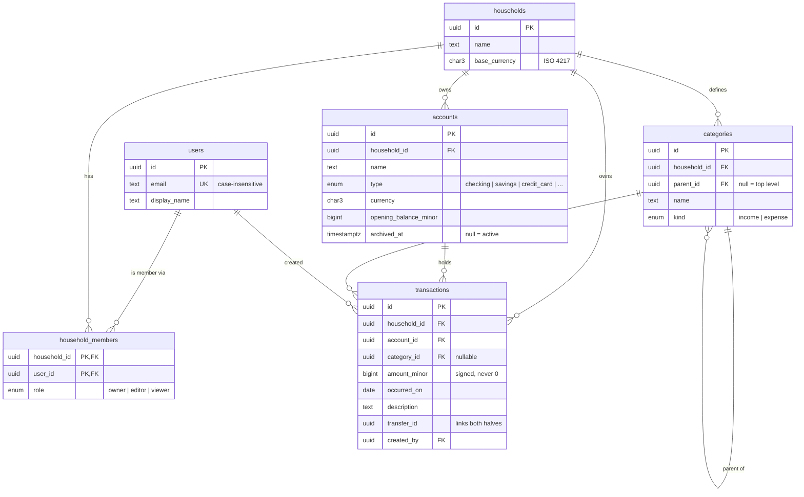
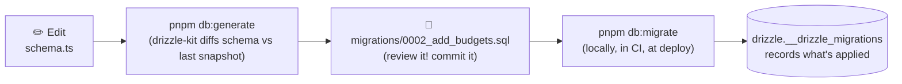

# Stage 3 — Database Design

> **Goal of this stage:** give Ledgerly a permanent memory. We design a PostgreSQL schema for users, households, accounts, categories and transactions; manage it with versioned migrations; fill it with a year of realistic demo data; and _prove_ with tests that the database itself refuses bad data.
>
> **What you can see at the end:** `pnpm db:up && pnpm db:migrate && pnpm db:seed` gives you a real database with 400+ transactions. `GET /health/ready` reports the API's live connection to it. Run `pnpm db:studio` to browse every table in your browser.

---

## Table of contents

1. [Why a relational database, and why PostgreSQL?](#1-why-a-relational-database-and-why-postgresql)
2. [Running Postgres locally with Docker](#2-running-postgres-locally-with-docker)
3. [The data model](#3-the-data-model)
4. [Choosing primary keys: UUID v7](#4-choosing-primary-keys-uuid-v7)
5. [Choosing data types](#5-choosing-data-types)
6. [Constraints: the database as the last line of defence](#6-constraints-the-database-as-the-last-line-of-defence)
7. [Indexes: making queries fast (with real measurements)](#7-indexes-making-queries-fast-with-real-measurements)
8. [Migrations: changing the schema safely](#8-migrations-changing-the-schema-safely)
9. [Talking to the database from code](#9-talking-to-the-database-from-code)
10. [Seed data](#10-seed-data)
11. [Testing against a real database](#11-testing-against-a-real-database)
12. [How this design scales](#12-how-this-design-scales)
13. [Run it yourself](#13-run-it-yourself)
14. [Exercises](#14-exercises)
15. [Glossary](#15-glossary)
16. [What's next](#16-whats-next)

---

## 1. Why a relational database, and why PostgreSQL?

A **relational database** stores data in **tables** (rows and columns) and lets you describe **relationships** between them: "every transaction belongs to an account". You ask questions in **SQL**:

```sql
select sum(amount_minor) from transactions where account_id = '…';
```

For a finance app, the decisive feature is **ACID transactions**. That is a guarantee that a group of changes either _all_ happen or _none_ do, even if the server crashes halfway through:

| Letter | Means       | In Ledgerly terms                                                                                |
| ------ | ----------- | ------------------------------------------------------------------------------------------------ |
| **A**  | Atomicity   | A transfer writes two rows (out of checking, into savings). You can never end up with only one.  |
| **C**  | Consistency | Every rule (constraint) holds after every change. No transaction can point to a deleted account. |
| **I**  | Isolation   | Two people editing the household budget at the same moment don't corrupt each other's changes.   |
| **D**  | Durability  | Once Postgres says "saved", it survives a power cut.                                             |

### Why PostgreSQL specifically?

| Option                | Verdict for Ledgerly                                                                                                                                                                                                                                                                |
| --------------------- | ----------------------------------------------------------------------------------------------------------------------------------------------------------------------------------------------------------------------------------------------------------------------------------- |
| **PostgreSQL** ✅     | Open source and very reliable. It has the richest feature set (CHECK constraints, partial indexes, JSON, full-text search, window functions) and runs on every cloud. It's the most-used database among professional developers in the Stack Overflow survey several years running. |
| MySQL                 | Also excellent and widely used, but historically weaker on constraints and standards compliance.                                                                                                                                                                                    |
| SQLite                | Superb for local and embedded apps, but a single file on a single machine doesn't fit a multi-instance web API.                                                                                                                                                                     |
| MongoDB (document DB) | Flexible "schemaless" documents. Money data is _highly relational_ (accounts ↔ transactions ↔ categories) and needs strong integrity. That's exactly what relational databases are built for.                                                                                       |

> **Key idea:** pick boring, proven technology for the thing you can least afford to lose. Your users' financial history is that thing.

---

## 2. Running Postgres locally with Docker

`docker-compose.yml` describes the infrastructure the app depends on:

```yaml
services:
  postgres:
    image: postgres:18-alpine # an exact major version, same as CI
    environment: { POSTGRES_USER: ledgerly, POSTGRES_PASSWORD: ledgerly, POSTGRES_DB: ledgerly }
    ports: ["5432:5432"]
    volumes:
      - postgres-data:/var/lib/postgresql # data survives restarts
      - ./docker/postgres/init.sql:/docker-entrypoint-initdb.d/init.sql:ro # creates ledgerly_test
    healthcheck:
      test: ["CMD-SHELL", "pg_isready -U ledgerly -d ledgerly"]
```

Why Docker for development dependencies?

- **Everyone gets the identical database version** with one command (`pnpm db:up`). There are no "I installed Postgres 14 three years ago" surprises.
- **Dev matches CI matches production.** CI runs the same `postgres:18-alpine` image as a _service container_ (see §11).
- **Disposable.** `docker compose down -v` deletes everything; `pnpm db:reset` rebuilds it in seconds.
- **The `healthcheck` + `--wait`.** `pnpm db:up` returns only once Postgres actually accepts connections, so a migrate command right after it never races a database that's still booting.

Your _application code_ still runs directly on your machine with hot reload. Only the infrastructure is containerised. That's the most common local-dev setup in industry today.

---

## 3. The data model

### 3.1 The entities

Data modelling starts with plain-language sentences about the domain:

- A **user** can belong to several **households**, and a household can have several users, each with a **role**.
- A household owns **accounts** (checking, savings, credit card, cash…).
- A household defines **categories**, organised in two levels ("Food" → "Groceries").
- A **transaction** is money moving in or out of one account, optionally in one category.
- A **transfer** moves money between two of the household's own accounts.

Turned into tables:



(Every table also has `created_at` and `updated_at`.)

The whole schema lives in **one file**, `packages/db/src/schema.ts`, written in TypeScript with Drizzle ORM. Let's walk through the decisions.

### 3.2 Households: multi-tenancy from day one

A **tenant** is a group whose data must be completely isolated from everyone else's. In Ledgerly it's a household. In Slack it's a workspace, in Shopify a store. The industry uses three patterns:

| Pattern                                      | Isolation                                   | Cost / complexity               | Used by                                      |
| -------------------------------------------- | ------------------------------------------- | ------------------------------- | -------------------------------------------- |
| **Shared tables + `household_id` column** ✅ | Logical (enforced by code + DB constraints) | Cheapest; one schema to migrate | Most SaaS: Slack, Linear, Notion, GitHub     |
| Schema per tenant                            | Stronger                                    | Thousands of schemas to migrate | Some B2B apps with few large customers       |
| Database per tenant                          | Strongest                                   | Expensive; complex operations   | Enterprise / regulated single-tenant deploys |

We chose the first pattern, and we made it _safer_ than usual with **composite foreign keys** (§6.3). Even a bug in the API can't link one household's transaction to another household's account.

Notice that `transactions` carries `household_id` **even though** it could be derived through `account_id → accounts.household_id`. That's deliberate _denormalisation_:

1. Every query starts with "for this household…". Having the column directly on `transactions` lets one index answer it without a join.
2. It's what makes the composite foreign keys possible.

### 3.3 Users ↔ households: a many-to-many join table

`household_members` has a **composite primary key** `(household_id, user_id)`. A user can't be added to the same household twice, and the table needs no separate `id`. The `role` column (owner, editor, viewer) is what Stage 5 will check before allowing changes, and Stage 11 builds sharing on top of it.

### 3.4 Accounts: balances are _computed_, not stored

There's no `balance` column. The balance is:

```
opening_balance_minor + sum(all transactions of that account)
```

This follows **normalisation**: store each fact _once_. If we stored the balance too, every insert, edit and delete of a transaction would also have to update it. One forgotten code path (a bulk import, a manual fix) and the stored balance silently disagrees with the transactions. In finance, _a balance that doesn't match its history is the worst bug possible_.

With the right index, computing the balance takes about a millisecond. If it ever becomes too slow at scale, we'll add a cache that is _derived from_ the transactions, never a second source of truth (Stage 12).

`archived_at` instead of deleting: closing a bank account doesn't erase the fact that you spent money from it last year. Archived accounts disappear from the UI but keep their history. A `NULL` `archived_at` means "active". A timestamp records _when_ it was archived, which is more useful than a boolean.

### 3.5 Categories: a self-referencing tree

`categories.parent_id` points to another row _in the same table_. `NULL` means top level. That gives you a two-level hierarchy (Food → Groceries, Dining out, Coffee) with one table. `getSpendingByCategory` uses a **self-join** to roll children up into their parent:

```ts
const root = alias(categories, "root_category");
// …join each category to its root: its parent if it has one, otherwise itself
.innerJoin(root, eq(root.id, sql`coalesce(${categories.parentId}, ${categories.id})`))
```

### 3.6 Transactions: the heart of the system

- **`amount_minor` is signed.** Positive is money in, negative is money out. Sums "just work", and a CHECK constraint forbids `0`, which is meaningless as a transaction.
- **`occurred_on` is a `DATE`, not a timestamp** (§5.4 explains why this matters a lot).
- **`category_id` is optional.** Imported bank transactions often arrive uncategorised (Stage 10).
- **`created_by` uses `ON DELETE SET NULL`.** If a member leaves and deletes their account, the household's financial history must stay intact. We just forget who entered it.

### 3.7 Transfers: why they need special treatment

Paying your credit card from checking isn't _spending_. The spending happened when you used the card. If we recorded the payment as an ordinary expense, every report would count your groceries twice: once at the shop, once when paying the card.

We store a transfer as **two rows sharing a `transfer_id`**:

| account        | amount_minor | transfer_id |
| -------------- | -----------: | ----------- |
| Checking       |     −120 000 | `0199…a1`   |
| Visa Signature |     +120 000 | `0199…a1`   |

The two halves sum to exactly zero. Balances of both accounts update correctly, and cash-flow reports simply filter `transfer_id IS NULL`. A CHECK constraint (`transfer_id IS NULL OR category_id IS NULL`) forbids categorising a transfer, and a seed-data test verifies every `transfer_id` has exactly two rows summing to zero.

> **Single-entry vs double-entry bookkeeping.** Professional accounting systems use _double entry_: every movement is a journal entry with two or more _postings_ that must sum to zero. Our transfer pair is a small piece of that idea. Full double entry is the right call for business accounting (and for systems like Stripe's ledger), but it makes everyday personal-finance features awkward ("show me my coffee spending"). Simple single-entry with linked transfers is how most personal-finance apps model money. Knowing _why_ you didn't pick the heavier model is part of good design.

---

## 4. Choosing primary keys: UUID v7

Every row needs a **primary key**, a value that uniquely identifies it forever. There are three common choices:

| Option                 | Example                                | Problems                                                                                                                                                                                                                                         |
| ---------------------- | -------------------------------------- | ------------------------------------------------------------------------------------------------------------------------------------------------------------------------------------------------------------------------------------------------ |
| Auto-increment integer | `1, 2, 3…`                             | **Guessable.** If your transaction is `/transactions/1052`, an attacker tries `/1053`. It leaks business data ("they only have 1,052 transactions"), and the database must hand out every ID, so you can't create one offline or in the browser. |
| UUID v4                | `f47ac10b-58cc-4372-a567-0e02b2c3d479` | Fully random, which is great for uniqueness. But random keys get inserted all over the index B-tree, causing page splits and poor cache locality on big tables.                                                                                  |
| **UUID v7** ✅         | `0199a2b4-7c1e-7f3a-9d2b-5e8f1a3c6b70` | The first 48 bits are a **timestamp** and the rest is random. Unguessable like v4, but _time-ordered_, so new rows append to the end of the index like an integer would.                                                                         |

UUID v7 was standardised in 2024 (RFC 9562) and is now the recommended default for new systems. We generate it **in the application** (`$defaultFn(() => uuidv7())`) rather than in the database. That has one big future benefit: in Stage 7 the _browser_ can create a transaction's ID before the server responds. That's what makes "optimistic UI" possible, where the transaction appears instantly and is confirmed in the background. (Postgres 18 can also generate v7 natively with `uuidv7()`, and either is fine.)

A test checks the ordering property: a household created second has a larger ID than one created first.

---

## 5. Choosing data types

### 5.1 Money: `bigint` minor units, again

Stage 1 established _never use floats for money_ in JavaScript. The database follows the same rule. All money columns are `bigint` holding cents, and their names end in `_minor`, so nobody ever wonders "is this dollars or cents?"

- **Why not `numeric(12,2)`?** It's also exact and a perfectly valid choice. We use integers end to end (database → API → `formatMoney`) so there's no conversion step where rounding could sneak in, and integer arithmetic is faster.
- **Why not `integer`?** A 32-bit integer tops out at about 2.1 billion cents ($21 million). That's fine for most people, but limits are what break in production. `bigint` goes to 9.2 quintillion.
- **The JavaScript limit.** JS numbers are exact up to 2⁵³ (about $90 trillion in cents). Drizzle's `bigint({ mode: "number" })` converts safely below that, and a test round-trips `Number.MIN_SAFE_INTEGER` to prove it.

### 5.2 Text: `text` + CHECK, not `varchar(n)`

In Postgres, `text` and `varchar(n)` are stored identically, with no performance difference. We use `text` and express limits as **named CHECK constraints** (`char_length(name) between 1 and 100`). The rule also forbids empty strings, which `varchar` doesn't. When it's violated, the error names the exact rule, and the API (Stage 4) can turn that into a precise message.

### 5.3 Currencies: `char(3)` + a format check

Currency codes are ISO 4217: exactly three uppercase letters (`USD`, `EUR`, `JOD`). `char(3)` plus the CHECK `~ '^[A-Z]{3}$'` rejects `"usd"` and `"US"` at the database level, and a test checks it. A currency lives on each **account**. Transactions inherit it from their account rather than repeating it, so a transaction's currency can never disagree with its account.

### 5.4 Time: `timestamptz` for moments, `date` for days

There are two different concepts here, and mixing them up causes classic bugs:

- **A moment in time** ("this row was created at 14:03:22 UTC") → `timestamp with time zone` (`timestamptz`). Postgres stores it in UTC and converts on display. _Always_ use `timestamptz`, never plain `timestamp`, which silently drops the time zone.
- **A calendar day** ("I bought groceries on March 3rd") → `date`.

Why does this matter? Suppose you live in California and buy coffee at 9 pm on March 3rd. As a timestamp, that's **March 4th, 05:00 UTC**. Store it as a timestamp, and a server in UTC puts your coffee in the wrong _day_. At month end, it lands in the wrong _month's budget_. Banks report transactions by calendar day for exactly this reason.

Drizzle reads our `date` column as a **plain string** (`"2026-03-03"`, via `mode: "string"`), never a JavaScript `Date` (which is always a moment with a hidden time zone). A test asserts the type is `string`.

### 5.5 Enums

`account_type`, `category_kind` and `household_role` are Postgres **enums**, a fixed list of allowed values that the database enforces. They're compact and self-documenting. One trade-off to know: adding a value later is easy (`ALTER TYPE … ADD VALUE`), but _removing_ one is hard. Use enums for sets that are genuinely stable. For lists that users or admins will edit, use a lookup table instead, like our `categories`.

---

## 6. Constraints: the database as the last line of defence

### 6.1 "But the API already validates input…"

It will (Stage 4). We validate **in both places**, and that's standard practice, called _defence in depth_:

- **App validation** gives _friendly_ errors ("Enter an amount like 12.50") and covers rules that need context.
- **Database constraints** are _guarantees_. The API is only one of many writers: a background import job, a migration script, a teammate fixing data in `psql` at midnight, or a future second service. Constraints protect against _all_ of them, forever, including against bugs in our own API.

Data outlives code. You'll rewrite the API several times over the years. The data and its integrity must survive every rewrite.

### 6.2 The constraints in our schema

| Constraint                                                         | Protects against                                     |
| ------------------------------------------------------------------ | ---------------------------------------------------- |
| `NOT NULL` on required columns                                     | Half-filled rows                                     |
| `transactions_amount_not_zero` (CHECK)                             | Meaningless $0 transactions                          |
| `*_iso4217` (CHECK)                                                | `"usd"`, `"dollars"`, `""`                           |
| `*_length` (CHECK)                                                 | Empty names, 10 MB descriptions                      |
| `users_email_lower_key` (UNIQUE on `lower(email)`)                 | Two accounts for `Alex@mail.com` and `alex@mail.com` |
| `categories_household_parent_name_key` (UNIQUE NULLS NOT DISTINCT) | Two "Food" categories at the top level               |
| `categories_not_own_parent` (CHECK)                                | A category being its own parent                      |
| `transactions_transfer_has_no_category` (CHECK)                    | A transfer counted as spending                       |
| Composite foreign keys (`transactions_account_fkey`, …)            | Cross-household data leaks (next section)            |

**`NULLS NOT DISTINCT`, a subtle one.** In SQL, `NULL` means "unknown", and two unknowns aren't considered equal. So a normal UNIQUE constraint on `(household_id, parent_id, name)` would happily allow _two_ top-level "Food" categories, because both have `parent_id = NULL`. Postgres 15 added `NULLS NOT DISTINCT` to treat NULLs as equal for uniqueness. A test proves it.

### 6.3 Composite foreign keys: tenant isolation in the schema

A normal foreign key says "this `account_id` must exist". Ours says **"this `(account_id, household_id)` pair must exist in `accounts`"**:

```ts
foreignKey({
  name: "transactions_account_fkey",
  columns: [t.accountId, t.householdId],
  foreignColumns: [accounts.id, accounts.householdId],
}),
```

So a transaction in household A _physically cannot_ reference household B's account, even if the API has a bug that passes the wrong ID. The test `rejects a transaction that points to ANOTHER household's account` tries exactly that attack and gets `23503 foreign_key_violation`. Categories (and category parents) are protected the same way.

This requires `UNIQUE (id, household_id)` on the referenced tables. It's technically redundant, since `id` alone is already unique, but it gives the composite key something to point at. It's a small price for a structural guarantee that **one user can never see or touch another household's money**, which is the single most important security property of this product.

### 6.4 What happens on delete?

Every foreign key decides what happens when the row it points to is deleted:

| Rule                  | Meaning                                                   | Where we use it                                                                                      |
| --------------------- | --------------------------------------------------------- | ---------------------------------------------------------------------------------------------------- |
| `CASCADE`             | Delete the dependent rows too                             | Deleting a **household** deletes all its data (that's what users expect when they delete everything) |
| `NO ACTION` (default) | Refuse, if dependents still exist when the statement ends | Deleting an **account** or **category** that still has transactions                                  |
| `SET NULL`            | Keep the row, clear the reference                         | Deleting a **user** clears `created_by` on their transactions                                        |

Why `NO ACTION` and not `RESTRICT` for accounts? Both refuse to orphan transactions. The difference is _timing_. `RESTRICT` checks immediately; `NO ACTION` checks at the end of the statement. When a whole household is deleted, Postgres cascades to both accounts _and_ transactions within one statement. With `RESTRICT`, the account deletion could be refused before its transactions are gone. With `NO ACTION`, everything is consistent by the end, so it succeeds. The test `deleting a household removes all of its data (and nothing else)` covers that.

The product rule this encodes: **financial history is never deleted by accident.** To get rid of an account, you archive it.

### 6.5 Turning database errors into useful errors

When a constraint fails, Postgres returns a standard 5-character **SQLSTATE code** plus the **constraint name**. `packages/db/src/errors.ts` gives the rest of the code a clean way to ask about them:

```ts
if (isPgError(error, "uniqueViolation", "categories_household_parent_name_key")) {
  // → 409 Conflict: "A category with this name already exists"
}
```

That's why every constraint has a deliberate, descriptive name: the name _is_ the error message's key.

---

## 7. Indexes: making queries fast (with real measurements)

### 7.1 What an index is

Without an index, finding "household X's transactions" means reading **every row** in the table, called a _sequential scan_. An **index** is a separate, sorted data structure (usually a **B-tree**) that points to rows. It's like the index at the back of a book, or a phone book sorted by surname: you jump straight to the right page.

### 7.2 Our indexes, and why each exists

```ts
index("transactions_household_occurred_idx").on(t.householdId, t.occurredOn, t.id);
index("transactions_account_occurred_idx").on(t.accountId, t.occurredOn);
index("transactions_category_idx")
  .on(t.categoryId)
  .where(sql`category_id is not null`);
index("transactions_transfer_idx")
  .on(t.transferId)
  .where(sql`transfer_id is not null`);
uniqueIndex("users_email_lower_key").on(sql`lower(${t.email})`);
index("household_members_user_id_idx").on(t.userId);
```

**Every index is designed from a query, never "just in case".** The household index serves the main screen ("this household's transactions, newest first"). The account index serves balances and account registers. The category index serves reports. The `household_members(user_id)` index serves "which households am I in?". The primary key index `(household_id, user_id)` can't answer that one, because of the next rule.

**Column order matters: the leftmost-prefix rule.** An index on `(household_id, occurred_on, id)` is sorted by household first, then date within each household, then id. It can answer queries filtering on `household_id`, or `household_id + occurred_on`. It _can't_ help a query that only filters by `occurred_on`, just as a phone book sorted by surname-then-first-name can't help you find everyone named "Sam".

**Partial indexes** (`WHERE category_id IS NOT NULL`) skip rows the queries never look for, making the index smaller and faster.

**Expression indexes** (`lower(email)`) index the _result_ of a function. That's what makes case-insensitive uniqueness enforceable _and_ lookups fast.

**Indexes aren't free.** Every insert must update every index, and indexes take disk and memory. That's why we don't index every column.

### 7.3 Measured: index vs no index (and a real bug the measurement caught)

To see the effect, I loaded **500,000 transactions** (200 households × 2,500) into the dev database and ran the main-screen query:

```sql
select id, occurred_on, amount_minor, description from transactions
where household_id = $1 order by occurred_on desc, id desc limit 50;
```

`EXPLAIN ANALYZE` makes Postgres run the query and show its _plan_, meaning how it actually found the rows:

| Setup                                                                            | Plan                                             |        Time |
| -------------------------------------------------------------------------------- | ------------------------------------------------ | ----------: |
| No index                                                                         | Parallel Seq Scan of all 500k rows → sort        | **24.0 ms** |
| Index declared `(household_id, occurred_on DESC NULLS LAST, id DESC NULLS LAST)` | Bitmap Index Scan → **sort** 2,500 rows          |     0.94 ms |
| Index declared `(household_id, occurred_on, id)` ✅                              | **Index Scan Backward**, no sort, stops after 50 | **0.27 ms** |

That middle row is a **real bug I hit while building this stage**, and it's a great lesson. My first version declared the index as `occurred_on.desc()`, which Drizzle writes as `DESC NULLS LAST`. But `ORDER BY occurred_on DESC` in SQL means `DESC NULLS FIRST` by default. The two orders differ (only in where NULLs go, even though our column can't be NULL!), so Postgres couldn't read rows _in order_ from the index. It used the index to find the household's 2,500 rows, then sorted them all.

The fix was to declare the index plain ascending. A B-tree can be **read backwards**, and a backward read of `ASC NULLS LAST` is exactly `DESC NULLS FIRST`. Now Postgres walks the index from the newest entry and stops after 50 rows: about **90× faster than no index**, and 3.5× faster than the subtly wrong index.

> **Lessons:** (1) Measure with `EXPLAIN ANALYZE` instead of assuming an index is used. (2) "Using an index" isn't the goal. The goal is a plan that touches as few rows as possible. Look for `Sort` nodes and row counts. (3) This kind of 3–100× difference is invisible with 400 rows of seed data and painful with 50 million, which is why we test with realistic volumes.

### 7.4 Pagination: keyset beats OFFSET

The transactions screen will load 50 rows at a time. There are two ways to get "the next page":

```sql
-- OFFSET pagination: "skip 2,400 rows, then give me 50"
... order by occurred_on desc, id desc limit 50 offset 2400;

-- Keyset (cursor) pagination: "give me 50 rows older than the last one I saw"
... where (occurred_on, id) < ('2026-09-06', 'e7c2…') order by occurred_on desc, id desc limit 50;
```

| Page deep into the list      | Plan                                               |        Time |
| ---------------------------- | -------------------------------------------------- | ----------: |
| `OFFSET 2400`                | Reads and sorts 2,450 rows, throws 2,400 away      |     1.64 ms |
| Keyset `(occurred_on, id) <` | Index Scan Backward straight to the spot, reads 50 | **0.19 ms** |

OFFSET gets slower the deeper you go: page 1,000 reads 50,000 rows. Keyset stays constant. Keyset is also _correct_ when data changes: if a new transaction is added while you scroll, OFFSET shifts every page by one, so you see a duplicate. Keyset doesn't.

That's why the index ends with `id`. Dates aren't unique (many transactions per day), so `(occurred_on, id)` gives every row a unique, stable position. This "tie-breaker column" detail is easy to miss. We'll implement keyset pagination in the API in Stage 4.

---

## 8. Migrations: changing the schema safely

### 8.1 The problem

Your database schema will change dozens of times over the life of the app. Budgets arrive in Stage 9, auth tables in Stage 5. Every developer's laptop, CI, staging and production must go through _exactly the same changes in the same order_, without losing data.

**Migrations** are numbered SQL files, committed to Git, each describing one change. The database records which ones it has already applied.



Our two migrations:

- `0000_initial_schema.sql` was **generated** from `schema.ts`. Open it: it's plain, readable SQL. Always review generated SQL before committing; tools make mistakes.
- `0001_updated_at_triggers.sql` was **hand-written**. Some things (triggers, functions, data backfills) can't be expressed in a schema file, so Drizzle lets you add custom SQL migrations into the same ordered sequence.

### 8.2 The `updated_at` trigger

```sql
CREATE FUNCTION set_updated_at() RETURNS trigger AS $$
BEGIN
  IF ROW(NEW.*) IS DISTINCT FROM ROW(OLD.*) THEN
    NEW.updated_at := now();
  END IF;
  RETURN NEW;
END; $$ LANGUAGE plpgsql;
```

A trigger runs inside the database on every `UPDATE`. Like constraints, it applies to _every_ writer, so no code path can forget it. It only bumps the timestamp if something actually changed, so a no-op save doesn't make a row look "recently edited". A test checks both cases. `updated_at` will matter for sync and real-time features (Stage 11) and for debugging ("when did this change?").

### 8.3 Migration rules professionals follow

1. **Never edit a migration that has been applied anywhere shared** (main branch, staging, production). Fix mistakes with a _new_ migration. (During this stage, while nothing had been committed yet, I regenerated the initial migration after fixing the index. That's fine _only_ because no shared database had ever run it.)
2. **Migrations only move forward.** Rolling back a deploy shouldn't roll back the schema. Instead, write migrations that the previous version of the code can also live with.
3. **Zero-downtime changes use expand → migrate → contract.** To rename `description` to `memo` without downtime:
   1. _Expand:_ add `memo`; deploy code that writes to both columns.
   2. _Migrate:_ backfill `memo` from `description` in batches.
   3. _Contract:_ deploy code that reads only `memo`; then drop `description` in a later migration.

   A one-step rename would break every running server instance the moment it applies.

4. **Run migrations as a deploy step, not on app startup.** If 10 API instances boot at once and each tries to migrate, they race. We also guard against that: `runMigrations` takes a Postgres **advisory lock** first, so concurrent runs wait their turn instead of colliding.
5. **CI checks for drift.** The new CI step runs `drizzle-kit check` and `db:generate`. If someone edited `schema.ts` but forgot to generate a migration, a new file appears, `git diff --exit-code` fails, and the PR goes red.

---

## 9. Talking to the database from code

### 9.1 ORM, query builder, or raw SQL?

| Approach                        | Example             | Trade-off                                                                                                                                    |
| ------------------------------- | ------------------- | -------------------------------------------------------------------------------------------------------------------------------------------- |
| Raw SQL strings                 | `pg`, `postgres.js` | Full power, but no type safety: a renamed column breaks at runtime.                                                                          |
| Heavy ORM (objects map to rows) | Prisma, TypeORM     | Very productive, but hides SQL. You learn the ORM's language instead of SQL, and complex reports fight the abstraction.                      |
| **Typed SQL query builder** ✅  | **Drizzle**, Kysely | Reads like SQL, but every table and column is type-checked. Rename a column in `schema.ts`, and every query that uses it fails to _compile_. |

Drizzle's motto is "if you know SQL, you know Drizzle". Compare:

```ts
db.select({ id: accounts.id, name: accounts.name, balanceMinor: sql<number>`…` })
  .from(accounts)
  .leftJoin(transactions, eq(transactions.accountId, accounts.id))
  .where(and(eq(accounts.householdId, householdId), isNull(accounts.archivedAt)))
  .groupBy(accounts.id);
```

It's SQL with autocomplete. The schema also gives us TypeScript types for free (`Transaction`, `NewTransaction`) via `$inferSelect` and `$inferInsert`.

### 9.2 Connection pooling and timeouts

`packages/db/src/client.ts`:

```ts
const pool = new pg.Pool({
  connectionString,
  max: maxConnections, // per process
  application_name: applicationName, // visible in pg_stat_activity
  statement_timeout: 10_000, // Postgres kills any query running > 10 s
  connectionTimeoutMillis: 5_000, // don't wait forever for a free connection
  idleTimeoutMillis: 30_000,
});
```

- **Why a pool?** Opening a Postgres connection costs a new server process, authentication and often TLS: several milliseconds and a few MB of RAM _on the database_. A pool keeps a few connections open and lends them to requests.
- **Sizing.** Postgres allows ~100 connections by default. 10 API instances × 10 connections = 100: already at the limit. More connections isn't faster. A database with N CPU cores does its best work with roughly 2–4 × N active connections. At larger scale you put a pooler like **PgBouncer** in front (Stage 12). For now, `DATABASE_POOL_MAX` is configurable per environment.
- **Timeouts are guard rails.** One accidental full-table query without `statement_timeout` can hold a connection for minutes. A few of those and the pool is exhausted, and _every_ request hangs. Failing one slow request is far better than taking the whole app down.
- **`application_name`.** When something is slow in production, `select application_name, query from pg_stat_activity` tells you _which service_ is running _which query_. I used it to confirm the API's pool connected as `ledgerly-api`.

### 9.3 A gotcha: SUM returns a string

`SUM()` over a `bigint` column returns Postgres `numeric`, because the sum could overflow a bigint. The `pg` driver returns `numeric` as a **string** (`"13304.87"` style), since converting it to a JS number could lose precision. If you don't handle it, `balance + 100` becomes string concatenation: `"1330487100"`. Our queries cast the result back and map it explicitly:

```ts
sql<number>`(${accounts.openingBalanceMinor} + coalesce(sum(${transactions.amountMinor}), 0))::bigint`.mapWith(
  Number,
);
```

Tests assert the results are real numbers.

### 9.4 Connecting it to the API

- `server.ts` creates the pool, then passes `db` into `buildApp(env, { db, closeDb })`. That's the **dependency injection** pattern from Stage 1. Tests pass a test database; production passes the real one.
- A small Fastify plugin decorates the app with `app.db` and registers an `onClose` hook, so **graceful shutdown closes the pool** after in-flight requests finish.
- `DATABASE_URL` is now required and validated at startup (it must be a `postgres://` URL), following fail-fast config from Stage 1.
- `@ledgerly/db` **re-exports** Drizzle's helpers (`sql`, `eq`, `and`…). When I first imported `sql` from `drizzle-orm` in the API, the test failed with _"Cannot find package 'drizzle-orm'"_. That's pnpm's strictness from Stage 1 doing its job: the API never declared that dependency. Re-exporting from one package keeps every consumer on exactly one Drizzle version.

### 9.5 Liveness vs readiness

```
GET /health        → 200 always (if the process is alive)          ← LIVENESS
GET /health/ready  → 200 if the DB answers within 2 s, else 503     ← READINESS
```

Orchestrators (Kubernetes, ECS, Fly.io, Render…) treat these differently:

- A failed **liveness** check means "this process is broken, **restart** it".
- A failed **readiness** check means "don't **send traffic** here for now".

The liveness check must _not_ touch the database. Otherwise a 30-second database hiccup makes every API instance fail liveness at once, and the platform restarts all of them simultaneously. A brief blip becomes a full outage with a thundering herd of reconnections. This is a classic, real-world mistake. A test proves `/health` stays 200 while `/health/ready` returns 503 when the database is unreachable.

---

## 10. Seed data

`pnpm db:seed` creates a demo household with four accounts, 21 categories and about 430 transactions over the last 12 months. That's salary twice a month, rent, utilities, subscriptions, groceries every 5–8 days, coffee, dining, rideshares, occasional travel, monthly savings transfers, ATM withdrawals, and a credit-card payment on the 25th that pays the card's _actual_ running balance.

Why invest in realistic seed data?

- **Design with real shapes.** The dashboard (Stage 8) needs months of history to look and feel right. Three hand-typed rows hide layout bugs.
- **Deterministic.** A seeded pseudo-random generator (`mulberry32`) means the same seed and date always produce identical data. A bug found in seed data can be reproduced by anyone, and a test asserts determinism.
- **Atomic.** The whole seed runs in one database transaction. It either fully succeeds or leaves nothing behind.
- **Batched inserts.** Postgres allows at most 65,535 parameters per statement. 430 rows × 10 columns is fine, but 10,000 rows isn't, so we insert in batches of 500.
- **Safe.** `db:seed` and `db:reset` wipe data, so `assertSafeToWipe` refuses to run if `NODE_ENV=production` or the database host isn't local. Every destructive script deserves a guard like this. "I ran the reset script against prod" is a real and recurring industry horror story.

---

## 11. Testing against a real database

`packages/db/src/db.test.ts` has 16 tests that run against **real PostgreSQL**, not mocks. Mocking the database would test nothing here: constraints, foreign keys, triggers, `NULLS NOT DISTINCT` and SQL aggregation _only exist inside Postgres_.

How the setup works:

1. **A separate test database** (`ledgerly_test`), because tests wipe data. A guard refuses to run if the database name doesn't contain "test".
2. **Global setup** drops everything and applies all migrations once, so tests always run against exactly the schema that production gets, built the same way.
3. **`beforeEach` truncates all tables**, so every test starts empty and tests can't affect each other.
4. **`fileParallelism: false`**, because test files share one database.

What they prove, grouped:

- **Types:** money round-trips exactly at the 2⁵³ limit, dates come back as strings, and IDs are time-ordered.
- **Integrity:** a cross-household reference is rejected, as are a zero amount, a bad currency, a case-insensitive duplicate email, duplicate sibling categories and a categorised transfer.
- **Deletion:** deleting an account with history is blocked; deleting a household cascades, and _only_ that household.
- **Trigger:** `updated_at` changes on real edits only.
- **Queries:** balances include opening balances and transfers; cash flow excludes transfers; subcategories roll up; no cross-household leakage.
- **Seed:** deterministic, transfers balanced, nothing in the future.

**In CI**, GitHub Actions starts `postgres:18-alpine` as a _service container_ next to the job, so the same tests run on every push. The API's tests also use it: they check `/health/ready` against the live test database, and point a second app at a dead port to check the 503 path.

---

## 12. How this design scales

Rough numbers: an active household creates about 500 transactions a year. 100,000 households is 50 million rows per year. Here's how the design holds up, and what we'd do next:

| Concern                         | Where we are                                                            | Next step when needed                                               |
| ------------------------------- | ----------------------------------------------------------------------- | ------------------------------------------------------------------- |
| Main list queries               | Index walks only the rows it returns; cost doesn't grow with table size | Nothing; this pattern holds up to billions of rows                  |
| Pagination                      | Index designed for keyset pagination                                    | Implement keyset in the API (Stage 4)                               |
| Balances / reports              | Computed on demand, about 1 ms per account                              | Cache derived aggregates in Redis or summary tables (Stage 12)      |
| Connections                     | Pool per instance, timeouts, configurable size                          | PgBouncer in front of Postgres                                      |
| Read-heavy dashboards           | Single primary                                                          | Read replicas for reports                                           |
| Very large `transactions` table | Single table                                                            | Partition by `occurred_on` (e.g. one partition per year)            |
| Tenant isolation                | `household_id` everywhere + composite FKs                               | Postgres **Row-Level Security** as an extra safety net (Stage 5/12) |
| Multi-currency                  | Currency per account; reports assume one currency                       | Exchange-rate table + conversion to `base_currency` in reports      |

None of these "next steps" requires changing the _shape_ of the data, which is the real test of a scalable schema. Good schemas scale by _adding_ things (indexes, caches, replicas), not by rewriting.

---

## 13. Run it yourself

Start PostgreSQL in Docker (waits until it's healthy):

```bash
pnpm db:up
```

Create your local env file for the database package (the API one from Stage 1 now also needs `DATABASE_URL`, so copy `apps/api/.env.example` again if you made yours earlier):

```bash
cp packages/db/.env.example packages/db/.env && cp apps/api/.env.example apps/api/.env
```

Apply migrations, then load demo data:

```bash
pnpm db:migrate && pnpm db:seed
```

Browse the data in your browser with Drizzle Studio:

```bash
pnpm db:studio
```

Or use SQL directly through the container:

```bash
docker compose exec postgres psql -U ledgerly
```

Start everything and check readiness at http://localhost:4000/health/ready:

```bash
pnpm dev
```

Run all checks (integration tests need the database running):

```bash
pnpm check
```

---

## 14. Exercises

1. **Read the migration.** Open `packages/db/migrations/0000_initial_schema.sql`. Find the composite foreign key on `transactions`, the partial index and the `NULLS NOT DISTINCT` constraint. Match each to its line in `schema.ts`.
2. **Attack your own database.** In `psql`, try to insert a transaction for the demo household that uses an `account_id` from a _new_ household you create. Read the error. Which constraint stopped you?
3. **Explain a query.** In `psql`, run:
   ```sql
   explain analyze select * from transactions
   where household_id = (select id from households limit 1)
   order by occurred_on desc, id desc limit 20;
   ```
   With only ~430 rows, Postgres may choose a sequential scan. Why might that be the _right_ choice for a tiny table? (Hint: compare reading 6 pages vs jumping around an index.)
4. **Write a migration.** Add a nullable `color text` column to `categories` in `schema.ts`, run `pnpm db:generate`, read the generated SQL, then `pnpm db:migrate`. Then delete the file and revert your change. Notice that CI would have caught it if you'd forgotten to generate.
5. **The time-zone trap.** In Node, run `new Date("2026-03-03")` and print `.getDate()` in a terminal with `TZ=America/Los_Angeles`:
   ```bash
   TZ=America/Los_Angeles node -e 'console.log(new Date("2026-03-03").getDate())'
   ```
   You'll get **2**, not 3. That's why `occurred_on` is a string end-to-end.
6. **Add a query.** Write `getLargestExpenses(db, householdId, limit)` in `queries.ts`, plus a test in `db.test.ts` (hint: `orderBy(asc(transactions.amountMinor))`, since expenses are negative).
7. **Break a test on purpose.** Remove `.nullsNotDistinct()` from the categories unique constraint, run `pnpm db:generate` and the tests, and watch which test fails. Revert both.
8. **Watch the pool.** With `pnpm dev` running, open http://localhost:4000/health/ready a few times, then run `select application_name, state from pg_stat_activity where datname = 'ledgerly';`.

---

## 15. Glossary

| Term                       | Meaning                                                                                       |
| -------------------------- | --------------------------------------------------------------------------------------------- |
| **ACID**                   | Atomicity, Consistency, Isolation, Durability: the guarantees of database transactions.       |
| **Schema**                 | The structure of the database: tables, columns, types, constraints, indexes.                  |
| **Primary key (PK)**       | The column(s) that uniquely identify a row.                                                   |
| **Foreign key (FK)**       | A column that must match a key in another table.                                              |
| **Composite key**          | A key made of more than one column.                                                           |
| **Constraint**             | A rule the database enforces (NOT NULL, CHECK, UNIQUE, FK).                                   |
| **Tenant / multi-tenancy** | An isolated customer group (a household) sharing one system with others.                      |
| **Normalisation**          | Storing each fact once, to avoid contradictory copies.                                        |
| **Denormalisation**        | Deliberately duplicating a fact (like `household_id` on transactions) for speed or integrity. |
| **Index / B-tree**         | A sorted structure that lets the database find rows without reading the whole table.          |
| **Partial index**          | An index covering only rows that match a condition.                                           |
| **Sequential scan**        | Reading every row of a table.                                                                 |
| **EXPLAIN ANALYZE**        | Runs a query and shows how Postgres executed it, with timings.                                |
| **Keyset pagination**      | Fetching the next page by "rows after the last one seen" instead of OFFSET.                   |
| **Migration**              | A versioned, ordered script that changes the schema.                                          |
| **Advisory lock**          | An application-defined lock in Postgres, used here so only one migration runs at a time.      |
| **Trigger**                | Code the database runs automatically on insert/update/delete.                                 |
| **ORM / query builder**    | Libraries that generate SQL from code; Drizzle is a typed query builder.                      |
| **Connection pool**        | A set of reused database connections shared by requests.                                      |
| **Liveness / readiness**   | "Is the process alive?" vs "Can it serve traffic right now?"                                  |
| **Seed data**              | Generated sample data for development and demos.                                              |
| **SQLSTATE**               | Standard 5-character error codes (e.g. 23505 = unique violation).                             |

---

## 16. What's next

**Stage 4: Backend API.** We'll expose this data through a well-designed REST API: resource-oriented URLs, request and response validation with the shared Zod schemas, consistent error responses (turning those SQLSTATE codes into proper HTTP errors), keyset pagination, filtering, idempotency for safe retries, and auto-generated OpenAPI documentation. We'll also structure the API into modules (routes → services → data access) so it stays maintainable as it grows.
