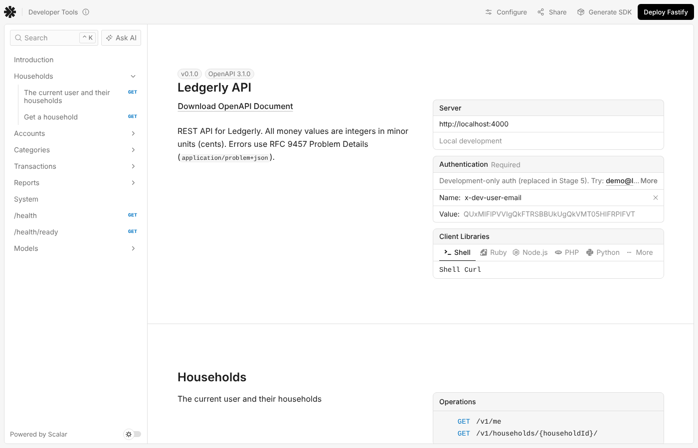
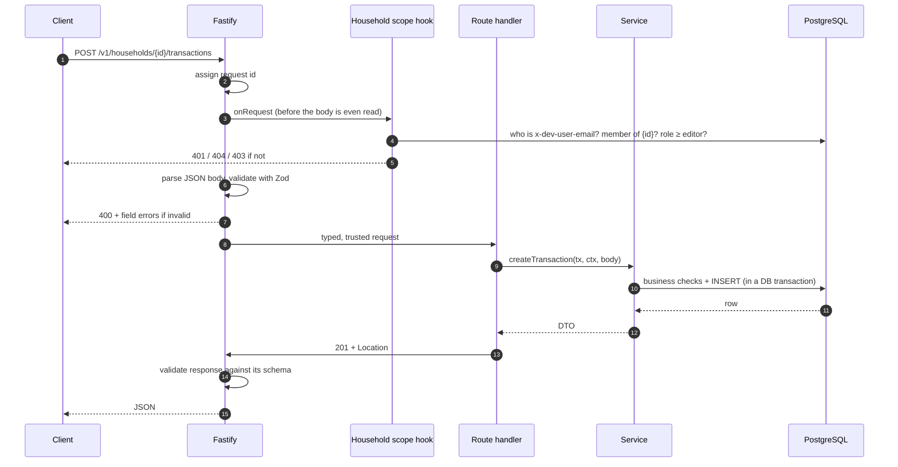
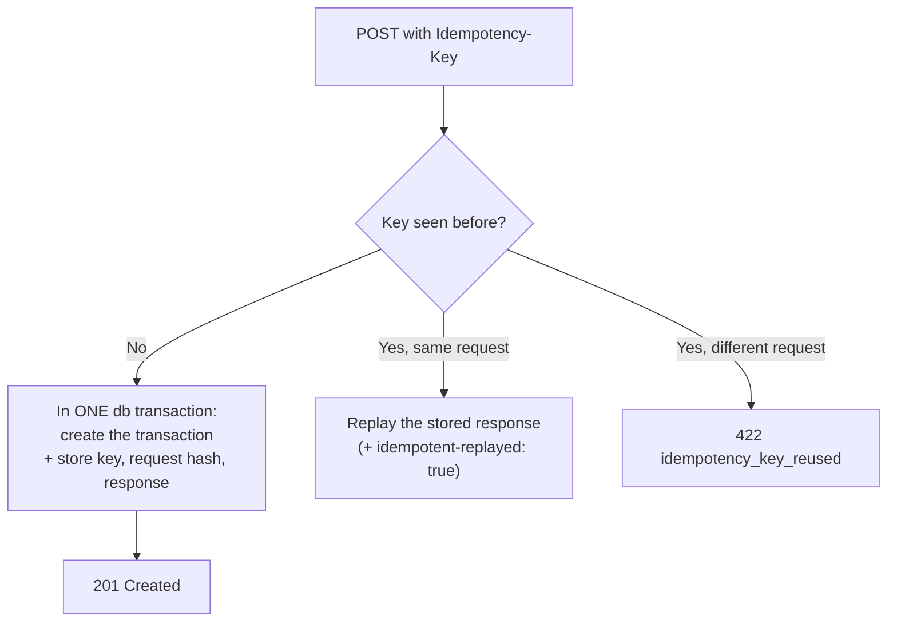

# Stage 4 — Backend API

> **Goal of this stage:** expose Ledgerly's data through a professional HTTP API. It covers resource-oriented routes, validation of everything that comes in _and_ goes out, one consistent error format, per-household authorization, keyset pagination, safe retries, atomic transfers and documentation generated from the code itself.
>
> **What you can see at the end:** with the API running, open **http://localhost:4000/docs** to get an interactive reference for every endpoint, where you can send real requests. The API has 47 integration tests running against a real database, and those tests caught two serious bugs while I was building this stage (§5.3).



---

## Table of contents

1. [What an API is, and the REST conventions we follow](#1-what-an-api-is-and-the-rest-conventions-we-follow)
2. [The Ledgerly API at a glance](#2-the-ledgerly-api-at-a-glance)
3. [Architecture: routes → services → data access](#3-architecture-routes--services--data-access)
4. [Contracts: one schema for validation, types and docs](#4-contracts-one-schema-for-validation-types-and-docs)
5. [Authentication and authorization](#5-authentication-and-authorization)
6. [Errors: one shape, the right status code](#6-errors-one-shape-the-right-status-code)
7. [Listing data: pagination, filters and search](#7-listing-data-pagination-filters-and-search)
8. [Idempotency: making retries safe](#8-idempotency-making-retries-safe)
9. [Business rules, atomicity and race conditions](#9-business-rules-atomicity-and-race-conditions)
10. [Generated documentation (and a scoped security exception)](#10-generated-documentation-and-a-scoped-security-exception)
11. [HTTP details that separate good APIs from great ones](#11-http-details-that-separate-good-apis-from-great-ones)
12. [Testing the API](#12-testing-the-api)
13. [How this scales](#13-how-this-scales)
14. [Run it yourself](#14-run-it-yourself)
15. [Exercises](#15-exercises)
16. [Glossary](#16-glossary)
17. [What's next](#17-whats-next)

---

## 1. What an API is, and the REST conventions we follow

An **API** (Application Programming Interface) is a contract: "send me a request shaped like _this_, and I'll answer with a response shaped like _that_". Our front end (Stage 6), a future mobile app, or a script you write will all talk to Ledgerly through it.

We follow **REST** conventions, the most widely used style for web APIs:

- **Everything is a resource with a URL**: `/accounts`, `/accounts/{id}`, `/transactions`.
- **HTTP methods say what to do with it**:

| Method   | Meaning            | Safe? (no changes) | Idempotent? (repeat = same result) |
| -------- | ------------------ | :----------------: | :--------------------------------: |
| `GET`    | Read               |         ✅         |                 ✅                 |
| `POST`   | Create             |         ❌         | ❌ (unless you add a key, see §8)  |
| `PATCH`  | Change some fields |         ❌         |    ✅ (same patch → same state)    |
| `DELETE` | Remove             |         ❌         |  ✅ (deleting twice = still gone)  |

- **Status codes say what happened**: `2xx` success, `4xx` the client did something wrong, `5xx` the server failed.

Those two columns aren't trivia. Browsers, proxies and retry libraries rely on them. For example, it's safe to automatically retry a `GET`, but _not_ a `POST`. §8 shows how we make `POST` retryable anyway.

**Alternatives we didn't choose:** _GraphQL_ lets clients ask for exactly the fields they want, which is great for big, varied front ends (GitHub, Shopify), but it adds a lot of machinery, and its caching is harder. _tRPC_ gives end-to-end types with almost no ceremony, but couples the API to TypeScript clients. A versioned REST API with an OpenAPI spec is the most universal choice: any language, any tool, any future mobile app.

---

## 2. The Ledgerly API at a glance

All household data lives under `/v1/households/{householdId}/…`:

| Endpoint                         | Methods            | Notes                                                               |
| -------------------------------- | ------------------ | ------------------------------------------------------------------- |
| `/v1/me`                         | GET                | Current user + their households and roles                           |
| `/v1/households/{id}`            | GET                | One household                                                       |
| `…/accounts`                     | GET, POST          | List includes live balances; `?includeArchived=true`                |
| `…/accounts/{accountId}`         | GET, PATCH, DELETE | DELETE refuses accounts with history (archive instead)              |
| `…/categories`                   | GET, POST          | Flat list; build the tree from `parentId`                           |
| `…/categories/{categoryId}`      | PATCH, DELETE      |                                                                     |
| `…/transactions`                 | GET, POST          | Keyset pagination, filters, search; POST supports `Idempotency-Key` |
| `…/transactions/{transactionId}` | GET, PATCH, DELETE | Transfer halves are protected                                       |
| `…/transfers`                    | POST               | Creates both halves atomically                                      |
| `…/reports/cashflow`             | GET                | `?from=&to=` → income, spending, net per month                      |
| `…/reports/spending-by-category` | GET                | Top-level category totals and shares                                |
| `/health`, `/health/ready`       | GET                | Liveness and readiness (Stage 3)                                    |
| `/docs`, `/openapi.json`         | GET                | Interactive reference + machine-readable spec                       |

**Why nest under the household?** The URL makes the tenant explicit, so authorization has exactly one thing to check (§5). It also reads naturally: "household X's transactions".

**Why `/v1`?** One day we'll need a breaking change (renaming a field, changing a response shape). Mobile apps installed on phones can't be updated instantly, so old clients must keep working. With a version prefix, `/v2` can ship next to `/v1`. Stripe, GitHub and Twilio all version their APIs.

---

## 3. Architecture: routes → services → data access

```
apps/api/src/
├── app.ts                    ← assembles everything (plugins, scopes, routes)
├── config/env.ts             ← validated configuration
├── plugins/                  ← cross-cutting concerns
│   ├── auth.ts               ←   who is calling?
│   ├── database.ts           ←   app.db
│   ├── error-handler.ts      ←   every error → Problem Details
│   └── openapi.ts            ←   /docs and /openapi.json
├── lib/                      ← small shared helpers (errors, cursor, idempotency…)
└── modules/                  ← one folder per business area
    ├── households/   scope.ts (authorization) · households.routes.ts
    ├── accounts/     accounts.routes.ts · accounts.service.ts · accounts.test.ts
    ├── categories/   …
    ├── transactions/ …
    └── reports/      …
```

This is the **modular monolith** from Stage 1 made concrete. Each business area is a module with the same internal layers:

| Layer           | File                     | Responsibility                                          | Knows about HTTP? |
| --------------- | ------------------------ | ------------------------------------------------------- | :---------------: |
| **Route**       | `*.routes.ts`            | URL, method, schemas, status codes, headers             |        ✅         |
| **Service**     | `*.service.ts`           | Business rules ("can't delete an account with history") |        ❌         |
| **Data access** | `@ledgerly/db` + Drizzle | SQL, transactions                                       |        ❌         |

Why separate routes from services? A service function like `createTransfer(db, ctx, input)` takes plain data and returns plain data. Stage 10's **background import job** will call the very same function. There's no HTTP request there, so if the business rules lived inside route handlers, we'd have to duplicate them.

Why no separate "repository" layer? Many codebases wrap every query in a repository class. With Drizzle, the query builder already _is_ a typed data-access layer, and wrapping it again adds indirection without adding safety. Reusable queries live in `@ledgerly/db` (`getAccountBalances`, `getMonthlyCashflow`). This is a judgement call, and both styles are common in industry. Pick one and be consistent.

### The life of a request



Notice the order. **Authorization runs before validation.** An outsider sending garbage to someone else's household gets `404`, not a helpful list of which fields are wrong. Error messages are information, and outsiders shouldn't get any.

---

## 4. Contracts: one schema for validation, types and docs

The request and response shapes live in `packages/shared/src/api/` as **Zod schemas**:

```ts
export const CreateTransactionSchema = z
  .object({
    accountId: IdSchema,
    categoryId: IdSchema.nullable().default(null),
    amountMinor: MinorUnitsSchema.refine((v) => v !== 0, "Amount can't be zero"),
    occurredOn: IsoDateSchema, // "2026-02-30" is rejected
    description: z.string().trim().min(1).max(200), // "   " is rejected
    notes: z.string().trim().max(2000).nullable().default(null),
  })
  .meta({ id: "CreateTransaction" });
```

That **single definition** does four jobs:

1. **Runtime validation.** `fastify-type-provider-zod` runs it on every request. Invalid input never reaches the handler.
2. **TypeScript types.** Inside the handler, `request.body` _is_ `CreateTransactionInput`, fully typed with no casting.
3. **API documentation.** `.meta({ id })` turns it into a named component in the OpenAPI spec.
4. **Front-end reuse.** In Stage 6, the web app imports the same schema to validate forms _before_ sending them, with identical rules and identical messages.

Change a rule in one place, and validation, types, docs and the front-end form all update together. That's the "single source of truth" principle again.

### Validation details worth copying

- **`.trim()` before `.min(1)`.** A name of `"   "` is empty in every way that matters. The test `creates an account` sends `"  Brokerage  "` and gets back `"Brokerage"`.
- **Unknown fields are stripped.** If a client sends `{ "householdId": "someone-else", … }` in a body, Zod drops it. Clients can never set fields we didn't explicitly allow. This blocks **mass assignment**, a classic vulnerability (OWASP API Security Top 10).
- **Every error at once.** Validation reports _all_ problems in one response (`body.name`, `body.type`, `body.currency`), so a form can highlight every field in one round trip.
- **`PATCH` needs at least one field.** An empty update is almost certainly a client bug, so we say so (`400`) instead of silently doing nothing.

### Responses are validated too

Fastify also runs each route's **response schema** before sending. If a service ever returns something that doesn't match, like a `Date` object where the contract says ISO string, the API returns a 500 and logs it, instead of sending clients malformed data. A contract is only real if both sides are held to it.

### DTOs: never return database rows directly

Services map rows to **DTOs** (Data Transfer Objects) with small `toDto` functions:

```ts
function toDto(row: Account & { balanceMinor: number }): AccountDto {
  return {
    id: row.id,
    name: row.name,
    type: row.type,
    currency: row.currency,
    openingBalanceMinor: row.openingBalanceMinor,
    balanceMinor: row.balanceMinor,
    archived: row.archivedAt !== null, // a friendlier shape for clients
    createdAt: row.createdAt.toISOString(),
    updatedAt: row.updatedAt.toISOString(),
  };
}
```

There are three reasons for this:

- **Internal columns stay private.** `household_id` and `created_by` never leak by accident.
- **The database can change without breaking clients.** Add a column and the API is unaffected until you _choose_ to expose it.
- **The API can present a better shape.** Clients get `archived: boolean`; they don't need to know we store `archived_at` timestamps.

---

## 5. Authentication and authorization

These two words are often confused:

- **Authentication (AuthN):** _who are you?_
- **Authorization (AuthZ):** _are you allowed to do this?_

### 5.1 Temporary development authentication

Real sign-in (password hashing, sessions, secure cookies) is Stage 5's whole topic. Until then, requests identify themselves with a header:

```
x-dev-user-email: demo@ledgerly.app
```

This is **obviously insecure**: anyone can claim to be anyone. So it's fenced in:

- It's implemented in one file (`plugins/auth.ts`) behind one function, `app.authenticate`. Stage 5 replaces the inside of that function, and nothing else changes.
- The environment schema has a cross-field rule: `AUTH_MODE=dev` with `NODE_ENV=production` **refuses to start**. A test checks that.

Building the authorization layer _now_, with a stand-in for authentication, is a common professional approach. The two are separate concerns, and the authorization rules are where the real product logic lives.

### 5.2 One hook protects every household route

`modules/households/scope.ts` registers one `onRequest` hook for every route under `/v1/households/:householdId`:

```ts
await app.authenticate(request);                                   // 1. who?
const membership = /* select role from household_members … */;   // 2. member?
if (!membership) throw notFound("Household");                      //    no → 404
const required = routeConfig.minRole ?? defaultRequiredRole(method); // 3. allowed?
if (!hasAtLeastRole(membership.role, required)) throw forbidden(…); //    no → 403
```

Key decisions:

- **Secure by default.** A new route added to this scope is automatically protected. You'd have to go out of your way to make it public. "Forgot the permission check on one endpoint" is one of the most common causes of real data breaches (OWASP API #1: _Broken Object Level Authorization_), so we design so it can't be forgotten.
- **Roles form a ladder:** `viewer < editor < owner`. Reads (`GET`) need `viewer` and writes need `editor`. A route can demand more via `config: { minRole: "owner" }` (we'll use that for managing members in Stage 11).
- **404 for non-members, 403 for members without permission.** An outsider asking for a household they don't belong to gets "not found". We don't even confirm it exists, because a `403` would leak that information. GitHub does exactly this for private repositories. A _member_ who lacks a role gets a `403`, because they already know it exists and deserve a clear reason.
- **Defence in depth.** Even inside an authorized request, every query includes `household_id = …`. With Stage 3's composite foreign keys, cross-household access would have to get past three separate layers.

### 5.3 Two bugs the tests caught, and what they teach

I wrote the authorization tests _before_ trying the API by hand, and they failed. That was the best thing that happened in this stage.

**Bug 1: authorization silently protected nothing.** The test "viewers can read but not write" got `201 Created` instead of `403`. Fastify uses **encapsulation**: a hook added inside a plugin only applies _inside that plugin_. I had registered the household-scope hook as its own plugin, _next to_ the route plugins, so it applied to zero routes. The fix is wrapping it with `fastify-plugin`, which hoists the hook to the parent scope:

```ts
export const householdScope = fp(scope, { name: "household-scope", dependencies: ["auth"] });
```

Without tests, this would have shipped as **"every household's data is readable by anyone"**, with no error and no warning, while everything looked like it worked. This is why authorization deserves tests for the **negative** cases (outsider → 404, viewer writes → 403), not just "the owner can read".

**Bug 2: balances ignored every transaction.** The balance test failed: the API said Cash had $120.00 (its opening balance) while the database query said $611.13. The SQL was a **correlated subquery**:

```sql
select sum(amount_minor) from transactions where account_id = id   -- ❌ which "id"?
```

Drizzle writes bare column names (`id`) in single-table queries. Inside the subquery, a bare `id` refers to the _nearest_ table in scope, which is `transactions.id`, not `accounts.id`. So the condition compared each transaction to itself, matched nothing, and the sum was always `NULL → 0`. The fix is to be explicit:

```sql
select sum(t.amount_minor) from transactions as t where t.account_id = "accounts"."id"   -- ✅
```

**Lesson:** in correlated subqueries, always alias the inner table and fully qualify the outer reference. And **test the numbers, not just the status codes**. A `200 OK` with wrong balances is the worst kind of bug in a finance app.

---

## 6. Errors: one shape, the right status code

### 6.1 RFC 9457 Problem Details

Every error from the API, whether validation, not found, a conflict or a crash, has the same shape and the content type `application/problem+json`:

```json
{
  "type": "https://docs.ledgerly.app/problems/validation_failed",
  "title": "Invalid request",
  "status": 400,
  "detail": "One or more fields are invalid.",
  "instance": "/v1/households/01a1…/accounts",
  "code": "validation_failed",
  "requestId": "c1a0dfed-3edf-4872-a8f7-68914a2c6b9b",
  "errors": [
    { "path": "body.name", "message": "Too small: expected string to have >=1 characters" },
    {
      "path": "body.type",
      "message": "Invalid option: expected one of \"checking\"|\"savings\"|…"
    },
    { "path": "body.currency", "message": "Must be a 3-letter ISO 4217 code like USD" }
  ]
}
```

_(That's a real response from the running API.)_

- **One shape** means clients write **one** error handler.
- **`code`** is stable and machine-readable (`account_name_taken`, `transfer_locked`). Front ends switch on it to show the right message, and it never changes even if we reword `detail`.
- **`requestId`** matches the `x-request-id` header and our logs (Stage 1). A user's screenshot of an error is enough to find exactly what happened.

RFC 9457 is the IETF standard for this, and it's used by Microsoft, Zalando and Spring, among many others. Using a standard means tools and developers already understand it.

### 6.2 Choosing the right status code

| Code | When                                                            | Example code                                                     |
| ---- | --------------------------------------------------------------- | ---------------------------------------------------------------- |
| 400  | The request is malformed or fails validation                    | `validation_failed`, `invalid_cursor`                            |
| 401  | We don't know who you are                                       | `unauthorized`                                                   |
| 403  | We know who you are; you're not allowed                         | `forbidden`                                                      |
| 404  | It doesn't exist (or you mustn't know it does)                  | `not_found`                                                      |
| 409  | It conflicts with the current state                             | `account_name_taken`, `account_has_transactions`                 |
| 413  | Body too large (limit: 100 KB)                                  | `fst_err_ctp_body_too_large`                                     |
| 422  | Well-formed, but breaks a business rule                         | `category_too_deep`, `transfer_locked`, `idempotency_key_reused` |
| 500  | Our bug. No details are leaked; it's logged with the request id | `internal_error`                                                 |

The 400-vs-422 split is worth understanding. **400** means "I can't even read this" (wrong types, missing fields): the client code is broken. **422** means "I understood you perfectly, but no": the request is valid, but the _situation_ doesn't allow it. That distinction helps both debugging and UI messages.

### 6.3 One central error handler

`plugins/error-handler.ts` is the **only** place where errors become responses:

- `AppError` (thrown by services) → its own status and code.
- Zod validation errors → 400 with field paths.
- Postgres errors that slip through → mapped by SQLSTATE (unique → 409, FK/check → 422). These are the Stage 3 constraints acting as a safety net.
- **Anything unexpected → a generic 500.** The real error and stack trace go to the logs, never to the client. Leaking stack traces and SQL is a frequent penetration-test finding, because it shows attackers your internals.

Services never build error JSON; they `throw notFound("Account")`. Routes never `try/catch`. That keeps every handler about the _happy path_, so it's short and readable.

---

## 7. Listing data: pagination, filters and search

### 7.1 Keyset pagination, implemented

Stage 3 designed the index for keyset pagination. Here it is in practice:

```http
GET /v1/households/{id}/transactions?limit=50
→ { "data": [ …50 rows… ], "nextCursor": "eyJkIjoiMjAyNi0xMS0wMSIs…" }

GET /v1/households/{id}/transactions?limit=50&cursor=eyJkIjoiMjAyNi0xMS0wMSIs…
→ { "data": [ …the next 50… ], "nextCursor": "…" }       // null on the last page
```

- **The cursor is the last row's sort key** (`occurredOn`, `id`), base64url-encoded. It's **opaque**: clients must not parse it, so we're free to change its format. A tampered cursor gets `400 invalid_cursor`, never a 500.
- **Fetch `limit + 1` rows.** If the extra row exists, there's another page. That avoids a separate `COUNT(*)` query, which gets expensive on big tables.
- **The SQL** is a row-value comparison that matches the index exactly: `where (occurred_on, id) < ($date, $id) order by occurred_on desc, id desc`.
- **`limit` is capped at 200.** Otherwise one request for `limit=1000000` could tie up the database.

A test walks _every_ page of the seeded data. It checks that the total equals the database count, that there are no duplicates, and that the order is strictly newest-first.

### 7.2 Filters

`accountId`, `categoryId`, `from`/`to` (dates, end exclusive), `type` (`income` / `expense` / `transfer`) and `q` (search) can be combined freely. Each one adds a `WHERE` condition, so they all compose with pagination.

One small product detail: **filtering by "Food" includes "Groceries", "Dining out" and "Coffee".** Users think in categories, not in database rows, so the parent filter expands to its subcategories with a subquery.

### 7.3 Search, and an index I measured and then removed

`q` searches descriptions case-insensitively with `ILIKE '%…%'`. There are two details here.

**Escape the wildcards.** In `LIKE` patterns, `%` means "anything" and `_` means "any one character". A user searching for `50%` would otherwise match `500`, `5000`… and a search for just `%` would match _every row_. `escapeLike()` makes them literal. A test searches for `%` and expects zero results.

**An index that didn't earn its place.** Substring search can't use a normal B-tree index, so the standard tool is a **trigram index** (`pg_trgm` + GIN). I added one, then measured it on 500,000 transactions:

| Query                                                              | Trigram index | No trigram index |
| ------------------------------------------------------------------ | ------------: | ---------------: |
| Rare term across **all** households (`'%#4242%'`, 56 rows)         |    **3.7 ms** |            93 ms |
| Common term across all households (14% of rows)                    |         96 ms |            97 ms |
| **The API's actual query** (one household, `'%coffee%'`, first 50) |    (not used) |       **1.3 ms** |

The last row decided it. Ledgerly's search always runs _inside one household_. Postgres walks that household's rows with the existing `(household_id, occurred_on, id)` index and filters as it goes, and it's already fast. The trigram index was never used by the real query, yet every insert would pay to maintain it. **So I removed it** (the migrations hadn't been committed, so no history was rewritten).

That's Stage 3's rule in action: _every index is designed from a query, never "just in case"_. If we later add a cross-household admin search, or a household grows to hundreds of thousands of transactions, the measurements above say exactly when to bring trigram back.

---

## 8. Idempotency: making retries safe

### 8.1 The problem

You add a $50 expense on your phone in a lift. The request reaches the server and the transaction is saved, but the _response_ is lost when the signal drops. The app sees a timeout and retries. **Now there are two $50 expenses.** In a finance app, that's a serious bug, and it happens constantly at scale: mobile networks, double-clicks, load balancers retrying, and so on.

`GET`, `PATCH` and `DELETE` are naturally idempotent (§1), but `POST` isn't.

### 8.2 The solution: `Idempotency-Key`

The client generates a unique key per _operation_ (not per attempt) and sends it with the request:

```http
POST /v1/households/{id}/transactions
Idempotency-Key: 4f0e9d8c-5b1a-4c2e-9f7d-0a1b2c3d4e5f
```

The server remembers the response for each key in the `idempotency_keys` table (migration `0002`):



This is exactly how **Stripe's** API works (they popularised the header), and an IETF draft standardises it. Details that make it correct:

- **Stored in the same database transaction** as the created row. "Created but not remembered" (or the reverse) is impossible.
- **A hash of method + URL + body** detects the client bug of reusing a key for a _different_ request. Silently replaying the old response would hide that bug.
- **Scoped per user**, so two users can't collide on the same key.
- **Race-proof.** If two identical requests arrive _at the same moment_, both pass the "seen before?" check. Both try to insert the key, and the primary key lets only one succeed. The loser's whole transaction rolls back, _including its duplicate row_, and it replays the winner's response. A test fires **5 identical requests concurrently** and asserts exactly one row was created. I ran it repeatedly to make sure it isn't flaky.

Old keys only need to live about 24 hours. Stage 10's background jobs will purge them, and the `created_at` index is there for that.

---

## 9. Business rules, atomicity and race conditions

### 9.1 Friendly checks first, constraints as the safety net

Before inserting a transaction, the service checks that the account exists in this household and isn't archived, and the same for the category. Failing that gives a helpful `422 account_not_found` with the field path. Stage 3's composite foreign key would _also_ reject a foreign account, but with a generic error. So we have two layers: **the service for good messages, the database for guarantees.**

### 9.2 Don't "check then insert"; let the constraint decide

How do we stop duplicate account names? The tempting way:

```ts
const exists = await db.select()…where(name = input.name);   // 1. check
if (exists) throw conflict(…);
await db.insert(accounts).values(input);                       // 2. insert
```

Two requests can both pass step 1 before either reaches step 2, which is a **race condition**. Instead, we just insert and let the UNIQUE constraint decide atomically, translating its error:

```ts
try {
  await db.insert(accounts).values({ householdId, ...input });
} catch (error) {
  if (isPgError(error, "uniqueViolation", "accounts_household_id_name_key"))
    throw nameTaken(input.name);
  throw error;
}
```

It's correct under concurrency and it's one query instead of two. That's why Stage 3 gave every constraint a deliberate name.

### 9.3 Atomic transfers

A transfer writes two rows: money out of one account, into another. `POST /transfers` runs inside `db.transaction(…)`. Either both rows exist or neither does. A test checks that both balances move by exactly the amount and that the monthly cash-flow report is _unchanged_, since a transfer isn't income or spending.

Two more rules protect the pair:

- **You can't edit the amount, date, account or category of one half** (`422 transfer_locked`). Changing one side would unbalance it. Renaming the description is allowed.
- **Deleting either half deletes both**, because a transfer is one logical event.

Currencies must match. Cross-currency transfers need exchange rates and are deliberately rejected for now, with a clear message.

---

## 10. Generated documentation (and a scoped security exception)

`@fastify/swagger` builds an **OpenAPI 3.1** document from the route schemas, available at `/openapi.json`, and **Scalar** renders it as an interactive reference at `/docs`. You can authenticate with the dev header and send real requests from the browser.

Because the docs are generated from the same Zod schemas that validate requests, **they can't drift from reality**. Hand-written API docs are always slightly wrong, and generated ones are exactly as right as the code. The spec is also machine-readable: you can generate typed clients in any language, import it into Postman, or run contract tests.

### A security header I had to relax, carefully

In the browser, the docs page was blank, with this error in the console:

> _Executing inline script violates the following Content Security Policy directive 'script-src 'self''_

That's **helmet's** Content-Security-Policy (Stage 1) doing its job: it forbids inline scripts, a key defence against cross-site scripting (XSS). The JSON API never needs scripts. The docs page is the one place that does.

The wrong fix is to turn CSP off for the whole API. The right fix is to relax it **only for the docs routes**, using Fastify's encapsulation (the same mechanism that caused Bug 1):

```ts
await app.register(async (docs) => {                // a child scope
  docs.addHook("onSend", async (_req, reply) => {   // applies ONLY inside it
    reply.header("content-security-policy", "default-src 'self'; script-src 'self' 'unsafe-inline'; …");
  });
  await docs.register(scalar, { routePrefix: "/docs", … });
});
```

Every JSON endpoint keeps the strict policy (verified with `curl -I`). **Make security exceptions as narrow as possible, and write down why.** In production you might disable docs entirely with `API_DOCS=false`.

---

## 11. HTTP details that separate good APIs from great ones

- **`201 Created` + `Location` header** on creates, pointing at the new resource's URL. **`204 No Content`** on deletes. Clients and tools understand these without reading your docs.
- **Body size limit: 100 KB.** Fastify's default is 1 MB. A JSON API for transactions never needs that, and smaller limits blunt abuse. A test sends 200 KB and expects `413`.
- **CORS `exposedHeaders`.** Browsers hide most response headers from JavaScript unless the server explicitly exposes them. We expose `location`, `x-request-id` and `idempotent-replayed` so the web app can read them.
- **Money is always integer minor units**, stated in the spec's description and enforced by the schema (`MinorUnitsSchema`).
- **Dates are `YYYY-MM-DD` strings** and timestamps are ISO 8601 with time zone. Every time value has one unambiguous format.
- **Date ranges are half-open**, `[from, to)`: "March" is `from=2026-03-01&to=2026-04-01`. Months have different lengths, and "up to but not including the 1st" is never wrong. A request where `from` isn't before `to` gets a 400 pointing at `querystring.to`.

---

## 12. Testing the API

There are **47 integration tests** in `apps/api`, run with `app.inject()` against a real Postgres. That means no network and no port, and the whole suite runs in a few seconds.

**The setup** (`src/test/helpers.ts`), run before _each_ test:

- Truncate every table, then load the deterministic demo household (`seedDemoData` with a fixed date and seed), so every test sees identical, realistic data.
- Add a **viewer** to that household and an **outsider** with their own household, so authorization can be tested from all three perspectives.

**A separate database per test suite.** Turborepo runs `@ledgerly/db`'s tests and `@ledgerly/api`'s tests _in parallel_, and both wipe their database. Sharing one database would make them randomly break each other: a "flaky test" that's really a design flaw. So the API uses `ledgerly_api_test` (created by `docker/postgres/init.sql` locally and by an extra CI step).

**What's covered:**

| Area          | Examples                                                                                                                           |
| ------------- | ---------------------------------------------------------------------------------------------------------------------------------- |
| Platform      | health/ready, security headers, request ids, 404/400/413 problems, OpenAPI spec contents, `/docs`                                  |
| AuthN / AuthZ | 401 without/unknown user, outsider → 404, viewer can read but gets 403 on write, authz before validation                           |
| Accounts      | balances match the DB query, 201 + Location, trimming, all field errors at once, 409 duplicate, archive, delete rules              |
| Categories    | tree, subcategory, too-deep and kind-mismatch 422s, duplicate 409, in-use 409                                                      |
| Transactions  | full pagination walk, type/category/search filters, `%` escaping, tampered cursor, balance update, validation, foreign account 422 |
| Idempotency   | replay, 5-way concurrent race, key reuse 422                                                                                       |
| Transfers     | atomic pair, balances, cash flow unchanged, same-account 400, locked halves, delete both                                           |
| Reports       | months, net = income − spending, shares sum to 1, invalid range                                                                    |

Note how many tests check **what must _not_ happen**: outsiders reading, viewers writing, duplicates being created. Security and money bugs live in the negative cases.

---

## 13. How this scales

| Concern              | Now                                                 | Later, when needed                                                               |
| -------------------- | --------------------------------------------------- | -------------------------------------------------------------------------------- |
| Stateless instances  | No in-memory state; any instance serves any request | Run N instances behind a load balancer (Stage 14)                                |
| Authorization lookup | One indexed PK query per request (~0.1 ms)          | Cache memberships in Redis, invalidate on change (Stage 12)                      |
| Listing              | Keyset pagination: constant time per page           | Nothing; this pattern scales to billions of rows                                 |
| Reports              | Computed per request                                | Cache per household + month; invalidate on write (Stage 12)                      |
| Abuse                | Body limit, `limit` cap, statement timeout          | Per-user rate limiting (Stage 5)                                                 |
| Retries              | Idempotency keys                                    | Purge old keys in a background job (Stage 10)                                    |
| Concurrent edits     | Last write wins                                     | Optimistic concurrency with `ETag` / `If-Match` for shared households (Stage 11) |
| Breaking changes     | `/v1` prefix                                        | Ship `/v2` alongside; deprecate with headers and timelines                       |

---

## 14. Run it yourself

The API's `.env` gained new settings, so copy the example again:

```bash
cp apps/api/.env.example apps/api/.env
```

If your Postgres container was created before this stage, create the new test database (new containers create it automatically):

```bash
docker compose exec postgres psql -U ledgerly -c "create database ledgerly_api_test"
```

Apply the new migration and reload demo data:

```bash
pnpm db:migrate && pnpm db:seed
```

```bash
pnpm dev
```

Open **http://localhost:4000/docs**, click _Authentication_, enter `demo@ledgerly.app`, and try any endpoint. Or use `curl`. First, find your household id:

```bash
curl -s -H "x-dev-user-email: demo@ledgerly.app" localhost:4000/v1/me
```

List expenses (replace `HOUSEHOLD_ID`):

```bash
curl -s -H "x-dev-user-email: demo@ledgerly.app" "localhost:4000/v1/households/HOUSEHOLD_ID/transactions?type=expense&limit=5"
```

See a validation problem:

```bash
curl -s -X POST -H "x-dev-user-email: demo@ledgerly.app" -H "content-type: application/json" -d '{"name":"","type":"piggy","currency":"usd"}' localhost:4000/v1/households/HOUSEHOLD_ID/accounts
```

Run everything CI runs:

```bash
pnpm check
```

---

## 15. Exercises

1. **Watch idempotency work.** Send the same `POST /transactions` twice with the same `Idempotency-Key` header using `curl -i`. Compare the `id`s and look for `idempotent-replayed: true`. Then change the amount but keep the key.
2. **Page by hand.** Request `?limit=3`, copy `nextCursor` into the next request, and repeat. Then try editing one character of the cursor.
3. **Break authorization on purpose.** Remove the `fp(…)` wrapper from `householdScope` in `scope.ts` and run `pnpm --filter @ledgerly/api test`. Read which tests fail and why. (Revert!)
4. **Recreate Bug 2.** In `accounts.service.ts`, change the subquery to `where account_id = ${accounts.id}` and run the account tests. Print the generated SQL with `.toSQL()` to see the bare `id`.
5. **Add a filter.** Support `?minAmount=` and `?maxAmount=` on `GET /transactions` (absolute value, in minor units). Add the fields to `TransactionListQuerySchema`, the conditions to the service, and a test. Then check `/docs`, where they appear automatically.
6. **Add an owner-only rule.** Make `DELETE /accounts/:id` require the `owner` role using `config: { minRole: "owner" }`, and write a test that an editor gets 403. (You'll need an editor in the fixtures.)
7. **Generate a client.** Download `/openapi.json` and paste it into an online OpenAPI viewer or client generator. Notice that `Account`, `Transaction` and `Problem` are named, reusable components.
8. **Think it through.** Why does the household hook use `onRequest` instead of `preHandler`? (Hint: when is the body parsed and validated, and what would an outsider learn otherwise?)

---

## 16. Glossary

| Term                           | Meaning                                                                                                  |
| ------------------------------ | -------------------------------------------------------------------------------------------------------- |
| **REST**                       | An API style built on resources (URLs) and standard HTTP methods.                                        |
| **Safe / idempotent method**   | Safe: doesn't change anything. Idempotent: repeating it has the same effect as doing it once.            |
| **Endpoint / route**           | One method + URL pattern, e.g. `POST /v1/households/{id}/transactions`.                                  |
| **DTO**                        | Data Transfer Object: the shape sent over the API, separate from the database row.                       |
| **Contract**                   | The agreed shape of requests and responses (our Zod schemas / OpenAPI spec).                             |
| **OpenAPI**                    | A standard, machine-readable format for describing HTTP APIs.                                            |
| **Authentication**             | Proving who you are.                                                                                     |
| **Authorization**              | Deciding what you're allowed to do.                                                                      |
| **RBAC**                       | Role-Based Access Control (owner / editor / viewer).                                                     |
| **Problem Details**            | RFC 9457, the standard JSON format for HTTP API errors.                                                  |
| **Keyset (cursor) pagination** | Paging by "after the last row seen" instead of skipping N rows.                                          |
| **Idempotency key**            | A client-chosen unique key that makes a POST safe to retry.                                              |
| **Race condition**             | A bug where the result depends on the timing of concurrent operations.                                   |
| **Mass assignment**            | A vulnerability where clients set fields they shouldn't (e.g. `householdId`) by adding them to the body. |
| **Encapsulation (Fastify)**    | Hooks and decorators only apply inside the plugin that registers them.                                   |
| **Correlated subquery**        | A subquery that references a column of the outer query, run per outer row.                               |
| **Trigram index**              | An index (pg_trgm + GIN) that speeds up substring searches.                                              |
| **CSP**                        | Content-Security-Policy: a header telling browsers which scripts and resources a page may load.          |

---

## 17. What's next

**Stage 5: Authentication & security.** We replace the development header with real sign-in: password hashing with Argon2, secure HTTP-only session cookies, sign-up and sign-in flows, CSRF protection, rate limiting against brute force, optional two-factor authentication with TOTP, and a tour of the OWASP Top 10 applied to Ledgerly. Because authorization is already isolated behind `app.authenticate`, the rest of the API won't need to change.
