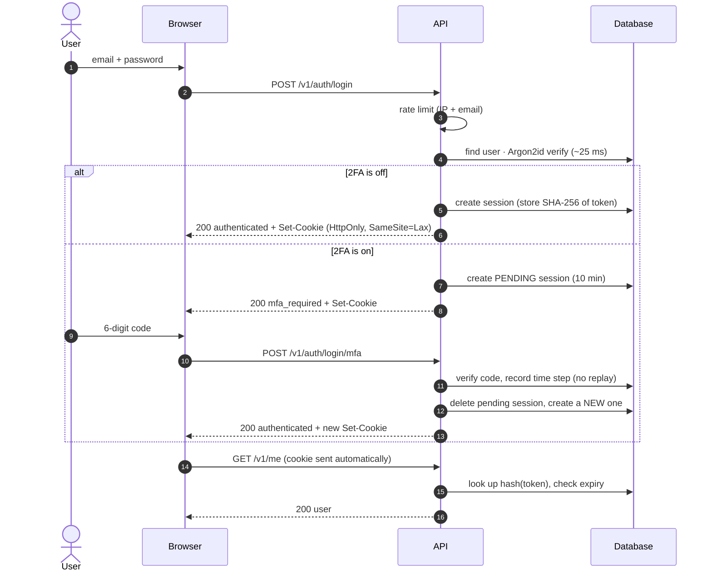

# Stage 5 — Authentication & Security

> **Goal of this stage:** replace the development header with real accounts. That means sign-up, sign-in, secure sessions, two-factor authentication and recovery codes, plus the defences around them: password hashing, CSRF protection, rate limiting, encryption at rest, secret hygiene and supply-chain checks. Then map it all onto the OWASP Top 10.
>
> **What you can see at the end:** sign in at `POST /v1/auth/login` with **demo@ledgerly.app / correct-horse-ledger** (from `/docs` or `curl`). The API answers with an `HttpOnly` session cookie. Turn on 2FA, scan the QR code with any authenticator app, and the next sign-in asks for a 6-digit code. There are 77 API tests, including attacks that must fail.

---

## Table of contents

1. [Start with a threat model](#1-start-with-a-threat-model)
2. [The flows at a glance](#2-the-flows-at-a-glance)
3. [Storing passwords](#3-storing-passwords)
4. [Sessions: how the server remembers you](#4-sessions-how-the-server-remembers-you)
5. [CSRF: when another site acts as you](#5-csrf-when-another-site-acts-as-you)
6. [XSS and why the cookie is HttpOnly](#6-xss-and-why-the-cookie-is-httponly)
7. [Rate limiting: stopping guessing at scale](#7-rate-limiting-stopping-guessing-at-scale)
8. [Two-factor authentication (TOTP) and recovery codes](#8-two-factor-authentication-totp-and-recovery-codes)
9. [Encryption at rest and secret management](#9-encryption-at-rest-and-secret-management)
10. [Security logging](#10-security-logging)
11. [Supply-chain security](#11-supply-chain-security)
12. [Ledgerly vs the OWASP Top 10](#12-ledgerly-vs-the-owasp-top-10)
13. [What we deliberately haven't built yet](#13-what-we-deliberately-havent-built-yet)
14. [Testing security](#14-testing-security)
15. [Run it yourself](#15-run-it-yourself)
16. [Exercises](#16-exercises)
17. [Glossary](#17-glossary)
18. [What's next](#18-whats-next)

---

## 1. Start with a threat model

Security work starts with three questions, not with code: **what are we protecting, from whom, and how could they get it?** This is called a _threat model_.

| We protect…                                     | From…                                                                  | Main defences in this stage                                    |
| ----------------------------------------------- | ---------------------------------------------------------------------- | -------------------------------------------------------------- |
| Account access                                  | **Credential stuffing**: bots trying passwords leaked from other sites | Rate limits, breached-password check, 2FA                      |
| Account access                                  | **Phishing** of passwords                                              | 2FA (a stolen password alone isn't enough)                     |
| Sessions                                        | **XSS** stealing tokens; network sniffing                              | `HttpOnly` + `Secure` cookies, CSP                             |
| Actions                                         | **CSRF**: another site making your browser send requests               | `SameSite` cookies, Origin / Fetch-Metadata checks, JSON only  |
| Passwords and secrets if the **database leaks** | Anyone with a stolen backup                                            | Argon2id hashes, hashed session tokens, encrypted TOTP secrets |
| Other households' data                          | Logged-in users probing IDs                                            | Stage 4's authorization + Stage 3's composite FKs              |
| Our code                                        | Malicious or vulnerable **dependencies**, leaked keys in Git           | Lockfile, `pnpm audit`, secret scanning in CI                  |

Notice the "database leaks" row. A recurring theme of this stage is **assume breach**: design so that even if an attacker reads the whole database, they can't sign in as anyone. That's why passwords, session tokens and recovery codes are stored _hashed_, and TOTP secrets _encrypted_.

---

## 2. The flows at a glance



The endpoints, all under `/v1/auth`:

| Endpoint                       | Purpose                                               |
| ------------------------------ | ----------------------------------------------------- |
| `POST /signup`                 | Create account + first household + starter categories |
| `POST /login`                  | Email + password → session (or "2FA required")        |
| `POST /login/mfa`              | Second step: TOTP or recovery code                    |
| `POST /logout`                 | End this session                                      |
| `GET /sessions`                | Devices where you're signed in                        |
| `DELETE /sessions/{id}`        | Sign out one device                                   |
| `POST /sessions/revoke-others` | Sign out everywhere else                              |
| `POST /password`               | Change password (signs out other devices)             |
| `POST /mfa/totp/setup`         | Start 2FA: secret + QR-code URI                       |
| `POST /mfa/totp/enable`        | Confirm with a code → recovery codes (shown once)     |
| `POST /mfa/totp/disable`       | Turn off 2FA (password **and** code)                  |

Thanks to Stage 4's design, the rest of the API didn't change at all. Every route still calls `app.authenticate` and reads `request.user`. Only _how_ `authenticate` works was replaced.

---

## 3. Storing passwords

### 3.1 Hash, don't encrypt, and never store plain text

- **Encryption** is reversible with a key. If an attacker gets the database _and_ the key (they're often on the same server), they get every password.
- **Hashing** is one-way. We never need the original password back; at sign-in we hash what the user typed and compare.

### 3.2 Why a _slow_ hash: Argon2id

SHA-256 is a fine hash, but it's _fast_: a modern GPU computes **billions** per second. With a leaked table of SHA-256 password hashes, attackers simply try every common password and every leaked password from other breaches. Most fall in hours.

Password hashes are deliberately **slow** and **memory-hard**:

```ts
// apps/api/src/auth/password.ts
const OPTIONS = {
  algorithm: Argon2id,
  memoryCost: 19_456 /* KiB = 19 MiB */,
  timeCost: 2,
  parallelism: 1,
};
```

These are OWASP's recommended parameters. One hash takes about **25 ms** and **19 MiB of RAM** on our server, which a user never notices. For an attacker, each guess now costs memory, so GPUs (which have lots of cores but little memory per core) lose most of their advantage. **Argon2id** won the Password Hashing Competition (2015) and is OWASP's first recommendation. bcrypt and scrypt are acceptable older alternatives.

### 3.3 Salts and the PHC string format

```
$argon2id$v=19$m=19456,t=2,p=1$0qdhTNREf1YEFdt/mL2Dcg$7Uu0tv5TpLS8YYmO…
 └ algorithm  └ version └ parameters  └ random salt         └ hash
```

- A random **salt** per password means two users with the same password get different hashes. Attackers can't use precomputed tables, and must attack each hash separately. A test hashes the same password twice and checks the results differ.
- Algorithm and parameters are stored **inside** the hash. When we raise the cost in a few years, `needsRehash()` detects old hashes, and `verifyCredentials` transparently re-hashes the password at the user's next sign-in, the only moment we have the plain text.

### 3.4 Password rules (NIST SP 800-63B)

Modern guidance from NIST, the US standards body, followed by most of the industry:

| Rule                                           | Why                                                                                                                     |
| ---------------------------------------------- | ----------------------------------------------------------------------------------------------------------------------- |
| **At least 12 characters**                     | Length is the biggest factor in strength. "violet tractor sunrise" beats "P@ssw0rd!".                                   |
| **No composition rules** ("1 symbol, 1 digit") | They push people to predictable patterns (`Password1!`) and don't add real strength.                                    |
| **Allow long passphrases (up to 256)**         | Password managers and passphrases should be welcome…                                                                    |
| …**but cap the length**                        | …because hashing a 10 MB "password" is a denial-of-service attack.                                                      |
| **Reject breached / common passwords**         | Attackers try these first. We check a small built-in list; production checks the full _Have I Been Pwned_ corpus (§13). |
| **No forced periodic changes**                 | Forced rotation produces `Summer2026!` → `Autumn2026!`. Change only on evidence of compromise.                          |

Rules that need context run on the server (`passwordWeakness`): no common passwords, no single repeated character, not containing your email or the app's name. The _length_ rule lives in the shared Zod schema, so the sign-up form in Stage 6 will show it instantly. Note that **sign-in never applies strength rules**: a password created under older rules must keep working.

### 3.5 Don't reveal which accounts exist

A sign-in form that says "no account with that email" tells attackers which emails to target. So:

- **One error for everything:** `401 invalid_credentials`, "Invalid email or password". A test compares the response for a wrong password and an unknown email, and they're identical (apart from the request id).
- **Equal timing.** If the email doesn't exist, we _still_ run a full Argon2id verification against a dummy hash. Otherwise "unknown email" would answer in 1 ms and "wrong password" in 25 ms, and an attacker could tell them apart just by timing.

**An honest trade-off:** sign-up _does_ say "this email is already registered" (409). The fully enumeration-proof pattern is "check your inbox" for every sign-up, which needs email delivery. That arrives with background jobs in Stage 10. Until then, sign-up is rate-limited to 5 per hour per IP, so the information is expensive to harvest. Security is often about **knowing** your remaining risks and keeping them small, not pretending to have none.

---

## 4. Sessions: how the server remembers you

HTTP is stateless: every request is independent. After you sign in, _something_ must identify you on the next request.

### 4.1 Server-side sessions vs JWTs

| Approach                        | How it works                                     | Pros                                                        | Cons                                                                                                                                          |
| ------------------------------- | ------------------------------------------------ | ----------------------------------------------------------- | --------------------------------------------------------------------------------------------------------------------------------------------- |
| **Opaque session token** ✅     | Random token in a cookie; the server looks it up | **Instant revocation**, tiny cookie, no crypto to get wrong | One indexed DB lookup per request (≈ 0.1 ms; cacheable in Redis later)                                                                        |
| **JWT** (signed JSON Web Token) | Signed claims in the token; no lookup needed     | Stateless, good for service-to-service                      | **Can't be revoked** before it expires without adding… a server-side lookup. Easy to misconfigure (`alg: none`, weak secrets). Large cookies. |

"Sign out everywhere", "your password changed, every other device is signed out" and "an admin locked this account" all need **revocation**. For a first-party web app talking to its own API, server-side sessions are the simpler and more secure choice, and they're what most banks and large consumer apps use. JWTs shine elsewhere: short-lived tokens between backend services, or third-party API access (OAuth).

### 4.2 Our session design

```ts
const token = randomBytes(32).toString("base64url");   // 256 bits from the OS's CSPRNG
await db.insert(sessions).values({ tokenHash: sha256(token), expiresAt, … });
reply.setCookie(cookieName, token, { httpOnly: true, secure, sameSite: "lax", path: "/" });
```

- **256 bits of randomness** from the operating system's cryptographically secure generator. Guessing one isn't "hard"; it's physically impossible. (Never use `Math.random()` for security: it's predictable.)
- **Only a SHA-256 hash is stored.** A leaked database contains no usable session tokens. A test checks the raw cookie value appears nowhere in the `sessions` table.
- **Fast SHA-256 is fine here** (unlike for passwords) because the input is already 256 random bits, so there's nothing to brute-force. _Slow hashing is for low-entropy secrets humans choose. Fast hashing is fine for high-entropy secrets machines generate._ The same reasoning applies to recovery codes.

### 4.3 Cookie attributes, one by one

```
Set-Cookie: ledgerly_session=NjydixDRg_…; Path=/; Expires=Tue, 01 Dec 2026 …; HttpOnly; SameSite=Lax
```

_(a real response from the running API in development)_

| Attribute        | What it does                                                                      | Threat it addresses                     |
| ---------------- | --------------------------------------------------------------------------------- | --------------------------------------- |
| `HttpOnly`       | JavaScript can't read the cookie (`document.cookie` doesn't show it)              | XSS stealing the session (§6)           |
| `Secure`         | Only sent over HTTPS (production only; enforced by config)                        | Network sniffing on public Wi-Fi        |
| `SameSite=Lax`   | Not sent on cross-site POST/PATCH/DELETE (still sent when you click a link to us) | CSRF (§5)                               |
| `__Host-` prefix | Browser enforces `Secure`, `Path=/` and _no_ `Domain` (production cookie name)    | A compromised subdomain overwriting it  |
| `Path=/`         | Sent to every API path                                                            | —                                       |
| `Expires`        | Matches the session's absolute expiry                                             | Stale sessions lingering in the browser |

**Why not store the token in `localStorage`?** Many tutorials do. But any JavaScript on the page can read `localStorage`, including an injected script or a compromised npm package in your front end. An `HttpOnly` cookie is out of JavaScript's reach entirely. That one choice turns "XSS = account takeover" into "XSS = bad, but contained". OWASP recommends cookies for browser sessions.

The config refuses to start in production without `Secure` cookies (`COOKIE_SECURE must be true in production`), and a test checks it. In development over `http://localhost`, the cookie is non-Secure and named `ledgerly_session`.

### 4.4 Expiry: absolute _and_ idle

- **Absolute lifetime: 30 days** (`SESSION_TTL_DAYS`). Even an active session must sign in again eventually, which limits how long a stolen token stays useful.
- **Idle timeout: 14 days** (`SESSION_IDLE_DAYS`). A forgotten laptop session dies sooner.
- Both are checked **in the SQL query** that loads the session, so an expired token simply doesn't match.
- `last_seen_at` is updated **at most every 5 minutes**. Writing to the database on _every_ request would turn reads into writes, a needless scaling cost.

### 4.5 Session fixation and rotation

**Session fixation:** an attacker plants a session id in your browser _before_ you sign in, then uses it _after_ you've authenticated it. The defence is to never upgrade an existing session; **always issue a new token when privilege changes**:

- Every successful sign-in creates a brand-new session.
- After the 2FA step, the _pending_ session is deleted and a _new_ token is issued. A test checks the token changed and the old one is dead.

### 4.6 Device management

`GET /v1/auth/sessions` lists your devices (user agent, IP, last seen), marking the current one. You can revoke one or "sign out everywhere else". **Changing your password signs out all other devices automatically**: if the old password leaked, the attacker's sessions die with it. A test checks that the other device's cookie stops working immediately.

---

## 5. CSRF: when another site acts as you

### 5.1 The attack

Cross-Site Request Forgery exploits the fact that browsers attach cookies automatically. You're signed in to Ledgerly, then you visit `evil.example`, which contains:

```html
<form action="https://api.ledgerly.app/v1/auth/sessions/revoke-others" method="POST">…</form>
<script>
  document.forms[0].submit();
</script>
```

Your browser sends the POST _with your Ledgerly cookie_. The server sees a valid session and does it. The attacker never saw your cookie; they didn't need to.

### 5.2 Three layers of defence

1. **`SameSite=Lax` cookies.** Browsers don't attach the cookie to cross-site POST/PATCH/DELETE requests, so the forged request arrives _unauthenticated_. On its own this already stops the classic attack in modern browsers.
2. **Origin and Fetch-Metadata checks** (`plugins/csrf.ts`). For every state-changing request, if the browser marks it `Sec-Fetch-Site: cross-site`, or it carries an `Origin` that isn't the API itself or one of our front ends, we reject it with `403 csrf_rejected` and log a warning.
3. **JSON-only bodies.** HTML forms can only send `application/x-www-form-urlencoded`, `multipart/form-data` or `text/plain`. Fastify only parses JSON, and we **removed its default `text/plain` parser**, which closes a known trick where a form posts JSON-looking text. A form submission gets `415 Unsupported Media Type`.

OWASP's CSRF cheat sheet lists exactly these as valid defences (SameSite cookies, verifying origin with standard headers, Fetch Metadata). That's why we don't need the older "hidden CSRF token in every form" pattern, which mainly exists for apps that serve HTML forms.

### 5.3 CORS is not CSRF protection

A common confusion: CORS (Stage 1) controls whether a _page on another origin can read_ our responses. It does **not** stop the browser from _sending_ a request. A form POST doesn't even trigger CORS. That's why a `GET /v1/me` with `Origin: https://evil.example` still returns 200 in the test: the request is harmless (it changes nothing), and the browser won't let `evil.example` _read_ the answer. **Safe methods must never change state**, which is one reason the REST rules from Stage 4 matter for security.

---

## 6. XSS and why the cookie is HttpOnly

**Cross-Site Scripting (XSS)** means an attacker gets _their_ JavaScript to run on _your_ page, for example by saving a transaction description like ``, which gets rendered as HTML somewhere.

Our layers:

- **React escapes text by default.** `{transaction.description}` renders as text, never HTML. The danger zone is `dangerouslySetInnerHTML`, which we don't use (the name is the warning).
- **Content-Security-Policy** (helmet, Stage 1) tells the browser which scripts may run. The API serves JSON with `script-src 'self'`, and Stage 4 relaxed it only for `/docs`. Stage 14 adds a strict CSP to the web app too.
- **`HttpOnly`** means that even if a script runs, it can't read the session cookie. It could still act _within the page_ while it's open, which is why XSS remains serious, but it can't walk away with your session.

---

## 7. Rate limiting: stopping guessing at scale

Without limits, an attacker can try millions of passwords, or replay billions of leaked email/password pairs (**credential stuffing**, the most common real-world account attack).

| Endpoint                                  | Limit             | Keyed on       | Why that key                                 |
| ----------------------------------------- | ----------------- | -------------- | -------------------------------------------- |
| Everything                                | 300 / minute      | IP             | Scrapers, runaway scripts                    |
| `POST /auth/login`                        | 10 / 15 minutes   | **IP + email** | Guessing one account doesn't block others    |
| `POST /auth/signup`                       | 5 / hour          | IP             | Mass account creation, email probing         |
| `POST /auth/login/mfa`                    | 5 / 5 minutes     | session        | A 6-digit code has only 1,000,000 values     |
| `POST /auth/password`, 2FA enable/disable | 5–10 / 15 minutes | IP             | Re-verification endpoints accept secrets too |

When the limit hits, the response is `429 Too Many Requests` as a Problem Details body with a `Retry-After` header. A test makes 10 failed attempts, then shows that **even the correct password** is refused, and that a _different_ email from the same IP is unaffected.

**Design notes:**

- **Throttle, don't permanently lock.** Locking an account after N failures lets an attacker lock _you_ out on purpose (a denial-of-service attack on a specific person). Time-boxed throttling slows attackers without handing them that weapon.
- **The real client IP.** Behind a load balancer, every request appears to come from the balancer, so all users would share one limit. `TRUST_PROXY=true` makes Fastify read `X-Forwarded-For`, but only enable it when a proxy _you control_ sets that header. Otherwise attackers forge it and get a fresh "IP" per request.
- **One process, one counter.** The counters live in memory. With 10 API instances, each counts separately, so the effective limit is 10× higher. Stage 12 moves the counters to **Redis** so limits are shared. The code comment says so, because a known limitation should be written down, not hidden.

---

## 8. Two-factor authentication (TOTP) and recovery codes

### 8.1 Why 2FA

Passwords get phished, reused and leaked. A second factor, _something you have_ (your phone), means a stolen password alone isn't enough. This is one of the single most effective security controls a consumer app can offer.

### 8.2 How TOTP works

**TOTP** (Time-based One-Time Password, RFC 6238) is what Google Authenticator, 1Password and Authy implement:

```
code = last 6 digits of HMAC-SHA1(shared_secret, floor(unix_time / 30))
```

The app and the server share a secret once, through the QR code. After that, both compute the same code every 30 seconds, offline. A code is useless a minute later.

**Why not SMS codes?** SMS can be intercepted, and attackers can talk a phone carrier into moving your number to their SIM ("SIM swapping"). NIST discourages SMS as an authenticator. TOTP has no network dependency and no carrier in the middle.

### 8.3 Setup is two steps on purpose

1. `POST /mfa/totp/setup` creates a secret and returns it plus an `otpauth://` URI (the web app will render it as a QR code). It's stored, but **not active**.
2. `POST /mfa/totp/enable` requires a valid code. Only then is 2FA switched on.

If we activated 2FA at step 1 and the user mis-scanned the QR code, they'd be locked out of their own account. Proving the app works before relying on it is the standard pattern.

### 8.4 Verification details that matter

- **Clock drift.** Phones' clocks aren't perfect. We accept the previous and next 30-second window (`window: 1`), and a unit test checks ±30 s is accepted and ±90 s isn't.
- **Replay protection.** A code is valid for its whole window, so an attacker shoulder-surfing your code could reuse it seconds later. We store the last accepted time step and require a strictly newer one, **in the same atomic `UPDATE`**:

  ```sql
  update users set totp_last_used_step = $step
  where id = $user and (totp_last_used_step is null or totp_last_used_step < $step)
  returning id
  ```

  If two requests race with the same code, only one `UPDATE` matches a row. A test signs in with a code, then tries the same code on another sign-in and gets `invalid_mfa_code`.

- **The pending session** (password OK, code not yet entered) lives at most 10 minutes. It can only call `/login/mfa` and `/logout`. Every other endpoint answers `401 mfa_required`, so it can't touch data.
- **Strict rate limit** on the code endpoint: 5 attempts per 5 minutes. Guessing one of a million codes this way would take years.

### 8.5 Recovery codes

Phones get lost. Enabling 2FA returns **10 one-time recovery codes** like `7KQM-W2XD-HN4P`, **shown once**:

- 12 characters from a 31-character alphabet **without look-alikes** (no `0/O`, `1/I/L`): about 59 bits of entropy each, impossible to guess within the rate limit.
- **Stored as SHA-256 hashes.** As with session tokens, they're high-entropy, so fast hashing is fine. A test checks no plaintext code is stored.
- **Normalised before comparing.** `7kqm w2xd-hn4p` works too, because people type codes in all sorts of ways.
- **One use each, atomically:** `update … set used_at = now() where … and used_at is null`. A test uses a code once successfully, then gets 401 the second time.

### 8.6 Turning 2FA off requires both factors

`POST /mfa/totp/disable` needs the **password and a current code**. A stolen session cookie alone must not be able to quietly remove 2FA. This "re-authenticate for sensitive actions" pattern also applies to changing the password, which requires the current one.

---

## 9. Encryption at rest and secret management

### 9.1 When to hash, when to encrypt

To check a TOTP code, the server needs the **original** secret, so we can't hash it. We **encrypt** it with **AES-256-GCM**:

```
v1.<12-byte IV>.<16-byte auth tag>.<ciphertext>      (base64url parts)
```

- **AES-256-GCM is authenticated encryption.** Besides hiding the data, the auth tag detects tampering. A test flips one character of the ciphertext and decryption throws, and decrypting with the wrong key throws too.
- **A fresh random IV every time.** Reusing an IV with the same key breaks GCM's security. A test encrypts the same value twice and gets different outputs.
- **`v1.` is a key version.** When we rotate keys, new data uses `v2`, old data is still readable with the v1 key, and a background job can re-encrypt it gradually.

_A small lesson the tests taught:_ my first tamper test changed the **last** character of the base64 text, and decryption _succeeded_. The final base64 character can carry padding bits that aren't part of the data, so changing it may not change a single byte. Changing the _first_ character fixed the test. When testing security properties, make sure the test really does what you think.

### 9.2 Where the key lives

```ini
# apps/api/.env.example
ENCRYPTION_KEY=          # REQUIRED — generate your own; never commit a real one
```

- The key comes **from the environment**, never from code. In production, it comes from a secrets manager (AWS Secrets Manager, GCP Secret Manager, Vault, or your platform's encrypted env vars).
- The **example file has it blank**, so a fresh clone fails to start with a clear message (`ENCRYPTION_KEY must decode to exactly 32 bytes`) until you generate your own. Shipping a "default" key, even a development one, is how default keys end up in production.
- Validation is fail-fast: it must decode to exactly 32 bytes (a test checks that 16 is rejected).
- The database and the key are **separate**. A stolen database backup without the key reveals nothing about anyone's 2FA secrets.

### 9.3 Keeping secrets out of Git

A new CI job runs **gitleaks**, which scans the _entire git history_ for API keys, private keys and tokens. Secrets pushed to Git must be treated as compromised even if you delete them later, because the history keeps them. Two values in our code look like secrets but aren't: the demo password hash and the dummy timing hash. They're annotated `// gitleaks:allow (not a secret)` on the same line, so the scanner skips them deliberately rather than by accident.

---

## 10. Security logging

You can't respond to attacks you can't see. The API logs **security events** as structured fields:

```
event: "auth.login"            userId …
event: "auth.login_failed"     ip …
event: "auth.mfa_verified"     method: "totp" | "recovery_code"
event: "auth.mfa_disabled"     (warning level)
event: "auth.password_changed"
"Blocked possible CSRF request" origin …, reason …
```

In production, these feed alerts like "50 failed sign-ins for one account in 5 minutes" or "2FA disabled right after a sign-in from a new country" (Stage 14). Just as important is **what's never logged**: passwords, codes, tokens and cookies. Fastify doesn't log request bodies, and the logger redacts `Authorization` and `Cookie` headers (Stage 1).

---

## 11. Supply-chain security

Our API pulls in hundreds of transitive npm packages. Any of them could have a known vulnerability, or be hijacked. The layers so far:

| Layer                                                                                                                  | Since       |
| ---------------------------------------------------------------------------------------------------------------------- | ----------- |
| Exact versions + `pnpm-lock.yaml` (`--frozen-lockfile` in CI)                                                          | Stage 1     |
| pnpm blocks install scripts except allow-listed ones                                                                   | Stage 1     |
| **`pnpm audit --prod --audit-level=high`** in CI: fails on known high/critical vulnerabilities in shipped dependencies | **Stage 5** |
| **gitleaks** secret scanning in CI                                                                                     | **Stage 5** |
| Automated dependency update PRs (Renovate/Dependabot)                                                                  | Stage 14    |

Right now `pnpm audit --prod` reports **"No known vulnerabilities found"**.

---

## 12. Ledgerly vs the OWASP Top 10

The **OWASP Top 10** is the most widely referenced list of web application security risks. Here's where Ledgerly stands against the 2021 edition (a 2025 update reorganises some categories, notably adding software supply-chain failures and mishandling of exceptional conditions, both covered below too):

| #   | Risk                                         | How Ledgerly addresses it                                                                                                                    |
| --- | -------------------------------------------- | -------------------------------------------------------------------------------------------------------------------------------------------- |
| A01 | **Broken Access Control**                    | One household-scope hook protects every route by default (Stage 4); 404 for non-members; roles; composite FKs (Stage 3); negative-case tests |
| A02 | **Cryptographic Failures**                   | Argon2id passwords; hashed tokens and recovery codes; AES-256-GCM secrets; HTTPS-only cookies in production; no home-made crypto             |
| A03 | **Injection**                                | All SQL is parameterised by Drizzle; LIKE wildcards escaped; Zod validates every input                                                       |
| A04 | **Insecure Design**                          | Threat model; assume-breach storage; 2FA; re-authentication for sensitive actions; idempotency (Stage 4)                                     |
| A05 | **Security Misconfiguration**                | Validated config that refuses insecure production settings; helmet headers; strict CSP; docs can be disabled; no stack traces to clients     |
| A06 | **Vulnerable & Outdated Components**         | Lockfile, `pnpm audit` in CI, install-script blocking                                                                                        |
| A07 | **Identification & Authentication Failures** | NIST password rules, breached-password check, rate limiting, no enumeration, secure sessions, fixation protection, 2FA                       |
| A08 | **Software & Data Integrity Failures**       | Frozen lockfile, CI checks on every change, authenticated encryption (tamper detection)                                                      |
| A09 | **Security Logging & Monitoring Failures**   | Structured security events with request ids; secrets never logged; alerting comes in Stage 14                                                |
| A10 | **Server-Side Request Forgery**              | The API never fetches user-supplied URLs. When imports arrive (Stage 10), they'll be file uploads, not URLs                                  |

---

## 13. What we deliberately haven't built yet

Being explicit about gaps is part of doing security well:

| Feature                            | Why not yet / when                                                                                                                                                                                                                                          |
| ---------------------------------- | ----------------------------------------------------------------------------------------------------------------------------------------------------------------------------------------------------------------------------------------------------------- |
| **Password reset by email**        | Needs reliable email delivery and background jobs → Stage 10. (Reset tokens will be random, hashed, single-use and expire in about 30 minutes.)                                                                                                             |
| **Email verification**             | Same dependency; also fixes the sign-up enumeration trade-off from §3.5                                                                                                                                                                                     |
| **Full breached-password check**   | Have I Been Pwned's _k-anonymity_ API: send only the first 5 characters of the password's SHA-1, get back matching suffixes, and compare locally. The password never leaves the server. Needs outbound network access, so it'll be enabled per environment. |
| **Passkeys (WebAuthn)**            | Phishing-proof, passwordless sign-in. It's the future, and it needs the web UI first (Stage 6+)                                                                                                                                                             |
| **Shared rate-limit counters**     | Redis in Stage 12                                                                                                                                                                                                                                           |
| **Postgres Row-Level Security**    | A database-enforced tenant filter as yet another safety net (Stage 12)                                                                                                                                                                                      |
| **Web-app security headers / CSP** | Stage 6 builds the authenticated UI; Stage 14 hardens it                                                                                                                                                                                                    |
| **Professional penetration test**  | What real companies do before launch. Automated tests reduce risk; they don't replace expert attackers.                                                                                                                                                     |

---

## 14. Testing security

The API now has **77 tests**. The new ones are written as _attacks that must fail_:

| File                      | What it proves                                                                                                                                                                                                                                                                                                                                                                                                                                                                          |
| ------------------------- | --------------------------------------------------------------------------------------------------------------------------------------------------------------------------------------------------------------------------------------------------------------------------------------------------------------------------------------------------------------------------------------------------------------------------------------------------------------------------------------- |
| `auth-primitives.test.ts` | Salted hashes, rehash detection, weak-password rules, 256-bit unique tokens, AES-GCM round-trip + tamper + wrong key, TOTP drift window, recovery-code format                                                                                                                                                                                                                                                                                                                           |
| `auth.test.ts`            | Sign-up creates household + categories and an `HttpOnly`/`SameSite=Lax` cookie; Argon2id stored; weak passwords rejected; identical errors for wrong password vs unknown email; tokens stored hashed; forged/expired/idle sessions rejected; logout; device list; can't revoke others' sessions; password change signs out other devices; 2FA: encrypted secret, pending session blocked, wrong code, token rotation, replay rejected, recovery code once, disabling needs both factors |
| `security.test.ts`        | CSRF: evil Origin → 403, `Sec-Fetch-Site: cross-site` → 403, `text/plain` → 415, own front end OK; rate limit: 10 failures → 429 + `Retry-After`, even for the right password, other accounts unaffected                                                                                                                                                                                                                                                                                |

Two more things happened along the way:

- **Normalise, then validate.** My first email schema validated the format _before_ trimming spaces, so `"  Sam@Example.com "` was rejected. Order matters: normalise input, _then_ check it.
- **The existing 48 tests now use real sessions.** The test helper creates a real session row per fixture user and sends real cookies, so every older test now also exercises the production authentication path. There's no test-only bypass.

---

## 15. Run it yourself

Your API `.env` needs the new settings. Copy the example, then generate an encryption key:

```bash
cp apps/api/.env.example apps/api/.env
```

```bash
node -e "console.log('ENCRYPTION_KEY='+require('crypto').randomBytes(32).toString('base64'))" >> apps/api/.env
```

Apply the new migration and re-seed (the demo user now has a password):

```bash
pnpm db:migrate && pnpm db:seed
```

```bash
pnpm dev
```

Sign in with `curl`, keeping cookies in a file (the `-c` flag saves them, `-b` sends them):

```bash
curl -i -c /tmp/ledgerly.jar -H "content-type: application/json" -d '{"email":"demo@ledgerly.app","password":"correct-horse-ledger"}' localhost:4000/v1/auth/login
```

```bash
curl -b /tmp/ledgerly.jar localhost:4000/v1/me
```

Watch CSRF protection reject a request pretending to come from another site:

```bash
curl -b /tmp/ledgerly.jar -X POST -H "origin: https://evil.example" localhost:4000/v1/auth/sessions/revoke-others
```

**Try 2FA with a real authenticator app.** Call the setup endpoint, then paste the `otpauthUri` into any online QR-code generator (fine for this throwaway demo secret, never for real ones) or type the `secret` manually into your app:

```bash
curl -b /tmp/ledgerly.jar -X POST localhost:4000/v1/auth/mfa/totp/setup
```

Then enable it with the 6-digit code your app shows, and save the recovery codes it returns:

```bash
curl -b /tmp/ledgerly.jar -H "content-type: application/json" -d '{"code":"123456"}' localhost:4000/v1/auth/mfa/totp/enable
```

Or do it all in the browser at **http://localhost:4000/docs**: call _Sign in_, and the docs page keeps the cookie for every following request.

---

## 16. Exercises

1. **Feel the cost of Argon2.** In `node`, time `require("node:crypto").createHash("sha256").update("x").digest()` in a loop of 100,000, then time 10 Argon2id hashes with our parameters. Work out how many guesses per second an attacker gets with each.
2. **Inspect the cookie.** Sign in at `/docs`, open DevTools → Application → Cookies, and find `HttpOnly` and `SameSite`. Then try `document.cookie` in the console. Where's the session?
3. **Break the timing defence.** Temporarily make `verifyCredentials` return early when the user isn't found. Use `curl -w "%{time_total}"` to compare an unknown email with a known one. Revert!
4. **Replay a code.** With 2FA on, use the same 6-digit code for two sign-ins within 30 seconds. Then find the SQL `UPDATE … WHERE totp_last_used_step < $step` that stops the second.
5. **Decode an encrypted secret.** Look at `users.totp_secret_encrypted` in Drizzle Studio. Split it on `.` and name each part. Why is the IV stored in the clear?
6. **Trip the rate limit.** Send 11 wrong sign-ins in a row with `curl`, and read the `retry-after` header on the 11th.
7. **Read the OWASP cheat sheets** for _Session Management_, _Password Storage_ and _Cross-Site Request Forgery Prevention_. Find three recommendations we implemented and one we haven't.
8. **Threat-model a feature.** Stage 11 adds "invite someone to your household by email". List what could go wrong (who could abuse it, and how) and one defence for each.

---

## 17. Glossary

| Term                             | Meaning                                                                                  |
| -------------------------------- | ---------------------------------------------------------------------------------------- |
| **Threat model**                 | A structured answer to: what are we protecting, from whom, and how could it be attacked? |
| **Hashing / salting**            | One-way transformation; a salt is random data mixed in so equal inputs hash differently. |
| **Argon2id**                     | A slow, memory-hard password hashing algorithm (OWASP's top recommendation).             |
| **Credential stuffing**          | Trying email/password pairs leaked from other sites.                                     |
| **User enumeration**             | Learning which accounts exist from an app's responses or timing.                         |
| **Session / session token**      | Server-side record of a sign-in, identified by a random token in a cookie.               |
| **JWT**                          | JSON Web Token: signed, self-contained claims; hard to revoke.                           |
| **HttpOnly / Secure / SameSite** | Cookie attributes: hidden from JS / HTTPS-only / not sent cross-site.                    |
| **Session fixation**             | Planting a session id before sign-in to hijack it afterwards.                            |
| **CSRF**                         | Cross-Site Request Forgery: another site makes your browser send authenticated requests. |
| **XSS**                          | Cross-Site Scripting: attacker-controlled JavaScript running on your site.               |
| **Fetch Metadata**               | `Sec-Fetch-*` headers where the browser says where a request came from.                  |
| **Rate limiting**                | Capping how many requests a client can make in a time window.                            |
| **2FA / MFA**                    | Two-/Multi-Factor Authentication: something you know + something you have.               |
| **TOTP**                         | Time-based One-Time Password: 6-digit codes from a shared secret + the current time.     |
| **Recovery codes**               | Single-use backup codes for when the second factor is lost.                              |
| **AES-256-GCM**                  | Authenticated symmetric encryption: confidentiality + tamper detection.                  |
| **IV (nonce)**                   | A per-encryption random value; must never repeat with the same key in GCM.               |
| **Key rotation**                 | Replacing an encryption key over time; key versions make it possible.                    |
| **OWASP Top 10**                 | The best-known list of the most critical web application security risks.                 |

---

## 18. What's next

**Stage 6: Frontend app shell.** Time to give all of this a face. We'll build the authenticated web app in Next.js: sign-up and sign-in screens (with the shared Zod schemas for instant validation), the 2FA step and QR code, protected routes, an app layout with sidebar navigation and household switcher, data fetching with TanStack Query (caching, loading and error states), a ⌘K command palette, and the fluid page transitions from our design system.
