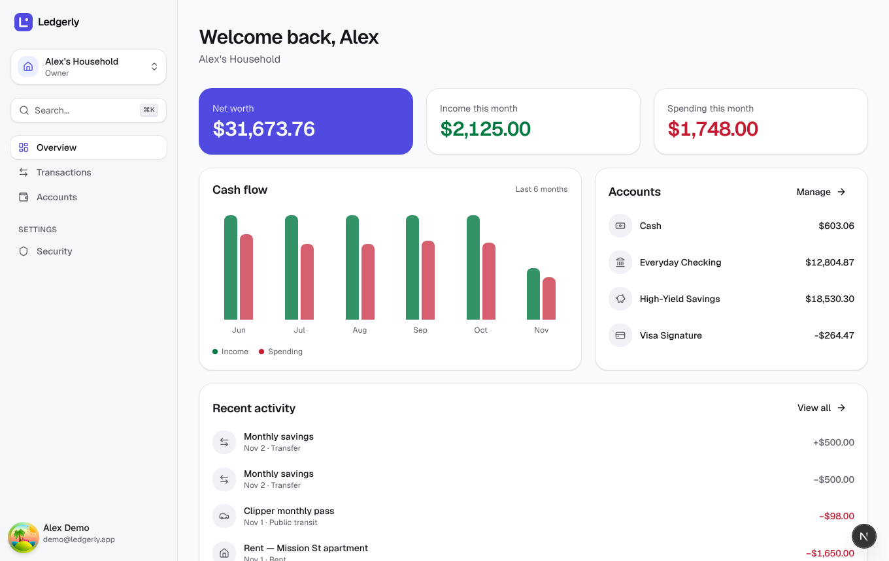
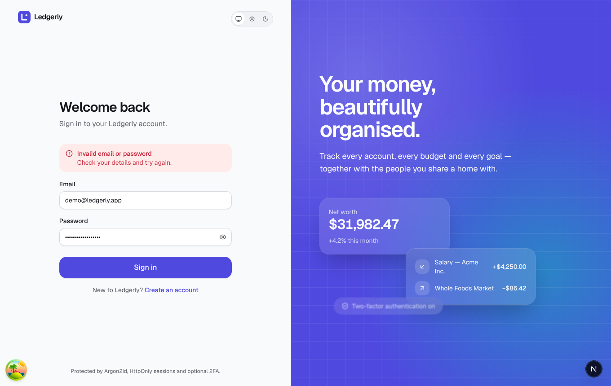
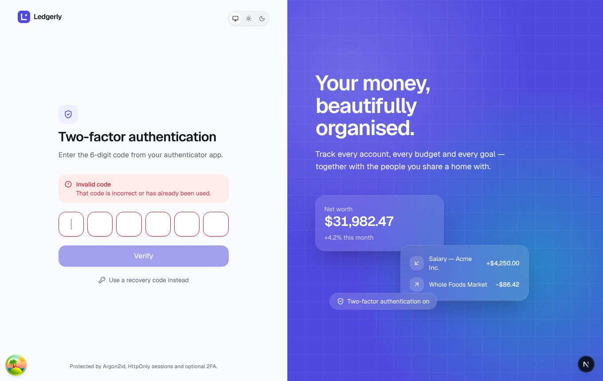
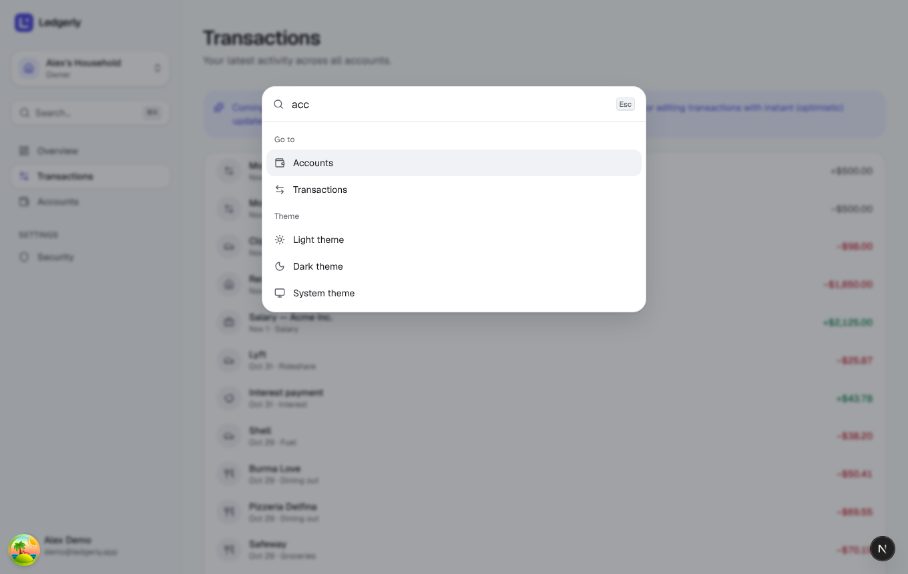
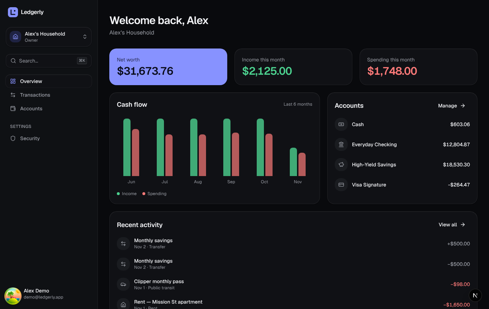
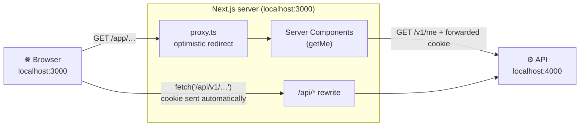
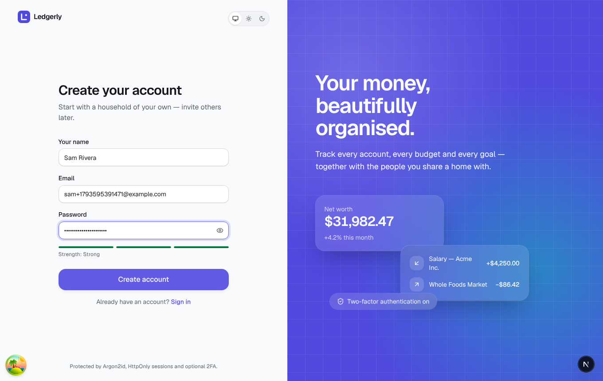
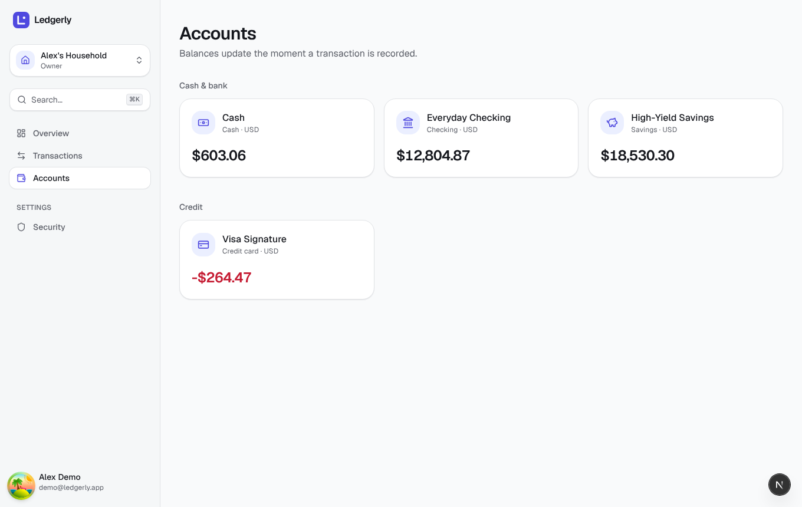
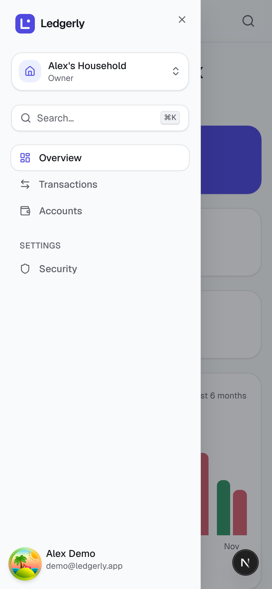

# Stage 6 — Frontend App Shell

> **Goal of this stage:** build the authenticated web app around the API. That covers sign-up, sign-in and the 2FA step; protected routes; an app layout with sidebar, household switcher and ⌘K command palette; data fetching with caching, loading and error states; and a security settings page where you can turn on 2FA with a QR code.
>
> **What you can see at the end:** run `pnpm dev`, open http://localhost:3000, and sign in with **demo@ledgerly.app / correct-horse-ledger**. You land on an overview with animated balances, a six-month cash-flow preview, your accounts and recent activity. Press **⌘K** (Ctrl+K) anywhere.



---

## Table of contents

1. [What we built](#1-what-we-built)
2. [How the browser, Next.js and the API fit together](#2-how-the-browser-nextjs-and-the-api-fit-together)
3. [Server Components, Client Components, and handing data between them](#3-server-components-client-components-and-handing-data-between-them)
4. [Authentication in the frontend: four layers](#4-authentication-in-the-frontend-four-layers)
5. [Routing: the URL is the source of truth](#5-routing-the-url-is-the-source-of-truth)
6. [Data fetching with TanStack Query](#6-data-fetching-with-tanstack-query)
7. [Forms that feel effortless](#7-forms-that-feel-effortless)
8. [The app shell: navigation, switcher, command palette](#8-the-app-shell-navigation-switcher-command-palette)
9. [Motion in a real app](#9-motion-in-a-real-app)
10. [Frontend security details](#10-frontend-security-details)
11. [A bug found by reading framework source code](#11-a-bug-found-by-reading-framework-source-code)
12. [Testing](#12-testing)
13. [Run it yourself](#13-run-it-yourself)
14. [Exercises](#14-exercises)
15. [Glossary](#15-glossary)
16. [What's next](#16-whats-next)

---

## 1. What we built

| Screen                                   | Highlights                                                                                                         |
| ---------------------------------------- | ------------------------------------------------------------------------------------------------------------------ |
| **Sign in** `/login`                     | Shared Zod validation, inline API errors with a headline, show/hide password, return to the page you wanted        |
| **Sign up** `/signup`                    | Live password-strength meter, server errors placed on the right field, lands in your new household                 |
| **2FA step** `/login/verify`             | Six-box code input (one real `<input>`), auto-submit, shake on a wrong code, recovery-code fallback                |
| **Overview** `/app/{household}`          | Net worth + this month's income and spending (counting animations), cash-flow bars, accounts, recent activity      |
| **Accounts** `/app/{household}/accounts` | Grouped cards with live balances                                                                                   |
| **Transactions**                         | The latest 25, with a preview of what Stage 7 adds                                                                 |
| **Security** `/app/settings/security`    | 2FA setup with a QR code drawn in the browser, recovery codes (copy/download), password change, device list        |
| **Everywhere**                           | Sidebar with gliding active indicator, household switcher, user menu, mobile slide-in menu, ⌘K palette, light/dark |

|                                                           |                                                             |
| --------------------------------------------------------- | ----------------------------------------------------------- |
|        |         |
|  |  |

---

## 2. How the browser, Next.js and the API fit together

### 2.1 The problem

The web app runs on `localhost:3000` and the API on `localhost:4000`. In production they'd be something like `app.ledgerly.app` and `api.ledgerly.app`. The session cookie from Stage 5 is set _by the API_. How does the browser, and the Next.js server rendering pages, use it?

### 2.2 Our answer: a same-origin proxy

```ts
// apps/web/next.config.ts
async rewrites() {
  return [{ source: "/api/:path*", destination: `${API_URL}/:path*` }];
}
```



The browser never calls `localhost:4000` directly. It calls `/api/...` on the web app's own origin, and Next.js forwards the request. That buys us:

| Benefit                                 | Why it matters                                                                                                                            |
| --------------------------------------- | ----------------------------------------------------------------------------------------------------------------------------------------- |
| **First-party cookie**                  | The session cookie belongs to the web app's own domain, so Next.js Server Components can read it and render pages _with_ the user's data. |
| **No CORS preflights**                  | Same-origin requests skip the extra `OPTIONS` round trip that cross-origin `fetch` with cookies needs, so every mutation is faster.       |
| **Third-party-cookie proof**            | Browsers are steadily restricting cookies in cross-site contexts. A same-origin cookie is unaffected.                                     |
| **The API is an implementation detail** | We can move, split or version it without changing a line of browser code.                                                                 |

**Alternatives:**

- _Calling the API cross-origin directly_ works, with CORS and `credentials: "include"`, but server-rendered pages can't see a cookie that belongs to another domain.
- _A full Backend-for-Frontend_, where every call goes through hand-written Next.js route handlers, gives more control (reshaping responses, hiding fields), at the cost of writing and maintaining a second API.
- _Server Actions_ calling the API are great for form posts, but we want one data layer that serves both reads and writes.

The rewrite gives us the main benefits of a BFF with almost no code.

---

## 3. Server Components, Client Components, and handing data between them

Next.js's App Router has two kinds of components:

| Server Components (default)             | Client Components (`"use client"`)                        |
| --------------------------------------- | --------------------------------------------------------- |
| Run only on the server; send HTML       | Also run in the browser; can use state, effects, events   |
| Can `await` data directly, read cookies | Needed for anything interactive: forms, menus, animations |
| Ship **zero** JavaScript for themselves | Their code is sent to the browser                         |

Our split:

- **Layouts and route pages are Server Components.** `app/app/layout.tsx` fetches the current user on the server, and the household layout checks membership and returns a real 404 for households you don't belong to.
- **Everything interactive is a Client Component:** forms, the shell, the overview widgets.

### 3.1 Prefetch on the server, hydrate on the client

```tsx
// app/app/layout.tsx (Server Component)
const me = await getMe(); // server → API, forwarding the cookie
const queryClient = new QueryClient();
queryClient.setQueryData(queryKeys.me, me); // put it in a cache…
return (
  <HydrationBoundary state={dehydrate(queryClient)}>
    {" "}
    {/* …serialise the cache into the HTML… */}
    <AppShell>{children}</AppShell> {/* …and the browser's useMe() finds it instantly */}
  </HydrationBoundary>
);
```

The sidebar, household switcher and greeting need the user. Without prefetching, the browser would render, _then_ request `/v1/me`, show a skeleton, then fill in. With it, **the first HTML already contains the user**, so there's no spinner and no second request. This "prefetch + hydrate" pattern is the recommended way to combine TanStack Query with the App Router.

### 3.2 `cache()`: one request, many callers

Both the app layout and the household layout need `getMe()`. React's `cache()` de-duplicates within one server render:

```ts
export const getMe = cache(() => serverApi("/v1/me", MeSchema));
```

Two calls, one network request. Each component simply asks for what it needs, without having to pass data down through several layers or calling the API twice.

---

## 4. Authentication in the frontend: four layers

The frontend **never decides** who you are. Only the API can validate a session. But four layers cooperate so the experience is smooth and nothing leaks:

| Layer                      | Where                   | What it does                                                                              | Is it security?  |
| -------------------------- | ----------------------- | ----------------------------------------------------------------------------------------- | :--------------: |
| 1. **Optimistic redirect** | `proxy.ts`              | No session cookie at all → redirect `/app/*` to `/login?next=…` before rendering anything |    ❌ UX only    |
| 2. **Server check**        | `getMe()` in the layout | Calls the API; a 401 (expired or forged cookie) → `redirect("/login")`                    |  ✅ via the API  |
| 3. **Client 401 handling** | TanStack `QueryCache`   | Any query getting 401 later (session revoked on another device) → back to sign-in         |  ✅ via the API  |
| 4. **The API itself**      | Stage 4–5               | Every request authenticated and authorized                                                | ✅ the real gate |

### 4.1 `proxy.ts`: optimistic, not authoritative

Next.js 16 renamed "middleware" to **Proxy**. It runs before every matched request:

```ts
const hasSession = SESSION_COOKIE_NAMES.some((name) => request.cookies.has(name));
if (pathname.startsWith("/app") && !hasSession) return NextResponse.redirect(loginUrl);
```

It only checks that a cookie **exists**. A forged cookie passes this check, then fails at layer 2. That's fine and intentional. The Next.js docs explicitly describe Proxy as the place for _optimistic_ checks, not full session validation: it runs on every request, so it must be fast, and calling the database there would slow every page.

### 4.2 Remembering where you were going, safely

Visiting `/app/settings/security` while signed out redirects to `/login?next=%2Fapp%2Fsettings%2Fsecurity`, and after signing in you land exactly there. The browser test checks this. But a `next` parameter is a classic **open redirect** hole: `/login?next=https://evil.example` would bounce a freshly-signed-in user to a phishing site. So:

```ts
export function safeNext(next) {
  return next && next.startsWith("/") && !next.startsWith("//") ? next : "/app";
}
```

Only same-site paths are allowed. `//evil.example` is rejected too, because browsers treat a leading `//` as "same protocol, _other host_". A unit test covers all four cases.

### 4.3 Signing out means _really_ signing out

```ts
onSettled: () => window.location.replace("/login"),
```

After the API deletes the session, we do a **full page load**, not a client-side navigation. That throws away every byte of JavaScript memory: cached API responses, form drafts, query state. On a shared computer, the next person can't press "Back" and see your finances from memory. Building it this way also exposed a subtle bug, described in §6.4.

---

## 5. Routing: the URL is the source of truth

```
app/
├── (auth)/               ← route GROUP: shares a layout, not part of the URL
│   ├── layout.tsx        ← split screen: form + animated showcase panel
│   ├── login/page.tsx            → /login
│   ├── login/verify/page.tsx     → /login/verify
│   └── signup/page.tsx           → /signup
├── app/
│   ├── layout.tsx        ← server: getMe() + hydrate + <AppShell>
│   ├── page.tsx          ← /app → redirect to your first household
│   ├── error.tsx         ← error boundary for the whole app area
│   ├── not-found.tsx
│   ├── [householdId]/
│   │   ├── layout.tsx    ← server: are you a member? else 404
│   │   ├── loading.tsx   ← instant skeleton while the page loads
│   │   ├── page.tsx                  → /app/{id}            (Overview)
│   │   ├── accounts/page.tsx         → /app/{id}/accounts
│   │   └── transactions/page.tsx     → /app/{id}/transactions
│   └── settings/security/page.tsx    → /app/settings/security
└── proxy.ts (in src/)    ← optimistic redirects
```

**The household lives in the URL** (`/app/01a1…/accounts`) rather than in hidden app state. The URL is the one piece of state that survives reloads, bookmarks, new tabs and sharing a link with your partner. The back button also just works. The household switcher keeps you in the same section: switching from _Accounts_ in one household lands you on _Accounts_ in the other.

**Special files** do a lot of work for free:

- `loading.tsx` wraps the page in a `<Suspense>` boundary. The skeleton appears **instantly** on navigation while the server works, and it's shaped like the real page so nothing jumps.
- `error.tsx` is an **error boundary**. If a page crashes while rendering, only the content area is replaced with "Something went wrong · Try again". The sidebar keeps working, so the user is never stranded on a blank screen.
- `not-found.tsx` shows a proper 404 for a household you don't belong to, using the _same_ message as for one that doesn't exist (the Stage 4 principle: don't reveal what exists).

The build output confirms how each route renders: auth and app pages are dynamic (`ƒ`, they depend on cookies), while `/signup` and `/design` are pre-rendered static HTML (`○`, served instantly from a CDN in production).

---

## 6. Data fetching with TanStack Query

### 6.1 Server state is different from UI state

"Is the menu open?" is **UI state**: it lives in the browser and only the browser changes it. "What are my account balances?" is **server state**: it lives on the server, other people (your partner, a background import) can change it, and our copy can go stale. Server state needs caching, de-duplication, background refreshes, retries and invalidation after changes. **TanStack Query** is the industry's standard library for exactly this; writing it all by hand with `useEffect` + `useState` is where most React data bugs come from.

### 6.2 One typed hook per endpoint

```ts
// lib/query/hooks.ts
export function useAccounts(householdId: string) {
  return useQuery({
    queryKey: queryKeys.accounts(householdId),
    queryFn: async ({ signal }) =>
      (
        await api(`/v1/households/${householdId}/accounts`, {
          schema: z.object({ data: z.array(AccountSchema) }), // the SAME schema the API uses
          signal, // cancelled if the component unmounts
        })
      ).data,
  });
}
```

Components just write `const { data: accounts } = useAccounts(householdId)`. They never call `fetch` or handle loading flags by hand. Three details matter here:

- **Responses are validated** with the shared Zod schemas. If the API and web app ever disagree (say, during a deploy), we get a clear error instead of `undefined` creeping through the UI.
- **`signal`** cancels in-flight requests when you navigate away, so there are no "set state on unmounted component" bugs and no wasted bandwidth.
- **Query keys are hierarchical**: `["households", id, "accounts"]`. Invalidating `["households", id]` refreshes everything for that household at once, which Stage 7 will use after adding a transaction.

### 6.3 App-wide policies in one place

```ts
// lib/query/client.ts
staleTime: 30_000,                       // fresh for 30 s: navigating back and forth is instant
retry: (count, error) => !(isApiError(error) && error.status < 500) && count < 2,
queryCache: new QueryCache({ onError: (e) => { if (e.status === 401) redirectToLogin(); } }),
mutationCache: new MutationCache({ onError: (e, …, mutation) => { if (!mutation.meta?.handlesErrors) toast.error(errorMessage(e)); } }),
```

- **Never retry 4xx.** A 404 or 403 won't fix itself, and retrying just makes the user wait three times longer for the error. Network failures and 5xx get two retries with backoff.
- **Errors surface by default.** Every failed mutation shows a toast _unless_ the component handles the error itself. Forms opt out with `meta: { handlesErrors: true }`, because they show errors inline. Nothing fails silently.
- **`useState(createQueryClient)`** in `providers.tsx` means each browser tab gets its own cache. A module-level client would be _shared between users on the server_, a real and serious data-leak mistake in server-rendered React apps.

### 6.4 A subtle bug while signing out

My first sign-out cleared the query cache, then navigated to `/login`. The browser test showed it landing on `/login?next=%2Fapp…` instead. That's wrong: you signed out on purpose, so there's nowhere to "return" to. Here's what happened:

1. Clearing the cache made the still-mounted components refetch.
2. Those requests hit the API with the now-deleted session and got 401.
3. The global 401 handler (layer 3 in §4) concluded "session expired!" and redirected with `next`.

The fix is a `signingOut` flag that the 401 handler respects, plus the full page reload from §4.3, which doesn't need to clear anything because the reload discards it all. **Global error handlers are powerful, but they need to know about intentional transitions.**

---

## 7. Forms that feel effortless

### 7.1 React Hook Form + the shared schemas

```tsx
const form = useForm<z.input<typeof SignupSchema>, unknown, SignupInput>({
  resolver: zodResolver(SignupSchema), // the SAME schema the API validates with
  mode: "onTouched",
});
```

- **Identical rules on both sides.** The 12-character minimum, email format and name length all come from `@ledgerly/shared`. The user gets instant feedback, and the server rejects exactly the same things. A unit test checks that submitting an empty form shows errors _without_ sending a request.
- **`mode: "onTouched"`** validates a field when you _leave_ it, then live as you fix it. That's the Stage 2 rule: never shout "invalid email" while someone is still typing.
- **Uncontrolled inputs.** React Hook Form doesn't re-render the whole form on every keystroke, which matters on large forms (Stage 7). We use `useWatch` to subscribe to _one_ field (the password, for the strength meter) instead of `watch()`. The linter flagged `watch()` because it defeats React's compiler optimisations.

### 7.2 Server errors land where they belong

Some rules only the server can check: "email already registered", "this password appears in leaked lists". The API returns them as Problem Details with field paths (Stage 4), and the form maps them back:

```ts
const message = error.code === "email_taken" ? error.detail : error.fieldError("password");
if (message) form.setError("password", { message }, { shouldFocus: true });
```

The browser test enters `password1234` and sees _"This password appears in lists of leaked passwords"_ under the password field, with focus moved there. Errors that aren't about one field ("Invalid email or password") appear in a `FormAlert` above the form, showing the problem's **title as a headline** and its detail below. My first version showed only the detail, "Check your details and try again.", which on its own explains nothing. The screenshot review caught that.

### 7.3 Small details that add up

- **`autoComplete` on every field** (`email`, `current-password`, `new-password`, `one-time-code`). Password managers then fill and _generate_ passwords correctly, which is one of the biggest security wins a form can offer, at no cost.
- **Show/hide password.** Seeing what you typed reduces typos and lockouts, and NIST recommends offering it.
- **A password-strength meter** based on length and variety, the factors that actually matter (Stage 5 §3.4). It's guidance, not a gate: the server decides.
- **The one-time-code input** _looks_ like six boxes but is **one real `<input>`**. That keeps pasting a whole code, OS/SMS autofill (`autocomplete="one-time-code"`), the numeric keypad on phones and a single label for screen readers all working. Six separate inputs break most of those. It submits automatically when the sixth digit arrives and shakes gently on a wrong code.



---

## 8. The app shell: navigation, switcher, command palette

### 8.1 One sidebar, two presentations

On large screens the sidebar is fixed. On phones it lives in a **sheet** that slides in from the left (a Radix Dialog with our own slide animation). Both render the _same_ `SidebarContents` component, so mobile and desktop navigation can never drift apart.

| Desktop                                     | Mobile menu                                       |
| ------------------------------------------- | ------------------------------------------------- |
|  |  |

### 8.2 Accessible navigation

- **`aria-current="page"`** marks the active link. Screen readers announce "current page"; colour alone wouldn't.
- **A "Skip to content" link** is the first thing keyboard users reach. One Tab, then Enter, and they skip the whole sidebar (it's WCAG 2.4.1).
- **Menus are Radix primitives** (household switcher, user menu): arrow keys, type-ahead, Esc and focus return work exactly as the WAI-ARIA menu pattern specifies.
- **The active indicator glides** between links using the same `layoutId` shared-layout animation as Stage 2's theme toggle.

### 8.3 The ⌘K command palette

Linear, Vercel, GitHub, Slack and Raycast all have one, because power users navigate faster with a keyboard than a mouse. It's built on **cmdk**, the library behind several of those, inside a Radix Dialog. Press ⌘K (or Ctrl+K), type "acc", press Enter, and you're on Accounts; the browser test does exactly this. It currently offers navigation, household switching, theme and sign-out. Stage 7 adds "New transaction" and search.

---

## 9. Motion in a real app

Stage 2 defined the motion system. Here's how it's applied with restraint:

| Where                  | Motion                                                     | Purpose (Stage 2 §6.1)              |
| ---------------------- | ---------------------------------------------------------- | ----------------------------------- |
| Every page             | 8 px rise + fade, 300 ms ease-out                          | Continuity between pages            |
| Overview cards & lists | Staggered entrance (60 ms apart)                           | Guides the eye top-to-bottom        |
| Balances               | Count up with `AnimatedMoney` (MotionValue, no re-renders) | Causality: "this is your number"    |
| Cash-flow bars         | Grow with a spring, slightly staggered                     | Draws attention to the trend        |
| Sidebar                | Active pill glides between links                           | Orientation                         |
| Error banner           | Height grows smoothly instead of pushing content abruptly  | No layout jolt                      |
| Wrong 2FA code         | A short horizontal shake                                   | Feedback, the universal "no"        |
| 2FA setup steps        | Cross-fade between scan → codes → done                     | Continuity                          |
| Auth showcase panel    | Gentle floating cards                                      | Brand personality (decorative only) |

And just as important, what does **not** animate: typing, table rows on scroll and anything you'd see hundreds of times a day. Everything respects "reduce motion" via `<MotionConfig reducedMotion="user">`.

---

## 10. Frontend security details

- **No tokens in JavaScript, ever.** The session is an `HttpOnly` cookie (Stage 5). The web app's code never sees it, which is why the API client uses `credentials: "same-origin"` and nothing else.
- **The 2FA QR code is drawn in the browser** by the `qrcode` package. Many tutorials send the `otpauth://` URI to an online QR service, which hands your 2FA secret to a third party. We render it to SVG locally, and the secret never leaves the conversation between you and our API.
- **That SVG is inserted with `dangerouslySetInnerHTML`**, the one place in the app we use it. It's safe here because the markup is generated by a library from a URI _our own API_ produced. It never contains user-typed text. The rule isn't "never use it"; it's "never with untrusted input, and justify it when you do".
- **Recovery codes are shown once**, with Copy and Download (generated locally as a `Blob`, with no upload), and the user must confirm they've saved them.
- **Open redirects blocked** (§4.2), and **sign-out wipes memory** (§4.3).
- **Server-only code stays server-only.** `lib/api/server.ts` and `lib/api/me.ts` import `"server-only"`, so the build fails if anything tries to bundle them for the browser.

---

## 11. A bug found by reading framework source code

Stage 5 rate-limited sign-in **per IP address**. But now every browser request reaches the API _through_ the Next.js proxy. Without care, the API would see **every user as the same IP** (the Next.js server's), and one user's failed sign-ins would lock out everybody.

The standard fix is the `X-Forwarded-For` header, where proxies record the original client address, combined with the API trusting its proxy. To get this right I read the relevant Next.js source (`next/dist/server/base-server.js`):

```js
req.headers["x-forwarded-for"] ??= originalRequest.socket.remoteAddress;
```

Note the `??=`: Next.js sets the header **only if it isn't already present**. If a client sends its own `X-Forwarded-For: 1.2.3.4`, Next.js passes it through unchanged. An API configured to "trust the proxy" blindly would believe whatever the client claims, and an attacker could rotate fake IPs to dodge every rate limit.

The fix is to **trust a specific number of proxy hops**, never the header as a whole. The API's `TRUST_PROXY` now accepts a hop count:

| Setting          | Meaning                                                                                                           |
| ---------------- | ----------------------------------------------------------------------------------------------------------------- |
| `false`          | No proxy: the TCP connection's address is the client                                                              |
| `1` (local dev)  | Trust the nearest proxy (Next.js) and take the address it reports, ignoring anything a client forged further left |
| `2` (production) | Load balancer + Next.js. The load balancer _appends_ the real address, and we take exactly that entry             |

Three new API tests check it: with `TRUST_PROXY=1`, `X-Forwarded-For: 203.0.113.7` is recorded as the client; `6.6.6.6, 203.0.113.7` still records `203.0.113.7` (the forged `6.6.6.6` is ignored); and with `false` the header is ignored entirely.

**Lesson:** when security depends on how a framework behaves, _read its source_ or test it. Assumptions about headers are behind a whole class of real-world bypasses.

---

## 12. Testing

**Unit and component tests (web: 53).** In addition to Stage 2's design-system tests, there are new tests for:

- **The API client:** it calls `/api` with same-origin credentials; Problem Details become a typed `ApiError` with field errors; responses are schema-validated; 500s never show internal details.
- **`safeNext`:** open-redirect protection, including `//evil.example`.
- **`LoginForm`:** client-side validation without network calls; the API error is shown with its headline; the 2FA path keeps the destination.
- **`OtpInput`:** one labelled input with the right hints; non-digits are stripped; auto-complete after six digits; paste works.

**API tests (now 80)** include the three proxy-trust tests from §11.

**End-to-end, in a real browser.** I drove the running app with Playwright through every flow below. All passed with **zero console errors**, and the screenshots in this document come from those runs:

1. `/app/settings/security` while signed out → `/login?next=…`
2. Wrong password → "Invalid email or password" alert
3. Correct password → back on `/app/settings/security`
4. Overview renders with the user's name and data
5. Accounts and Transactions pages render
6. ⌘K → "acc" → Enter → Accounts
7. Set up 2FA: QR code → real TOTP code → 10 recovery codes → status "On"
8. Sign out → clean `/login` → sign in → 2FA step → wrong code shows an error → correct code → overview
9. Dark mode overview
10. Mobile (390 px): no horizontal overflow; menu sheet opens
11. Sign up: leaked password rejected on the field → strong password → lands in the new household with the empty states showing

Stage 13 turns these flows into a permanent Playwright suite that runs in CI.

---

## 13. Run it yourself

The API's `.env` has a new recommended setting (`TRUST_PROXY=1`). Update yours if you made it before this stage:

```bash
sed -i.bak 's/^TRUST_PROXY=.*/TRUST_PROXY=1/' apps/api/.env
```

Then start everything (Postgres must be running: `pnpm db:up`):

```bash
pnpm dev
```

Open http://localhost:3000 → **Sign in** → `demo@ledgerly.app` / `correct-horse-ledger`. Things to try:

- Press **⌘K** / **Ctrl+K**, type a few letters, and press Enter.
- Narrow the window below 1024 px to get the mobile layout, then open the menu.
- Go to **Security** → _Set up two-factor_, and scan the QR code with any authenticator app on your phone.
- Sign out, then sign in again and use the 2FA step. Try a wrong code first.
- Open **TanStack Query Devtools** (the small flower icon, top-right, development only) to watch the cache: keys, freshness and refetches as you navigate.

Run every check:

```bash
pnpm check
```

---

## 14. Exercises

1. **Watch the cache.** Open the Query Devtools, go Overview → Accounts → Overview. Which queries refetch, and which are served from the cache? Change `staleTime` to `0` in `lib/query/client.ts` and compare.
2. **See hydration at work.** Comment out the `<HydrationBoundary>` in `app/app/layout.tsx` and reload with the network throttled (DevTools → Network → Slow 4G). What appears empty at first?
3. **Try an open redirect.** Visit `/login?next=https://example.com`, sign in, and see where you land. Then find `safeNext` and explain each condition.
4. **Break the error boundary on purpose.** Throw an error inside `Overview`. What does the user see? Does the sidebar still work?
5. **Add a command.** Add a "Go to design system" item to the command palette that opens `/design`.
6. **Keyboard only.** Unplug your mouse (figuratively). Can you sign in, switch household, open the user menu, change theme and sign out with just the keyboard? Note anything awkward.
7. **Spoof an IP.** With the API running and `TRUST_PROXY=1`, send `curl -H "x-forwarded-for: 6.6.6.6"` to `/api/v1/auth/login` with wrong credentials 11 times. Then send the same with a _different_ fake IP. Does it get through? Why or why not? (§11)
8. **Lighthouse.** In Chrome DevTools → Lighthouse, run an audit of `/login`. Read the Accessibility and Best Practices findings.

---

## 15. Glossary

| Term                              | Meaning                                                                                              |
| --------------------------------- | ---------------------------------------------------------------------------------------------------- |
| **Same-origin proxy (rewrite)**   | Forwarding `/api/*` on the web app's own origin to the API server.                                   |
| **BFF (Backend-for-Frontend)**    | A server layer dedicated to one front end, shaping data and handling auth for it.                    |
| **Server / Client Component**     | React components that run only on the server vs. also in the browser.                                |
| **Hydration**                     | The browser "taking over" server-rendered HTML and making it interactive, reusing data sent with it. |
| **Dehydrate / HydrationBoundary** | Serialising a server-side query cache into the page so the client cache starts warm.                 |
| **Route group**                   | A folder in parentheses (`(auth)`) that shares a layout without affecting the URL.                   |
| **Error boundary**                | A component that catches render errors in its children and shows a fallback.                         |
| **Suspense / loading.tsx**        | Showing a fallback (skeleton) instantly while slower content is prepared.                            |
| **Server state**                  | Data owned by the server that the UI caches (vs UI state, owned by the browser).                     |
| **Query key / invalidation**      | The cache address of a piece of server data / marking it stale so it refetches.                      |
| **Open redirect**                 | A flaw where a URL parameter can send users to an arbitrary external site.                           |
| **Optimistic check**              | A cheap, non-authoritative check (cookie exists) used for UX, with the real check elsewhere.         |
| **X-Forwarded-For**               | A header where proxies record the original client IP; only trustworthy for known proxy hops.         |
| **Command palette**               | A keyboard-launched search box for every action in an app.                                           |

---

## 16. What's next

**Stage 7: Transactions.** This is the heart of the product. We'll build a fast, keyboard-friendly transactions table with infinite scrolling (keyset cursors from Stage 4) and virtualisation for thousands of rows; search and filters kept in the URL; a polished add/edit sheet with category pickers and amount parsing; **optimistic updates**, where your change appears instantly and rolls back with a toast if the server rejects it, using client-generated UUID v7 IDs and idempotency keys; bulk actions; and ⌘K commands like "New transaction".
