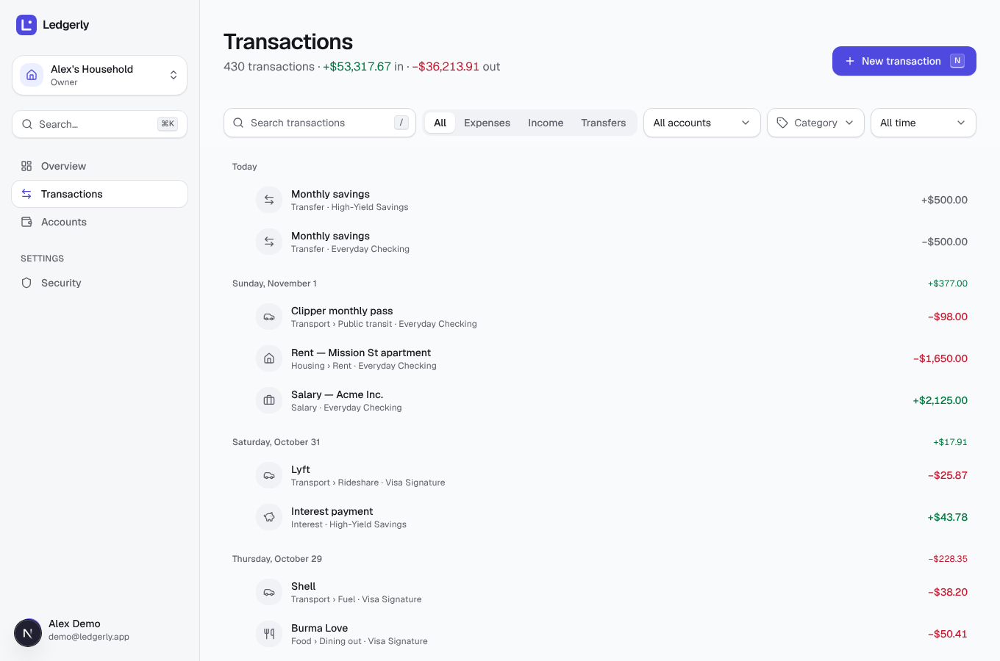
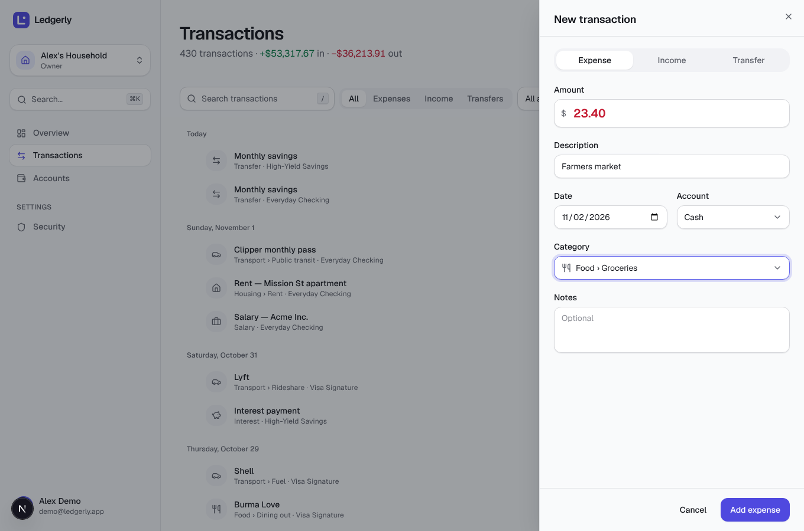
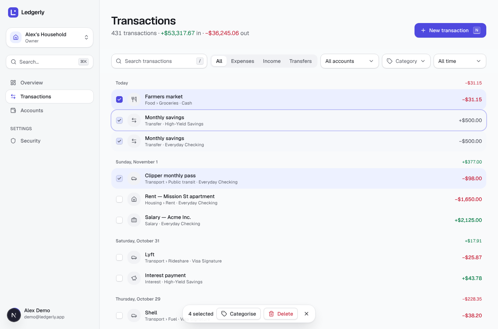
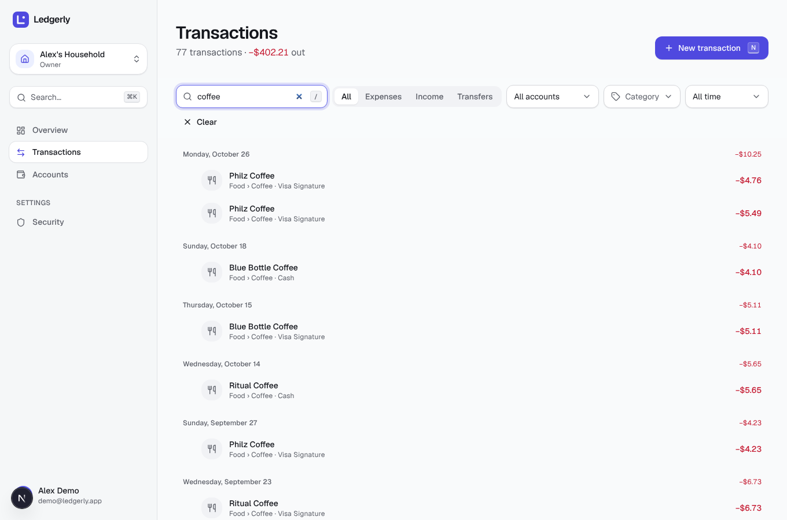
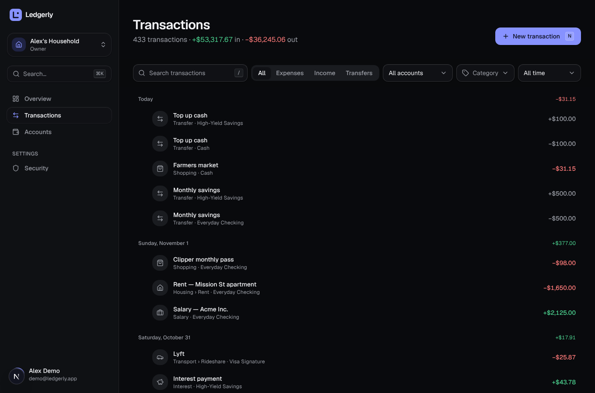
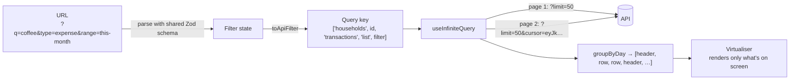
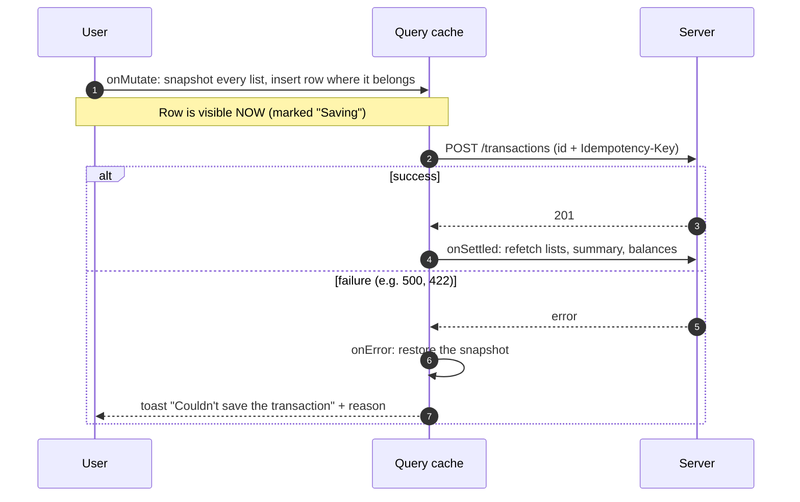

# Stage 7 — Transactions

> **Goal of this stage:** build the screen people will use every day, the transactions list, to the standard of the best apps. That means instant scrolling through any amount of history, search and filters you can bookmark, adding and editing that feels instantaneous, delete with undo, keyboard shortcuts for everything, and bulk actions.
>
> **What you can see at the end:** sign in and open **Transactions**. Scroll and it keeps loading. Type `/` to search, `N` to add, `J`/`K` to move, `Enter` to edit, `X` to select. Add an expense and it appears _before the server has even answered_.



---

## Table of contents

1. [What we built](#1-what-we-built)
2. [How the list gets its data](#2-how-the-list-gets-its-data)
3. [Virtualisation: 10,000 rows, 24 in the DOM](#3-virtualisation-thousands-of-rows-24-in-the-dom)
4. [Filters that live in the URL](#4-filters-that-live-in-the-url)
5. [Optimistic updates: the change appears before the server answers](#5-optimistic-updates-the-change-appears-before-the-server-answers)
6. [Delete with Undo (and when to ask "Are you sure?" instead)](#6-delete-with-undo-and-when-to-ask-are-you-sure-instead)
7. [The add/edit sheet](#7-the-addedit-sheet)
8. [Keyboard-first design](#8-keyboard-first-design)
9. [Bulk actions and the summary endpoint](#9-bulk-actions-and-the-summary-endpoint)
10. [Bugs and lessons from this stage](#10-bugs-and-lessons-from-this-stage)
11. [Testing](#11-testing)
12. [Performance and scalability](#12-performance-and-scalability)
13. [Run it yourself](#13-run-it-yourself)
14. [Exercises](#14-exercises)
15. [Glossary](#15-glossary)
16. [What's next](#16-whats-next)

---

## 1. What we built

| Feature                         | Detail                                                                                                   |
| ------------------------------- | -------------------------------------------------------------------------------------------------------- |
| **Infinite, virtualised list**  | Grouped by day with a daily net; loads 50 at a time as you scroll; only on-screen rows exist in the DOM  |
| **Summary line**                | "430 transactions · +$53,317.67 in · −$36,213.91 out", always for exactly the current filters            |
| **Search & filters in the URL** | Search (debounced), type, account, category (parent includes children), date presets; bookmarkable       |
| **Add / edit sheet**            | Expense / income / transfer, currency-aware amount, category picker, native date picker, notes           |
| **Optimistic create & edit**    | The row appears or updates instantly, shows "Saving", and rolls back with a toast if the server refuses  |
| **Delete with Undo**            | The row vanishes and you get 5 seconds to undo before anything is sent                                   |
| **Keyboard shortcuts**          | `N` new · `/` search · `J`/`K` or arrows move · `Enter`/`E` edit · `X` select · `⌫` delete · `Esc` clear |
| **Multi-select & bulk actions** | Click, Shift+click ranges; bulk categorise (skips transfers) and bulk delete (confirmed), both atomic    |
| **⌘K "New transaction"**        | From anywhere in the app                                                                                 |

|                                                      |                                               |
| ---------------------------------------------------- | --------------------------------------------- |
|  |  |
|       |  |

**API additions** (in the same spirit as Stage 4):

| Endpoint                                 | Purpose                                                                     |
| ---------------------------------------- | --------------------------------------------------------------------------- |
| `POST …/transactions` with optional `id` | The client may choose the new row's UUID (§5.2)                             |
| `GET …/transactions/summary?<filters>`   | Count, income and spending for the same filters as the list                 |
| `POST …/transactions/bulk`               | `{ action: "delete" \| "categorize", ids: [...] }`, all-or-nothing, max 500 |

---

## 2. How the list gets its data



`useInfiniteQuery` from TanStack Query is built for exactly this pattern. Each page carries the `nextCursor` from Stage 4's keyset pagination, and `getNextPageParam: (last) => last.nextCursor` tells it how to fetch the next page. A `null` cursor means "that's everything".

**Different filters are different cache entries.** The filter is part of the query key, so switching from "All" to "Expenses" and back is instant the second time, because it's cached. Meanwhile `placeholderData: (previous) => previous` keeps the previous results on screen, slightly dimmed, while new ones load. Search results update without the list flashing to a skeleton on every keystroke.

---

## 3. Virtualisation: thousands of rows, 24 in the DOM

### 3.1 The problem

Every row is about 15 DOM elements (icon, text, amount, checkbox…). A few years of history means thousands of rows, so tens of thousands of elements. The browser has to lay out, style and keep all of them in memory. Scrolling starts to stutter, and on phones the tab can crash.

### 3.2 The solution

**Virtualisation** (also called "windowing") renders only the rows currently visible, plus a few above and below (the _overscan_). Everything else is empty space of exactly the right height, so the scrollbar and scroll position behave normally.

Measured in this stage's browser test, after scrolling to the end of the demo data:

| Loaded transactions | List height (px) | Rows actually in the DOM |
| ------------------: | ---------------: | -----------------------: |
|                 430 |           35,490 |                   **24** |

With 43,000 transactions, there would _still_ be about 24 rows in the DOM.

### 3.3 How it's built

```ts
const items = groupByDay(rows).flatMap((group) => [
  { kind: "header", key: `h-${group.date}`, group }, // "Sunday, November 1   +$377.00"
  ...group.rows.map((row) => ({ kind: "row", key: row.id, row })),
]);

const virtualizer = useWindowVirtualizer({
  count: items.length,
  estimateSize: (i) => (items[i].kind === "header" ? 44 : 60),
  overscan: 10,
  scrollMargin, // the list starts below the page header and filters
  getItemKey: (i) => items[i].key, // stable keys → no re-measuring when rows are inserted
});
```

- **One flat list of mixed items** (date headers and rows). That's the simplest way to get group headers into a virtual list.
- **`useWindowVirtualizer`** follows the _page's_ scroll, so the page header and filters scroll naturally and nothing is trapped in an inner scroll box. That matters especially on phones.
- **Measured heights.** `ref={virtualizer.measureElement}` measures each rendered row, so items can differ in height (long descriptions, different screen widths) without overlapping.
- **Infinite scroll is a side effect of virtualisation.** When the last _rendered_ item is within 15 of the end, `fetchNextPage()` runs. No scroll listeners and no "intersection observer" juggling.

**Honest trade-offs:** rows that aren't rendered can't be found with the browser's Ctrl+F (our search box covers that), and screen readers only see the rendered window. That's why the list has an accessible label, every row is a real button with a meaningful name, and keyboard navigation (§8) scrolls the active row into view.

---

## 4. Filters that live in the URL

```
/app/01a1…/transactions?q=coffee&type=expense&range=this-month
```

Filters are stored in the **URL**, not in component state. A filtered view survives a reload, the back button works, and you can paste the link to your partner to show them "all our coffee this month". The rules:

- **The URL is parsed with the shared Zod schema** (`TransactionFilterSchema`). Anything invalid (`type=hacked`, `account=not-a-uuid`) is _dropped_, never trusted. A unit test checks this.
- **Only non-default values appear.** "All time" and "All types" aren't written, so URLs stay short and readable.
- **`router.replace`, not `push`.** Each filter change replaces the current history entry. Otherwise typing "coffee" would create six back-button steps.
- **Search is debounced.** The URL (and therefore the request) only updates 250 ms after you stop typing. Six keystrokes become one request.
- **Date presets are computed in the user's calendar** and are half-open: "This month" in March is `from=2026-03-01&to=2026-04-01`, the same `[from, to)` convention as the API. Unit tests pin down every preset, including "Last 90 days" across a year boundary.

---

## 5. Optimistic updates: the change appears before the server answers

### 5.1 The idea

A normal save goes: click → spinner → wait for the server → update the screen. On a good connection that's 100–300 ms; on a train, seconds. An **optimistic update** assumes success, since it almost always succeeds. The screen updates _immediately_, the request runs in the background, and in the rare failure case the change is undone with an explanation. This is a big part of why apps like Linear and Things feel "instant".

In the browser test, the server was **deliberately slowed by 1.5 seconds**:

> `optimistic row visible after 415 ms; server answered yet? false; shows "Saving"? true`

The 415 ms includes the sheet's closing animation and the test's own polling, so the row was on screen long before the server replied, marked "Saving". When the server confirmed, "Saving" disappeared.

### 5.2 Client-generated IDs (an API change that makes this clean)

The tricky part of optimistic _creates_ is identity. The row needs an `id` _now_, but the database normally assigns it later. The usual workaround is a temporary id, swapped for the real one when the server answers, which causes bugs: edits made in that window target the wrong id, and React re-mounts the row because its key changes.

We avoid the problem entirely. **The browser generates the id**, a UUID v7, exactly what the server would have generated (Stage 3 §4), and the API accepts an optional `id` on create. The optimistic row already has its final identity.

Is it safe to let clients choose ids? Yes, with two rules, both tested:

- **Never overwrite.** If the id already exists, anywhere in the database, the insert fails on the primary key and the API returns `409 transaction_exists`. A client can't hijack or replace an existing row.
- **Ids carry no authority.** Knowing an id gives you nothing. Every access is still checked against the household (Stage 4).

### 5.3 Retries that can't duplicate

The same id is also sent as the **`Idempotency-Key`** (Stage 4 §8). That unlocks something you normally must _not_ do with a `POST`: **automatic retries**.

```ts
retry: (count, error) => !isApiError(error) && count < 3,   // network failures only
headers: { "idempotency-key": input.id },
```

If the connection drops after the server saved the row but before the response arrived, the retry replays the stored response instead of creating a second transaction. Validation errors (`ApiError`) are never retried; they won't fix themselves.

### 5.4 The full lifecycle



Details that make it correct:

- **`matchesFilter` mirrors the server's filters.** A new _expense_ must not appear in a list filtered to _Income_, and one for March must not appear in "Last month". The optimistic code edits _every_ cached list for the household and inserts the row only where the server would include it. Unit tests cover the filter logic (including "Food" containing "Groceries" and exclusive end dates).
- **`insertSorted` respects unloaded pages.** If a new transaction dated three years ago sorts after everything currently loaded, it belongs to a page we haven't fetched yet. Appending it to the bottom would put it in the wrong place, so we leave it out until that page loads. That's a unit test too.
- **Pure functions, never mutation.** The cache helpers return new data and never modify the old, so React's change detection and the rollback snapshot both stay correct. A test asserts the input is untouched.
- **`cancelQueries` first.** If a background refetch is in flight, it could land _after_ our optimistic edit and overwrite it with stale data. Cancelling first prevents that race.
- **Reconcile afterwards.** Whatever happens, `onSettled` refetches lists, the summary, account balances and reports. The server is always the source of truth; optimism is only about _perceived_ speed.
- **Rollback is tested in a real browser:** the test makes the server return 500, and the row appears, then disappears with the toast _"Couldn't save the transaction"_.

Edits use the same pattern. If you change a transaction's date, `replaceTransaction` removes it and re-inserts it at its new position, or drops it if it no longer matches the current filter.

**Where we chose _not_ to be optimistic:** transfers create two rows across two accounts with currency rules, so we simply wait for the server and show "Transfer recorded". Optimism is for the common, low-risk path. The extra complexity isn't worth it everywhere.

---

## 6. Delete with Undo (and when to ask "Are you sure?" instead)

### 6.1 Deferred delete

Deleting one transaction:

1. The row disappears **immediately** (both halves, if it's a transfer).
2. A toast says _"Transaction deleted"_ with an **Undo** button for 5 seconds.
3. Only when those 5 seconds pass is the `DELETE` request actually sent.
4. **Undo** just restores the cache. The server never knew anything happened.

The browser test deletes the edited "Farmers market" row (count drops to 0), clicks Undo (count back to 1), waits past the 5 seconds, reloads, and the row is still there, proving no request was sent.

This is the pattern Gmail made famous with "Undo send". It's better than a confirmation dialog for frequent, low-stakes actions: dialogs interrupt the 99% of deletes you meant, and people learn to click "Yes" without reading. Undo costs nothing unless you need it.

**What if you close the tab during those 5 seconds?** A `pagehide` listener flushes pending deletes immediately, using `fetch(…, { keepalive: true })`, which lets the request complete even while the page unloads. You asked for a delete, so you get one.

### 6.2 Bulk delete asks first

Deleting 40 selected transactions shows a **confirmation dialog** instead ("Delete 40 transactions? This can't be undone."). Why the inconsistency? The _blast radius_ is different. A mistaken bulk delete is far more costly, harder to notice, and undoing it would mean re-creating 40 rows. Choosing the safety mechanism by the cost of the mistake is the actual design principle.

---

## 7. The add/edit sheet

The sheet slides in from the right (our `Sheet` gained a `side` prop), and on phones it covers the screen width.

### 7.1 Form schema vs API schema

The form has its **own** Zod schema, separate from the API's, because what people _type_ differs from what we _send_:

| Field  | In the form                           | Sent to the API                                  |
| ------ | ------------------------------------- | ------------------------------------------------ |
| Amount | `"1,234.5"` (text, as typed)          | `-123450` (signed minor units, via `parseMoney`) |
| Type   | `"expense" \| "income" \| "transfer"` | The amount's sign, or a different endpoint       |
| Notes  | `""`                                  | `null` when empty                                |

The amount is converted with Stage 2's `parseMoney`, using **the selected account's currency**, so a yen account accepts `1500` but not `15.00`, and nothing ever passes through a floating-point number. The currency symbol in the field updates when you change accounts.

### 7.2 Small decisions that add up

- **The native date picker** (`<input type="date">`) is accessible, localised, and uses the platform's own picker on phones. A custom calendar widget is a lot of code to get _less_ accessible.
- **It remembers your last account** in `localStorage`, since most people log most spending from one card. Wrapped in `try/catch`, because storage can be unavailable (private browsing), and the form must still work.
- **The category picker is a searchable combobox** (cmdk in a Radix Popover): type "groc" + Enter. Categories are grouped under their parent, filtered by kind, and switching Expense → Income clears a now-invalid category.
- **Transfers are protected.** Editing half of a transfer locks the amount, date and account (the API would reject changing them anyway, Stage 4 §9.3) and explains why in plain words.
- **It closes immediately on save.** That's the optimistic update at work: the list already shows the change.

---

## 8. Keyboard-first design

| Key                  | Action                              |
| -------------------- | ----------------------------------- |
| `N`                  | New transaction                     |
| `/`                  | Focus search                        |
| `J` / `↓`, `K` / `↑` | Move the active row                 |
| `Enter` / `E`        | Edit the active row                 |
| `X` (`Shift+X`)      | Select (a range)                    |
| `⌫` / `Delete`       | Delete the active row (with Undo)   |
| `Esc`                | Clear selection                     |
| `⌘K`                 | Command palette → "New transaction" |

These are the conventions of Gmail, Linear and GitHub, so many people already know them. The implementation details that keep them from being annoying:

- **Never while typing.** A guard checks whether focus is in an input, textarea, dialog, menu or listbox, so typing "n" in the description field doesn't open a new sheet. Getting this wrong is the #1 complaint about keyboard shortcuts on the web.
- **No modifier conflicts.** Shortcuts ignore ⌘/Ctrl/Alt combinations, so the browser's own shortcuts keep working.
- **The active row stays visible.** Moving with `J` calls `virtualizer.scrollToIndex`, which works even for rows that aren't rendered yet.
- **Shift+click selects a range**, like a file manager, anchored at the last row you clicked.
- **They're discoverable:** a hint line under the list, and a `N` badge on the "New transaction" button.

---

## 9. Bulk actions and the summary endpoint

### 9.1 Bulk actions are one atomic request

Re-categorising 40 transactions could be 40 `PATCH` requests: slow, and if request 23 fails you're left half-done. Instead there's one endpoint, run in **one database transaction**:

```http
POST /v1/households/{id}/transactions/bulk
{ "action": "categorize", "ids": ["…", "…"], "categoryId": "…" }
→ { "affected": 38, "skipped": 2 }
```

- **All or nothing.** If anything fails, nothing changes.
- **Transfers are skipped when categorising** (they can't have a category; the database CHECK from Stage 3 would refuse anyway). The response says how many were skipped, and the toast tells the user why.
- **Deleting half of a transfer deletes both**, same as the single-delete rule.
- **Other households' ids are silently skipped.** Every statement includes `household_id = …`, so a foreign id simply matches nothing. A test confirms the other household's row still exists afterwards.
- **Capped at 500 ids**, so one request can't lock large parts of the table for long.

### 9.2 One filter builder, two queries

The summary line ("430 transactions · +$53,317.67 in · −$36,213.91 out") comes from `GET …/transactions/summary`, a single aggregate query. Both the list and the summary build their `WHERE` clause with the **same function**, `filterConditions()`. They can never disagree about what "expenses in May" means, and a test checks that the summary's count and total equal the list's rows exactly.

---

## 10. Bugs and lessons from this stage

**1. A hydration error hiding in plain sight.** The Next.js dev badge showed "2 Issues". The console said: _"In HTML, `<div>` cannot be a descendant of `<p>`. This will cause a hydration error."_ Our `Page` component wrapped the description in a `<p>`, and the transactions page passed a loading `Skeleton` (a `<div>`) as the description. Browsers "fix" invalid nesting by restructuring the HTML, so the HTML the server sent no longer matched what React expected. The fix is to make the wrapper a `<div>`. **Lesson:** treat dev-overlay warnings as bugs; they become subtle production glitches.

**2. React's compiler lint caught two patterns** (it's enabled through `eslint-config-next`):

- _"Cannot create components during render"_ on `const Icon = categoryIcon(name)`. React can't tell that the returned component is stable. The fix is a small `<CategoryIcon name=…/>` component that does the lookup from a fixed module-level table.
- _"Calling setState synchronously within an effect."_ Syncing the search box from the URL inside `useEffect` causes a wasted extra render with stale text. React's recommended pattern for "reset state when a value changes" is to **compare with the previous value during render**:

  ```ts
  const [syncedQ, setSyncedQ] = useState(state.q);
  if (state.q !== syncedQ) {
    // the URL changed from outside (Clear, back button)
    setSyncedQ(state.q);
    setSearch(state.q ?? "");
  }
  ```

  The same pattern now clears the selection when filters change and opens the sheet when ⌘K sends `?new=1`.

**3. Dev overlays covering real buttons.** The browser test couldn't click _Add expense_: the Next.js issue badge was sitting on top of it, and the Query Devtools icon covered the sheet's close button. These overlays exist only in development, but they block real testing and real development work. They now sit where they don't overlap actions.

**4. Not every test failure is a bug.** One run reported two "Farmers market" rows after a single add. Checking the database showed the seed data _already contains_ real "Farmers market" grocery transactions; the app was right and the test's selector was too loose. Another failure was the sheet correctly hiding the "from" account in the "to" list. **Investigate before "fixing"**, or you'll break correct behaviour to satisfy a wrong test.

---

## 11. Testing

| Suite                   | New in Stage 7                                                                                                                                                                                                                          |
| ----------------------- | --------------------------------------------------------------------------------------------------------------------------------------------------------------------------------------------------------------------------------------- |
| **Web unit (64 total)** | Cache helpers: sorted insert, unloaded-page rule, immutability, move on date change, drop on filter mismatch; `matchesFilter` parity with the API; `groupByDay` daily nets; URL filter round-trip, invalid-value dropping, date presets |
| **API (88 total)**      | Client-chosen id is used; duplicate id → 409; summary equals the list; transfers excluded from totals; bulk categorise skips transfers; bulk delete takes both transfer halves; other households untouched; viewers get 403             |
| **Browser (11 flows)**  | Results below                                                                                                                                                                                                                           |

Results of the end-to-end run in Chromium (all passing, zero console errors):

```
1  summary: 430 transactions · +$53,317.67 in · −$36,213.91 out
2  reached end: true, total=430, rows in DOM=24, list height=35490px
3  search: ?q=coffee | rows: 12 | all match: true
4  optimistic row visible after 415 ms; server answered yet? false; shows "Saving"? true
5  edited: Farmers market Food › Groceries · Cash −$31.15
6  after delete: 0 → after undo: 1; still exists after reload (no DELETE sent): 1
7  keyboard (J J Enter) opened: Edit transaction | Monthly savings
8  4 selected (Shift+click) → Categorised 2 transactions, transfers skipped
9  transfer via the sheet → 2 rows
10 forced server 500: optimistic row appeared: 1 → after rollback: 0
11 ⌘K "New transaction" opened the sheet, URL cleaned up; mobile: no horizontal overflow
```

Stage 13 turns these into a permanent Playwright suite in CI.

---

## 12. Performance and scalability

| Concern                          | How it's handled                                                                                 |
| -------------------------------- | ------------------------------------------------------------------------------------------------ |
| Thousands of rows in the browser | Virtualisation: DOM size is constant (~24 rows)                                                  |
| Database cost per page           | Keyset cursor + `(household_id, occurred_on, id)` index: ~0.2 ms per page at 500k rows (Stage 3) |
| Requests while typing            | 250 ms debounce; previous results stay visible (no flashing)                                     |
| Re-visiting a filter             | Cached per filter; 30 s fresh                                                                    |
| Many small writes                | Bulk endpoint: one request, one DB transaction                                                   |
| Flaky networks                   | Optimistic UI + idempotent automatic retries                                                     |
| Summary totals                   | One aggregate query using the same index-friendly `WHERE`                                        |

What we'd add at much larger scale: a server-side **search index** for full-text search across years of history (Postgres `tsvector`, or a search service), and **cached summaries** per month (Stage 12).

---

## 13. Run it yourself

Postgres must be running (`pnpm db:up`). Reload the demo data if you've been experimenting:

```bash
pnpm db:seed
```

```bash
pnpm dev
```

Open http://localhost:3000, sign in (**demo@ledgerly.app / correct-horse-ledger**) and go to **Transactions**. Then try:

- Press `/` and type `coffee`. Look at the URL, then reload the page.
- Press `N`, enter `12.50`, a description, pick a category by typing, and press Enter. Watch the row appear.
- Click a row, press **Delete**, then **Undo** in the toast.
- Press `J` a few times, then `X` on two rows, then **Categorise** in the floating bar.
- Throttle the network in DevTools (Network → Slow 4G) and add another transaction. Notice the "Saving" indicator while it waits.

Run every check:

```bash
pnpm check
```

---

## 14. Exercises

1. **Count the DOM.** With the list scrolled to the end, run `document.querySelectorAll('ul[aria-label="Transactions"] > li').length` in the console. Scroll and run it again.
2. **Break optimism on purpose.** In DevTools → Network, right-click a `POST …/transactions` request → _Block request URL_, then add a transaction. Watch it appear, then roll back.
3. **Find the race.** In `useCreateTransaction`, remove `await queryClient.cancelQueries(…)`. Under what timing could the optimistic row briefly vanish? (Hint: a refetch that started _before_ your click.)
4. **Add a filter.** Add an "Uncategorised only" filter: an API flag, a branch in `filterConditions`, a `matchesFilter` rule with a unit test, and a toggle in the filter bar. Notice how the summary updates for free.
5. **Undo for bulk categorise.** The response tells you which rows changed. Sketch how you'd offer Undo, including what you'd need to remember _before_ the change.
6. **Keyboard audit.** Using only the keyboard, find the largest expense this month, re-categorise it, then delete and undo it.
7. **Read the virtualiser.** In `transaction-list.tsx`, change `overscan` to `0` and scroll fast. What do you see at the edges? Why does a small overscan help?
8. **Feel the debounce.** Change the search debounce to `0` ms and watch the Network tab while typing. Then try `1000` ms. Which feels better, and why is 200–300 ms the usual choice?

---

## 15. Glossary

| Term                           | Meaning                                                                                      |
| ------------------------------ | -------------------------------------------------------------------------------------------- |
| **Virtualisation / windowing** | Rendering only the visible part of a long list; the rest is empty space of the right height. |
| **Overscan**                   | Extra rows rendered just outside the visible area so fast scrolling doesn't show gaps.       |
| **Infinite query**             | A cached query made of pages, fetched one after another using cursors.                       |
| **Optimistic update**          | Updating the UI before the server confirms, and rolling back if it refuses.                  |
| **Rollback / snapshot**        | Saving the cache before an optimistic change, so it can be restored exactly on failure.      |
| **Reconciliation**             | Refetching after a mutation so the UI matches the server's truth.                            |
| **Client-generated ID**        | An identifier (UUID v7) created in the browser, so a new item has its final id immediately.  |
| **Deferred delete**            | Hiding an item at once but sending the delete only after an undo window expires.             |
| **Debounce**                   | Waiting until input pauses before acting on it.                                              |
| **Combobox**                   | A text input with a filtered list of options (our category picker).                          |
| **Hydration error**            | A mismatch between server-rendered HTML and what React renders in the browser.               |
| **Blast radius**               | How much damage a mistake can do; used to pick the right safety mechanism.                   |

---

## 16. What's next

**Stage 8: Dashboard & charts.** With a year of transactions, it's time to see the shape of your money. We'll pick a charting approach, build an accessible design-system palette for data, and create animated, interactive charts: cash flow over time, spending by category (with drill-down), net-worth trend and month-over-month comparisons. We'll also make the dashboard widgets rearrangeable with drag-and-drop, and back it with efficient aggregate queries.
