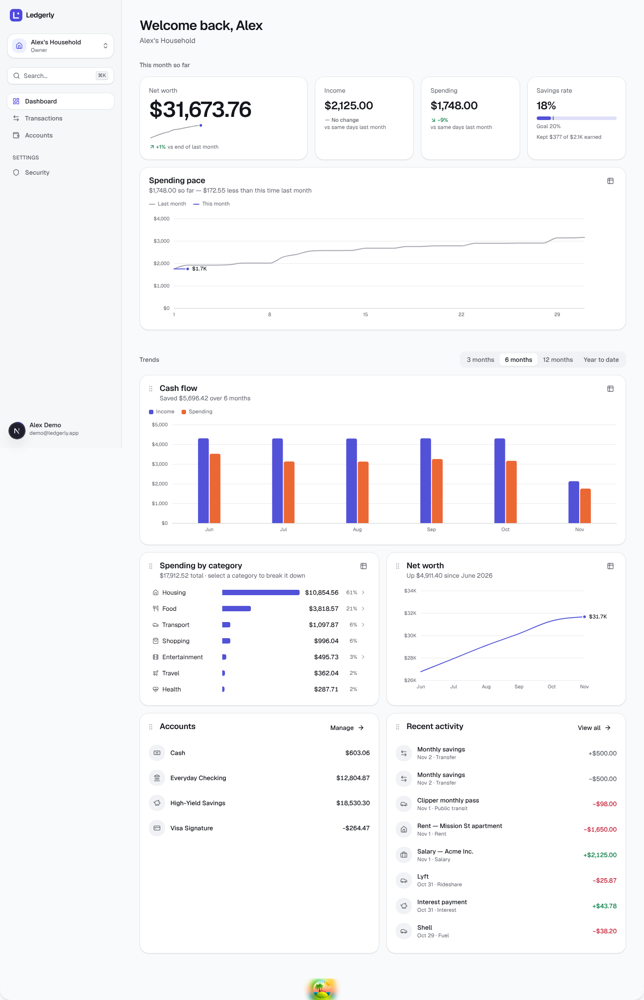
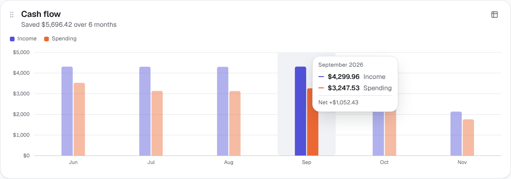
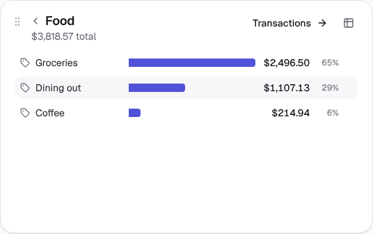
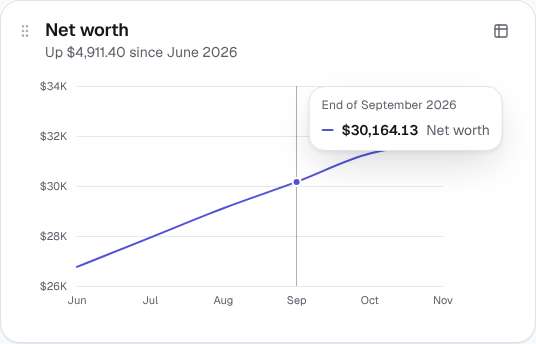
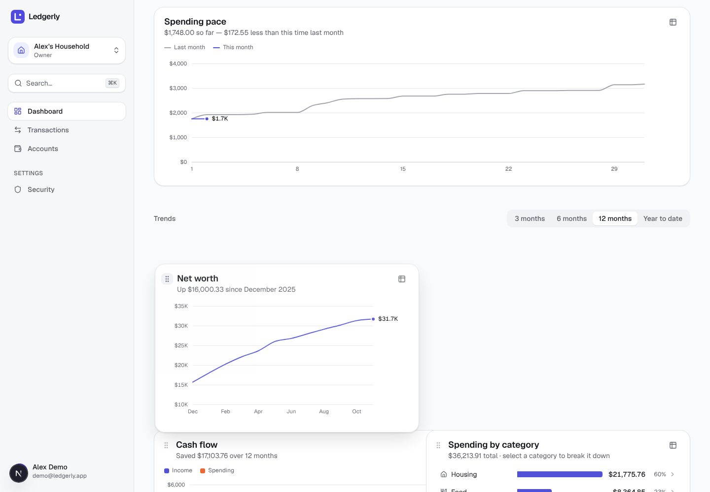
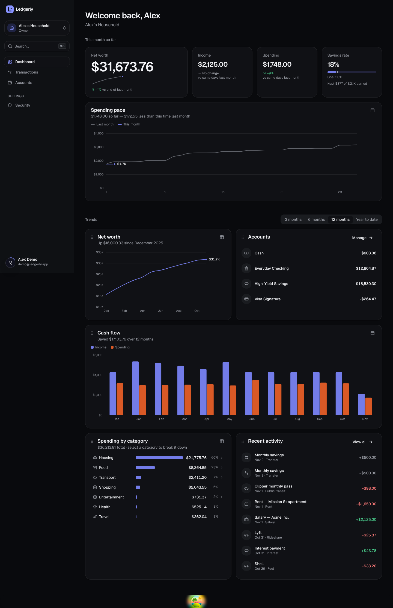

# Stage 8 — Dashboard & Charts

> **Goal of this stage:** turn a year of transactions into a dashboard you can understand at a glance, with charts that are beautiful, accessible and _honest_. Along the way, learn data visualisation as a **procedure with checks**, not a matter of taste.
>
> **What you can see at the end:** sign in and land on the dashboard. You get a hero net-worth figure, month-to-date tiles, a spending-pace chart, then a "Trends" section with one period filter and widgets you can **drag to rearrange**, with the mouse or the keyboard. Your arrangement is saved to your account.



---

## Table of contents

1. [What we built](#1-what-we-built)
2. [Data visualisation is a procedure](#2-data-visualisation-is-a-procedure)
3. [Step 1: choose the form before anything else](#3-step-1-choose-the-form-before-anything-else)
4. [Steps 2–3: colour by job, then validate it, and our Stage 2 palette failed](#4-steps-23-colour-by-job-then-validate-it-and-our-stage-2-palette-failed)
5. [Step 4: mark specs, where "quiet and considered" comes from](#5-step-4-mark-specs-where-quiet-and-considered-comes-from)
6. [Building the charts](#6-building-the-charts)
7. [Step 5: interaction](#7-step-5-interaction)
8. [Step 6: accessibility](#8-step-6-accessibility)
9. [Honest numbers](#9-honest-numbers)
10. [The aggregate queries behind it](#10-the-aggregate-queries-behind-it)
11. [A dashboard you can rearrange](#11-a-dashboard-you-can-rearrange)
12. [Step 7: look at it, and what looking caught](#12-step-7-look-at-it-and-what-looking-caught)
13. [Testing](#13-testing)
14. [Run it yourself](#14-run-it-yourself)
15. [Exercises](#15-exercises)
16. [Glossary](#16-glossary)
17. [What's next](#17-whats-next)

---

## 1. What we built

| Part                          | Form                                               | What it answers                                  |
| ----------------------------- | -------------------------------------------------- | ------------------------------------------------ |
| **Net worth**                 | Hero figure + sparkline + delta                    | "Where do I stand?"                              |
| **Income / Spending**         | Stat tiles, compared with the same days last month | "How is this month going?"                       |
| **Savings rate**              | Meter against a 20% goal                           | "Am I saving enough?"                            |
| **Spending pace**             | Emphasis line chart: this month vs last            | "Am I spending faster than usual?"               |
| **Cash flow**                 | Grouped columns per month                          | "Income vs spending over time"                   |
| **Spending by category**      | Ranked bars with **drill-down**                    | "Where does the money go?" → "…and within Food?" |
| **Net worth trend**           | Line with end label                                | "Is it growing?"                                 |
| **Accounts, Recent activity** | Lists                                              | Quick reference                                  |

|                                                                            |                                                          |
| -------------------------------------------------------------------------- | -------------------------------------------------------- |
|                      |  |
|  |      |



**New API endpoints:** `GET …/reports/net-worth`, `GET …/reports/daily-cashflow`, `GET …/reports/spending-by-category?parentId=` (drill-down), and `GET`/`PUT …/dashboard` (your layout).

---

## 2. Data visualisation is a procedure

Most bad charts start with "let's pick some nice colours". This stage followed a **design-system-agnostic data-viz method**: a fixed sequence of steps where each step has checks, and the colour part is _computed_ by a validator script rather than judged by eye.

1. **Pick the form.** What job does the data do? Sometimes the answer isn't a chart at all.
2. **Assign colour by the job it does:** identity, magnitude, polarity or status.
3. **Validate the palette with a script.** Don't reason about it; run the checks.
4. **Apply the mark specs:** thin marks, rounded data ends, surface gaps.
5. **Add the hover layer:** crosshair or tooltip, with hit targets bigger than the marks.
6. **Final accessibility pass:** legends, table views, dark mode, keyboard.
7. **Render it and look at it.** Validators check colour, not layout.

The order matters: **colour comes last**. The sections below follow these steps.

---

## 3. Step 1: choose the form before anything else

| Data                                  | Its job                                 | Form chosen                      | Rejected (and why)                                                      |
| ------------------------------------- | --------------------------------------- | -------------------------------- | ----------------------------------------------------------------------- |
| Net worth now                         | One headline number                     | **Hero figure** (≥48 px)         | A chart: one number _is_ the chart                                      |
| Income/spending this month            | A value + its change                    | **Stat tiles** with deltas       | A two-bar chart (bars for two numbers waste space and precision)        |
| Savings rate                          | One ratio against a goal                | **Meter**                        | A pie of two slices                                                     |
| Income vs spending by month           | Two series over time                    | **Grouped columns**              | Dual-axis chart (see below)                                             |
| Spending per category                 | Compare and rank parts of a whole       | **Ranked horizontal bars**       | **Donut/pie**: angles and areas make close values impossible to compare |
| Net worth over time                   | One series' trend                       | **Line**                         | Area (see §9.3)                                                         |
| This month's spending vs last month's | One series is the story, one is context | **Emphasis**: accent line + grey | Two equally coloured lines: the story gets buried                       |

Three principles from that table are worth remembering:

- **Sometimes the right chart is no chart.** A dashboard should lead with _exactly one_ hero figure, the number people come for. Big, plain, in the same typeface as everything else.
- **Pies and donuts are almost never the answer.** People are bad at comparing angles and areas, and good at comparing lengths along a common baseline. Ranked bars, largest first, make "Housing is 60%, Food 23%" instantly legible, and they fit labels and values beside every bar.
- **Never use two y-axes.** It's tempting to draw net savings as a line on its own scale over the cash-flow columns. But the alignment of two scales is arbitrary, so the chart _invents_ correlations that aren't in the data. Net savings instead appears in the tooltip ("Net +$1,052.43") and the card's subtitle ("Saved $5,696.42 over 6 months").

**Emphasis is the most underused form.** "Spending pace" draws this month in the brand colour and last month in quiet grey. You see the _one_ thing that matters, whether you're above or below last month's line, without decoding two equally loud colours.

---

## 4. Steps 2–3: colour by job, then validate it, and our Stage 2 palette failed

### 4.1 Every colour does exactly one job

| Job             | Encodes                           | Structure                                    | Used here for                      |
| --------------- | --------------------------------- | -------------------------------------------- | ---------------------------------- |
| **Categorical** | Identity (_which_ series)         | Distinct hues in a fixed order, never cycled | Income (slot 1), Spending (slot 2) |
| **Sequential**  | Magnitude (_how much_)            | One hue, light → dark                        | (not needed yet)                   |
| **Diverging**   | Polarity (above/below a baseline) | Two opposite hues + neutral grey middle      | (not needed yet)                   |
| **Status**      | State (good/bad)                  | Reserved colours, always with icon + label   | Deltas: "↗ +1%", "↘ −9%"           |

**Why aren't income and spending green and red?** Because in a chart they're _identities_, not _judgements_. Painting spending red every single month says "bad!" about rent and groceries, which is noise. Red and green are also the classic pair that people with red-green colour blindness (about 1 in 12 men) can't tell apart. So the series wear categorical colours (indigo and orange), and green/red are reserved for **status**: a delta that's actually good or bad, always with an arrow and words. Spending going _down_ gets a green "↘ −9%", because the colour encodes _direction × whether that direction is good_.

**Ranked category bars use one hue** (slot 1) for every bar. The categories are one series, and the bar's _length_ already shows the value. Colouring each bar differently would spend the colour channel on nothing.

### 4.2 The validation, and a failure

The method's rule: **never eyeball whether a palette is colour-blind safe; run the validator.** It checks each palette, in each mode, for:

1. lightness inside a band (light mode L 0.43–0.77; dark 0.48–0.67);
2. a chroma floor, so a "colour" doesn't read as grey;
3. **colour-blind separation**: neighbouring colours must stay distinguishable (ΔE ≥ 8 target, ≥ 6 floor) under simulated protanopia and deuteranopia;
4. normal-vision separation (ΔE ≥ 15);
5. contrast against the chart surface (≥ 3:1 for marks).

I ran it first on the chart colours I had hand-picked in Stage 2:

```
Palette (light, surface #ffffff): #5959e8,#00b393,#e49e22,#c841a5,#008dbe
  [FAIL] CVD separation   worst adjacent #008dbe↔#c841a5 ΔE 5.3 (deutan)
Palette (dark,  surface #101115): #8792ff,#32c8a9,#f3b94c,#e56bc1,#3bacda
  [FAIL] Lightness band   outside band: all five too light for dark mode
  [FAIL] CVD separation   worst adjacent #3bacda↔#e56bc1 ΔE 5.3 (deutan)
```

**My Stage 2 palette failed.** It looked fine to me, which is exactly the point: to someone with deuteranopia, the blue and magenta neighbours were nearly identical. The dark-mode steps were all too light, so marks would glare on the dark surface. This is the "eyeballing colour-blind safety" anti-pattern, caught by a script in seconds.

**The fix:**

- Keep our brand indigo in slot 1, stepped into each mode's lightness band.
- Take the remaining slots from a pre-validated hue order (orange, aqua, yellow, magenta), with **separately chosen dark-mode steps** rather than an automatic "flip".
- Re-run the validator:

| Check                                      | Light                                       | Dark           |
| ------------------------------------------ | ------------------------------------------- | -------------- |
| Lightness band                             | PASS                                        | PASS           |
| Chroma floor                               | PASS                                        | PASS           |
| Colour-blind separation (worst neighbours) | PASS (ΔE 9.1)                               | PASS (ΔE 8.4)  |
| Normal-vision separation                   | PASS (ΔE 19.6)                              | PASS (ΔE 19.3) |
| Contrast vs surface                        | WARN: slots 3–5 below 3:1 → relief required | PASS           |

The light-mode contrast warning is **not dismissable**: it obliges a "relief channel", meaning visible labels or a table view. Every chart here has a table view (§8), and today we only use slots 1–2, which pass. The final values live in `globals.css` as `--chart-1…5`, with a comment explaining where they came from.

---

## 5. Step 4: mark specs, where "quiet and considered" comes from

The calm look of the best dashboards comes from a few fixed specs. **The data is the only thing allowed to be loud.**

| Mark          | Spec                                                                 | In our code                                                 |
| ------------- | -------------------------------------------------------------------- | ----------------------------------------------------------- |
| Columns/bars  | **≤ 24 px thick**; **4 px rounded data end, square at the baseline** | `columnPath()` draws exactly that shape; width capped at 24 |
| Touching bars | A **2 px surface gap**, never an outline                             | `gap = 2` between income and spending columns               |
| Lines         | **2 px**, round caps and joins                                       | `strokeWidth={2} strokeLinecap="round"`                     |
| End markers   | **≥ 8 px** dot with a **2 px surface-coloured ring**                 | `r={4} stroke="var(--surface)" strokeWidth={2}`             |
| Grid/axes     | **Hairline, solid** (never dashed), one step off the surface         | `--chart-grid`, `shapeRendering="crispEdges"`               |
| Labels        | **Selective**: the endpoint, never a number on every point           | Only the line's end value ("$31.7K") is labelled            |
| Text colour   | **Text tokens, never the series colour**                             | Legend text is muted grey; identity comes from the swatch   |

```ts
/** A column with a 4px rounded DATA end and a square BASELINE end. */
export function columnPath(x: number, y: number, width: number, height: number) {
  const r = Math.min(4, width / 2, height);
  return `M${x},${y + height}V${y + r}Q${x},${y} ${x + r},${y}H${x + width - r}Q${x + width},${y} ${x + width},${y + r}V${y + height}Z`;
}
```

Why round only the top? The baseline is where the bar _starts_; it must look anchored and exact. The rounded data end softens the shape without making the value ambiguous.

**Typography for numbers:** big standalone figures (the hero, tile values) use _proportional_ digits. `tabular-nums` makes "1" as wide as "0", which looks loose at 48 px. Tabular digits are kept for columns that must align: axis ticks, tables and transaction amounts.

---

## 6. Building the charts

### 6.1 Library or hand-built?

| Option                                    | Pros                                                                             | Cons                                                                                        |
| ----------------------------------------- | -------------------------------------------------------------------------------- | ------------------------------------------------------------------------------------------- |
| Recharts / Nivo / Chart.js                | Fast to start; many chart types                                                  | You fight the defaults to meet specs like "4 px data end, square baseline"; heavier bundles |
| ECharts / Highcharts                      | Extremely capable                                                                | Large; their own styling and animation system                                               |
| **d3-scale + d3-shape + SVG + Motion** ✅ | Total control over every pixel; tiny; uses our tokens and motion system directly | You write the chart components yourself                                                     |

We use d3 only for the **maths**: `scaleLinear`/`scaleBand` (with `.nice()` and `.ticks()`) and `line`/`area` path generators. Rendering is plain React SVG, styled with our design tokens and animated with Motion. That's how product teams that care about craft usually work. Airbnb's **visx** library is built on exactly this split.

### 6.2 Responsive by measurement

SVG needs real pixel widths. `useSize()` wraps a **ResizeObserver** to re-measure the container whenever it changes: sidebar collapsing, phone rotation, a widget being dragged into a wider slot. That's better than listening to `window.resize`, which misses container-only changes.

**The chart's height includes its x-axis labels** (`PLOT_HEIGHT + AXIS_BAND`). A classic bug is a fixed-height container that fits the plot but not the axis, giving the card a tiny nested scrollbar.

### 6.3 Motion with purpose

| Element       | Motion                                                  | Detail                                                                                                        |
| ------------- | ------------------------------------------------------- | ------------------------------------------------------------------------------------------------------------- |
| Columns       | Grow from the baseline on a spring, 30 ms apart         | `transformBox: "fill-box"` + `transformOrigin: "50% 100%"` makes SVG scale from each column's own bottom edge |
| Lines         | "Draw" themselves in over 0.9 s                         | Motion's `pathLength` 0 → 1                                                                                   |
| End dot       | Pops in after the line arrives                          | A spring with slight overshoot                                                                                |
| Category bars | Widths spring to size; drill-down reflows with `layout` | `AnimatePresence mode="popLayout"`                                                                            |
| Tooltip       | Follows the pointer on a stiff spring                   | No jitter, no lag                                                                                             |
| Hovered month | Others fade to 45%                                      | Focus without hiding context                                                                                  |

All of it respects "reduce motion" through the `MotionConfig` from Stage 2.

---

## 7. Step 5: interaction

An HTML chart is interactive by default. The hover layer is part of the deliverable, not an upgrade.

- **The hit target is bigger than the mark.** On the cash-flow chart, you don't have to land on a 20 px column. The _whole month band_ is the target. On line charts, a **crosshair** snaps to the nearest month as the pointer moves; readers aim at a date, never at a 2 px line.
- **One tooltip, every series.** Hovering September shows income, spending _and_ net together.
- **Values lead, labels follow.** In the tooltip the number is bold and the series name is secondary (the reverse of a legend), because by then you know the series and want the number. Series are keyed with short _lines_, not filled boxes.
- **Labels are rendered as text, never HTML.** Category names come from the database; building tooltips with `innerHTML` would be an XSS hole (Stage 5 §6).
- **Refetch holds the frame.** Switching "6 months" → "12 months" keeps the old chart on screen, dimmed, until the new data arrives (`placeholderData`). There's no skeleton flash and no layout jump.
- **One filter row, above everything it scopes** (§11.1).
- **Drill-down.** Click "Food" to see Groceries, Dining out and Coffee, with a back arrow and a "Transactions →" link that opens the transactions list already filtered to Food (Stage 7's URL filters paying off).

---

## 8. Step 6: accessibility

| Requirement                              | Implementation                                                                                                                                                                                               |
| ---------------------------------------- | ------------------------------------------------------------------------------------------------------------------------------------------------------------------------------------------------------------ |
| **Identity never by colour alone**       | Two or more series → a legend is always present, plus tooltips and direct end labels. One series → no legend box (the title names it).                                                                       |
| **A table view for every chart**         | The ⊞ button on each card swaps the chart for an accessible `<table>` with the exact numbers. Tooltips enhance; they never _gate_ a value.                                                                   |
| **Keyboard access to values**            | Each month band in the column chart is focusable (Tab) and announces "September 2026: Income $4,299.96, Spending $3,247.53". Line charts: focus the plot, then use **← →** (Home/End) to move the crosshair. |
| **Screen-reader names**                  | SVGs have `role="img"` + `aria-label`; the meter is a real `role="meter"` with min/max/now values; category bars are buttons with full sentences.                                                            |
| **Status with icon + words**             | "↘ −9% vs same days last month": arrow, number and named period, not just a red or green number.                                                                                                             |
| **Dark mode is _selected_, not flipped** | Separate dark steps of the same hues, validated against the dark surface (§4.2).                                                                                                                             |
| **Drag-and-drop without a mouse**        | §11.3                                                                                                                                                                                                        |

---

## 9. Honest numbers

A beautiful chart that misleads is worse than none. Three decisions here are about honesty.

### 9.1 Compare like with like: month-to-date vs the same days last month

On November 2nd, "spending this month" is two days of spending. Comparing that with _all_ of October would show "−92%!" every month until the very end. The tiles therefore compare **month-to-date with the same days of last month** (November 1–2 vs October 1–2), and say so: "vs same days last month". That needed a new daily cash-flow endpoint, and `monthToDate()` handles edge cases like 31 March vs a 28-day February (unit tested).

### 9.2 Deltas name their period, and their colour means good or bad

"+1%" is meaningless without "vs end of last month". And the colour isn't "up = green". It's **direction × whether that direction is good**: income up is green, spending up is red, net worth up is green.

### 9.3 Net worth is a line, not an area

My first version drew net worth as an area chart (line plus shaded fill). Looking at it, the y-axis started at $26K, because a zero baseline would squash a $26K→$32K trend into a flat line near the top. But **a shaded area implies quantity down to the axis**, so the fill visually claims the bottom of the chart is "nothing". The honest fix is to keep the zoomed axis and drop the fill. A line makes no claim about the baseline. **Rule:** areas and bars need a zero baseline; lines don't.

### 9.4 One currency at a time

Net worth sums accounts in the household's base currency only. Adding dollars to euros without exchange rates would produce a precise-looking but meaningless number. A test proves a EUR account is excluded.

---

## 10. The aggregate queries behind it

**Net worth by month end:** opening balances plus every transaction up to each month end, in one SQL statement:

```sql
with months as (select generate_series(date_trunc('month', $from::date),
                                       date_trunc('month', $to::date - 1), interval '1 month')::date as month),
     opening as (select coalesce(sum(opening_balance_minor), 0) as total from accounts where …),
     flows as (select date_trunc('month', occurred_on)::date as month, sum(amount_minor) as net
               from transactions t join accounts a on a.id = t.account_id where … group by 1)
select to_char(m.month, 'YYYY-MM'), o.total + coalesce((select sum(f.net) from flows f where f.month <= m.month), 0)
from months m cross join opening o order by m.month;
```

- **`generate_series`** creates one row per month even if a month had no transactions, so the line has no gaps.
- **Transfers cancel out automatically.** −$200 from checking and +$200 to savings sum to zero. A test proves net worth doesn't move on a transfer.

**Consistency is proven, not assumed:**

- The daily cash-flow endpoint uses the same definitions as the monthly one (transfers excluded). A test checks that the days of May **add up exactly** to May's monthly totals.
- The last net-worth point equals the **sum of today's account balances** from the accounts endpoint, which is a completely different query. Two independent calculations agreeing is strong evidence both are right.
- The drill-down total for "Food" equals Food's row in the top-level report.

**Drill-down** groups by subcategory _and_ the parent itself, because spending can be booked directly on "Food". That row appears as "Food (general)" rather than silently disappearing.

---

## 11. A dashboard you can rearrange

### 11.1 Layout: one filter scopes everything below it

A rule of good dashboards is that a **filter row scopes everything below it**, so the numbers always agree. But "this month vs last month" tiles have their own fixed period. Putting them under a "12 months" filter would make the page contradict itself. So the dashboard has two sections:

1. **"This month so far"**: hero, tiles, meter and spending pace. A fixed, clearly labelled period.
2. **"Trends"**: one period filter (3 / 6 / 12 months / year to date, kept in the URL), then the widgets it scopes.

### 11.2 Drag-and-drop with dnd-kit

**dnd-kit** is the modern React drag-and-drop toolkit: accessible, touch-friendly and animation-friendly.

```ts
const sensors = useSensors(
  useSensor(PointerSensor, { activationConstraint: { distance: 6 } }), // a click on a chart isn't a drag
  useSensor(KeyboardSensor, { coordinateGetter: sortableKeyboardCoordinates }),
);
```

- **Drag only from the handle** (⋮⋮), so you can still click bars, hover charts and select text everywhere else.
- **A 6 px activation distance** separates "click" from "drag".
- **`CSS.Translate`, not `CSS.Transform`**, while dragging. Widgets of different widths would otherwise be _scaled_ into each other's shapes mid-drag.
- `rectSortingStrategy` reflows a two-column grid with mixed widths.

### 11.3 Keyboard and screen-reader support

Focus a ⋮⋮ handle, press **Space** to pick it up, use the **arrow keys** to move it, **Space** to drop, **Escape** to cancel. Custom announcements tell screen-reader users what's happening ("Picked up Net worth. Use the arrow keys to move…", "Accounts dropped at position 2 of 5"). The browser test reads that live region and gets exactly that sentence. Drag-and-drop that only works with a mouse excludes keyboard users, switch-device users and many screen-reader users.

### 11.4 Saved on the server, as a personal preference

```http
PUT /v1/households/{id}/dashboard   { "widgets": ["net-worth", "cashflow", …] }
```

- **Stored per user _and_ per household** (`dashboard_layouts` table, migration `0004`). Your layout follows you from laptop to phone, and your partner's arrangement is independent.
- **Viewers may change it** (`config: { minRole: "viewer" }`). It's _their_ preference, not household data, and a test checks a viewer can save their own.
- **Saved optimistically:** the new order appears instantly and a failed save puts the old order back.
- **Forward-compatible:** if a future release adds a widget, older saved layouts get it _appended_ rather than hidden. Unknown or duplicate ids are rejected (400).

---

## 12. Step 7: look at it, and what looking caught

The validator checks colour, not layout, so the method's last step is to **render it and look**. Reviewing the screenshots caught real problems:

| Found by looking                                  | Fix                                                                                                                                                                                               |
| ------------------------------------------------- | ------------------------------------------------------------------------------------------------------------------------------------------------------------------------------------------------- |
| **29 px horizontal overflow on phones**           | Grid items default to `min-width: auto`, so the hero number plus sparkline stretched the _whole column_ past the screen. Fix: `min-w-0` on tiles, a smaller hero on phones, a wrapping value row. |
| Net-worth area implying volume to a non-zero axis | Line instead of area (§9.3)                                                                                                                                                                       |
| A tall, mostly empty savings-rate card            | Moved into the tile row; the pace chart got the full width it needs for 31 days                                                                                                                   |
| Deltas wrapping as "No / change"                  | Phrases kept whole (`whitespace-nowrap`), wrapping only between them                                                                                                                              |
| Accounts sitting next to an empty half-row        | Recent activity became a normal-width widget                                                                                                                                                      |
| Generic tag icons in the drill-down               | Subcategories inherit their parent's icon                                                                                                                                                         |

And one failure that _wasn't_ an app bug. The first browser test of mouse dragging selected text instead of dragging. The test had measured the handle's position while the table→chart cross-fade was still changing the layout. The keyboard drag passed, which proved the sortable logic worked; waiting for the layout to settle made the mouse test pass too. Telling a flaky test from a real bug is a skill worth practising.

---

## 13. Testing

| Suite        | New in Stage 8                                                                                                                                                                                                                                         |
| ------------ | ------------------------------------------------------------------------------------------------------------------------------------------------------------------------------------------------------------------------------------------------------ |
| **db (19)**  | Net worth = opening + flows, unchanged by transfers, other currencies excluded; drill-down includes parent-booked spending; daily cash flow splits in/out and excludes transfers                                                                       |
| **API (95)** | 12 monthly net-worth points ending at today's total balance; daily cash flow sums to the monthly report; drill-down total equals the parent's; layout defaults, per-user saving, viewers allowed, appended new widgets, unknown/duplicate ids rejected |
| **web (69)** | `monthToDate` (same days, short February), `relativeChange`/`savingsRate` division-by-zero guards, `spendingPace` cumulative lines stopping at today, trend ranges                                                                                     |
| **Browser**  | Results below                                                                                                                                                                                                                                          |

```
1 tiles: Net worth $31,673.76 (+1% vs end of last month) · Income $2,125.00 (no change vs same days) · Spending …
2 cash flow, 6 months by default; hover September → $4,299.96 Income | $3,247.53 Spending | Net +$1,052.43
3 net worth via keyboard (focus + ←←) → End of September 2026 | $30,164.13
4 drill-down: 7 top-level categories → Food → Groceries, Dining out, Coffee
5 period filter → ?range=12m, 12 months of columns
6 table view → 12 rows: Month · Income · Spending · Net
7 mouse drag: Net worth moved to first place; keyboard drag announced "Accounts dropped at position 2 of 5"; order persisted after reload
8 dark mode rendered; mobile 390 px: no horizontal overflow; console errors: none
```

---

## 14. Run it yourself

Apply the new migration (dashboard layouts), refresh the demo data, and start:

```bash
pnpm db:migrate && pnpm db:seed
```

```bash
pnpm dev
```

Sign in (**demo@ledgerly.app / correct-horse-ledger**) and try:

- Hover the cash-flow columns, then press **Tab** to move through months with the keyboard.
- Click **Food** in "Spending by category", then **Transactions →**.
- Switch **Trends** to "12 months", then reload. The URL kept it.
- Click ⊞ on any chart for its table view.
- Drag a widget by its ⋮⋮ handle; then try with the keyboard: Tab to a handle, Space, arrows, Space.
- Toggle dark mode and compare the chart colours.

---

## 15. Exercises

1. **Run the validator yourself.** Pick five colours you like and imagine them as chart series. Check them with any online colour-blindness simulator (search "deuteranopia simulator"). Would neighbours survive?
2. **Break the baseline rule.** Re-enable `area: true` on the net-worth series. Describe what the shaded region _claims_ about the data, and why that's false.
3. **Make the dual-axis mistake on paper.** Sketch cash flow with net savings on a second y-axis, then shift that axis's range. How does the "story" change without any data changing?
4. **Add a widget.** Add "Top merchants this period" (ranked bars by description). You'll need a query, an endpoint, a widget id in `DashboardWidgetSchema`, and a case in the dashboard switch. Check that existing saved layouts get it appended.
5. **Sequential colour.** Build a calendar heatmap of daily spending using one hue from light to dark (the sequential job). Why would a rainbow scale be wrong here?
6. **Keyboard-only.** Reorder the whole dashboard without touching the mouse. Then turn on your OS screen reader and listen to the announcements.
7. **Honest comparison.** Change the Spending tile to compare with _all_ of last month. On the 2nd of a month, what does it show? Revert.
8. **Read the numbers twice.** Compare the net-worth widget's last value, the hero figure, and the sum of the Accounts widget. Why do they match, and what in the code guarantees it?

---

## 16. Glossary

| Term                                              | Meaning                                                                            |
| ------------------------------------------------- | ---------------------------------------------------------------------------------- |
| **Form**                                          | The kind of visual: bar, line, tile, meter, or no chart at all.                    |
| **Categorical / sequential / diverging / status** | The four jobs a colour can do: identity, magnitude, polarity, state.               |
| **CVD**                                           | Colour-vision deficiency (colour blindness): protanopia, deuteranopia, tritanopia. |
| **ΔE (Delta E)**                                  | A measure of how different two colours look; here in the perceptual OKLab space.   |
| **Emphasis**                                      | Highlighting one series in an accent colour and greying the rest.                  |
| **Hero figure**                                   | The single headline number a dashboard leads with.                                 |
| **Dual-axis chart**                               | Two series with different y-scales on one plot; misleading by construction.        |
| **Crosshair**                                     | A vertical guide that snaps to the nearest x value under the pointer.              |
| **Hit target**                                    | The area that responds to the pointer; should be bigger than the visible mark.     |
| **Table view**                                    | An accessible table with the same numbers as a chart.                              |
| **Drill-down**                                    | Clicking a summary to see its breakdown.                                           |
| **Activation constraint**                         | How far the pointer must move before a press becomes a drag.                       |
| **Live region / announcement**                    | Text that screen readers read aloud automatically when it changes.                 |
| **Month-to-date (MTD)**                           | From the 1st of the month to today.                                                |

---

## 17. What's next

**Stage 9: Budgets & goals.** Now that we can _see_ spending, we'll help _plan_ it. That means monthly budgets per category with progress meters that change colour as you approach the limit (status colours, with icons and labels), rollover of unspent amounts, alerts when you cross 80% and 100%, savings goals with target dates and projected completion, and recurring-transaction rules. It all builds on today's report queries and chart components.
