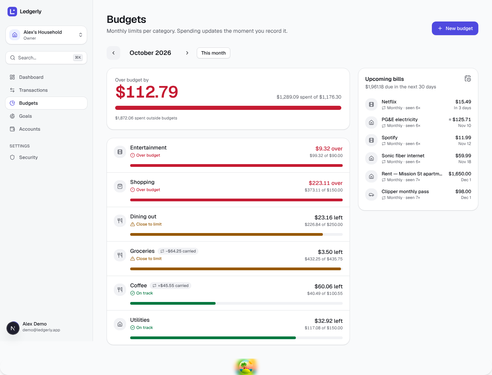
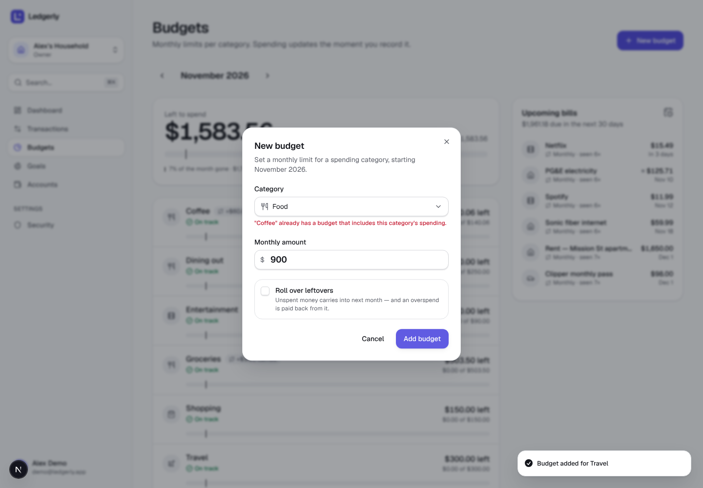
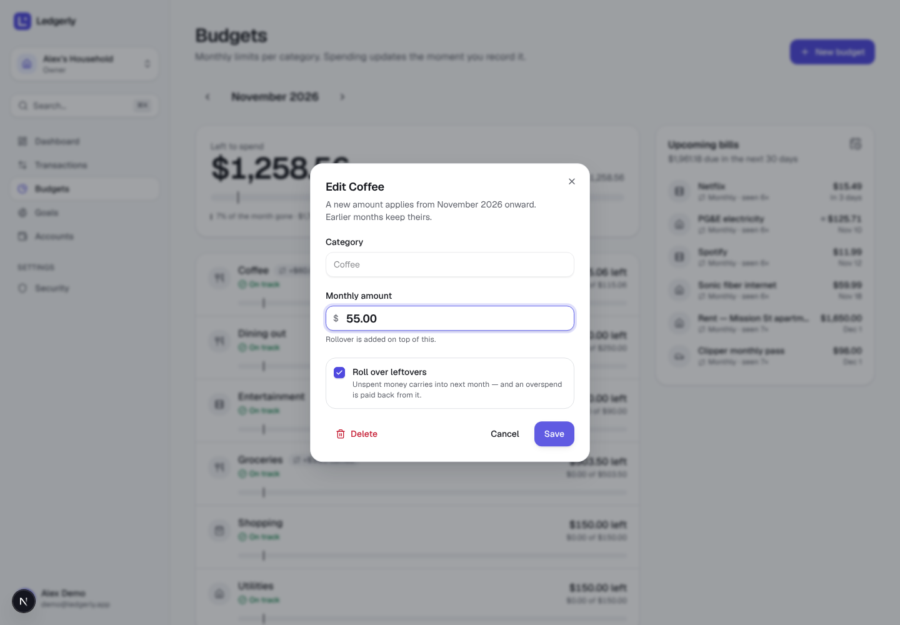
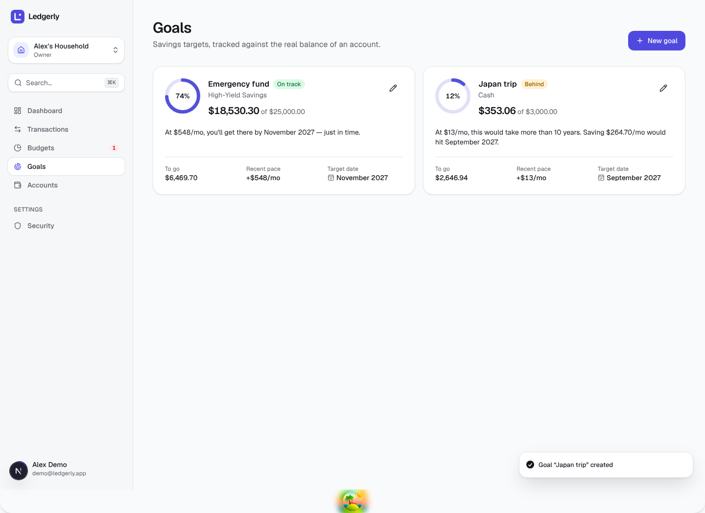
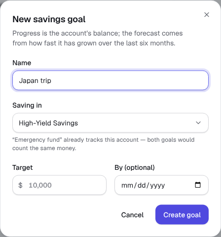
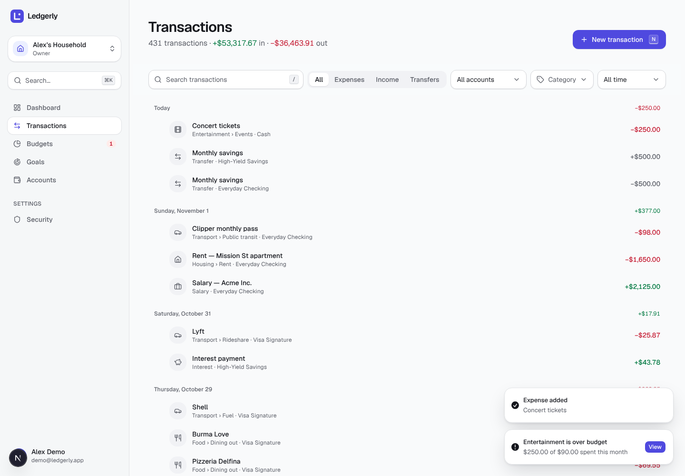
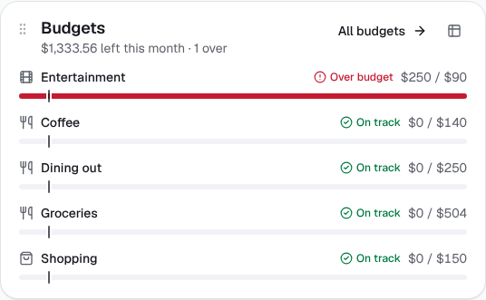
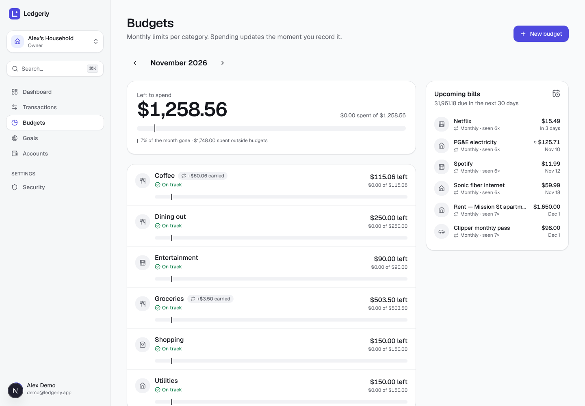
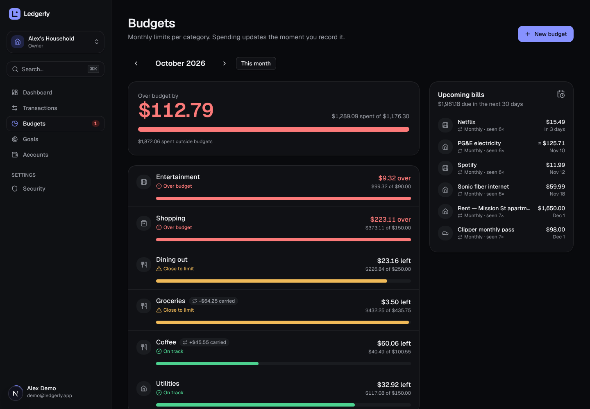

# Stage 9 — Budgets & Goals

> **Goal of this stage:** Stage 8 showed you what you spent. This stage helps you **plan** what you will spend. You get monthly budgets per category (with rollover), alerts when you approach or pass a limit, savings goals with a forecast, and a list of upcoming bills that Ledgerly finds by itself in your history.
>
> **What you'll learn:** the difference between data you **store** and data you **compute**. You'll also learn **effective dating** (changing a value without rewriting history), keeping business rules in **pure functions**, forecasting honestly, and detecting patterns with simple rules you can explain to a user.



---

## Table of contents

1. [What we built](#1-what-we-built)
2. [Store the facts, compute the rest](#2-store-the-facts-compute-the-rest)
3. [Effective dating: changing a budget without rewriting history](#3-effective-dating-changing-a-budget-without-rewriting-history)
4. [The rules live in pure functions](#4-the-rules-live-in-pure-functions)
5. [The API](#5-the-api)
6. [Goals: forecasting honestly](#6-goals-forecasting-honestly)
7. [Upcoming bills: detecting recurring transactions](#7-upcoming-bills-detecting-recurring-transactions)
8. [The Budgets page](#8-the-budgets-page)
9. [Alerts: derived on the client](#9-alerts-derived-on-the-client)
10. [The Goals page and the dashboard widget](#10-the-goals-page-and-the-dashboard-widget)
11. [What looking caught](#11-what-looking-caught)
12. [Testing](#12-testing)
13. [Run it yourself](#13-run-it-yourself)
14. [Exercises](#14-exercises)
15. [Glossary](#15-glossary)
16. [What's next](#16-whats-next)

---

## 1. What we built

| Area     | What's new                                                                                                                                                                     |
| -------- | ------------------------------------------------------------------------------------------------------------------------------------------------------------------------------ |
| Database | `budgets`, `budget_amounts` (the amount history) and `goals` tables, with constraints and `updated_at` triggers. Two new aggregate queries.                                    |
| Shared   | Pure domain logic in `@ledgerly/shared/domain`: month arithmetic, budget maths (rollover and status), goal projection, and recurring-transaction detection. 30 new unit tests. |
| API      | `GET/POST/PATCH/DELETE /budgets`, `GET/POST/PATCH/DELETE /goals` and `GET /reports/recurring`. 17 new integration tests.                                                       |
| Web      | A **Budgets** page (month switcher, summary, budget rows, edit dialog, Upcoming bills), a **Goals** page, alerts (toasts and a nav badge), a dashboard widget and ⌘K actions.  |

Here's how a budget amount becomes "$23.16 left", end to end:

```
budget_amounts (history)  ─┐
budgets (start, rollover) ─┼─► API gathers the facts ─► computeBudgetMonth() ─► JSON ─► BudgetRow
transactions (spending)   ─┘        (2 queries)          (pure, in shared)
```

A note on scope: the Stage 8 doc promised _recurring-transaction rules_, meaning rules that create next month's rent for you automatically. Creating rows on a schedule is a **background job**, and that's what Stage 10 is about. So this stage does the read-only half: it **detects** recurring bills and shows them as "Upcoming bills". Stage 10 can then offer "turn this into a rule" on top of that detection.

---

## 2. Store the facts, compute the rest

The most important design decision of this stage is **what NOT to store**.

A budget screen shows six numbers per row: amount, rollover, available, spent, remaining and status. It would be easy to give each one a column and keep them up to date. That would be a mistake, because only one of them is a fact:

| Number     | Fact or derived?             | Why                                                                        |
| ---------- | ---------------------------- | -------------------------------------------------------------------------- |
| **Amount** | **Fact.** The user chose it. | Nothing else can produce it.                                               |
| Spent      | Derived from transactions    | Changes whenever a transaction is added, edited, deleted or recategorised. |
| Rollover   | Derived from previous months | Changes whenever an _earlier_ month's spending changes.                    |
| Available  | amount + rollover            | —                                                                          |
| Remaining  | available − spent            | —                                                                          |
| Status     | remaining vs available       | —                                                                          |

If we stored `spent`, every transaction write would also have to update it. Every edit of an _old_ transaction would then have to update every later month's rollover. Miss one code path (a bulk edit, an import, a manual fix in the database) and the numbers would quietly disagree with reality. This failure is called **denormalisation drift**, and finance apps that suffer from it lose users' trust quickly.

So the database stores only facts:

```ts
// packages/db/src/schema.ts (simplified)
budgets        (id, household_id, category_id, start_month, rollover)
budget_amounts (budget_id, effective_month, amount_minor)   -- PK(budget_id, effective_month)
goals          (id, household_id, account_id, name, target_minor, target_date)
```

Everything else is computed when someone asks for it. "Isn't that slow?" Not here. One household's budgets touch a few hundred transactions a month. Postgres sums those in about a millisecond using the `(household_id, occurred_on)` index from Stage 3. When computing does become too slow (millions of rows, or many reads per write), you **cache** the derived values (Stage 12). Even then, the facts remain the source of truth, and the cache can be thrown away and rebuilt at any time.

> **Best practice:** _Store facts, derive views._ Only denormalise when you've measured a need, and then treat the copy as a cache you can rebuild.

### 2.1 Constraints that keep the facts clean

As in Stage 3, the database itself guards its invariants:

- `unique (household_id, category_id)`: one budget per category. A second POST returns **409 `budget_exists`**.
- A **composite foreign key** `(category_id, household_id) → categories(id, household_id)` means a budget can never point at another household's category (the tenant-isolation pattern from Stage 3).
- `check (extract(day from start_month) = 1)`: months are stored as the first of the month. Otherwise "2026-06-15" and "2026-06-01" would both mean June, and comparisons would quietly break.
- `check (amount_minor > 0)` and `check (target_minor > 0)`.
- `ON DELETE CASCADE` from category → budget → amounts: deleting a category removes its budget and history.

Two rules **can't** be expressed easily in SQL, so the service checks them (and returns 422):

1. **Only expense categories can be budgeted.** You can't overspend your salary.
2. **No overlapping budgets.** A budget on _Food_ already includes _Groceries_ and _Coffee_ (its subcategories). If _Groceries_ had its own budget as well, the same $50 would count twice and the totals would lie. So you can budget a parent **or** its children, but not both.



### 2.2 Migrations, and an ordering mistake

As in earlier stages, there are two migrations: `0005` (generated by drizzle-kit from the schema) and `0006` (hand-written triggers for `updated_at`). The first time, I generated the custom trigger file **before** the table migration. That meant `CREATE TRIGGER … ON budgets` would have run before `budgets` existed, and a fresh database would have failed to migrate. I deleted both files and regenerated them in the right order.

The lesson: migrations run **in filename order on every fresh database**, so their order is part of the code. CI catches this, because it migrates an empty database on every push.

---

## 3. Effective dating: changing a budget without rewriting history

You set Dining out to $200 in June. In September you raise it to $250. What should August show?

- **Wrong:** $250. If the amount were a single column on `budgets`, the update would rewrite every past month. August would suddenly say you were _under_ budget when, at the time, you were over.
- **Right:** $200. August was budgeted at $200, and history shouldn't change because of a decision made later.

The pattern that does this is called **effective dating**. Instead of one value, store a list of _changes_, each with the date it takes effect:

```
budget_amounts for "Dining out"
effective_month | amount_minor
2026-06-01      | 20000        ← from June
2026-09-01      | 25000        ← from September onward
```

The amount for any month is _the latest change on or before that month_:

```ts
// packages/shared/src/domain/budgets.ts
export function amountForMonth(changes: BudgetAmountChange[], month: YearMonth): number | null {
  let amount: number | null = null;
  let latest = "";
  for (const change of changes) {
    const effective = toYearMonth(change.effectiveMonth);
    if (effective <= month && effective >= latest) {
      latest = effective;
      amount = change.amountMinor;
    }
  }
  return amount;
}
```

That's why the browser test shows:

```
2 ?month=2026-09  Dining out · $212.36 of $250.00
2 ?month=2026-08  Dining out · Over budget · $208.97 of $200.00
```

Editing is an **upsert** keyed on `(budget_id, effective_month)`. Changing the amount twice in the same month replaces that month's row instead of adding a duplicate:

```ts
await tx
  .insert(budgetAmounts)
  .values({ budgetId, effectiveMonth: effective, amountMinor: input.amountMinor })
  .onConflictDoUpdate({
    target: [budgetAmounts.budgetId, budgetAmounts.effectiveMonth],
    set: { amountMinor: input.amountMinor },
  });
```

Effective dating shows up everywhere in real systems: prices, tax rates, salaries, insurance policies, exchange rates. Payroll and accounting systems take it further with **bitemporal** data, which records both _when a fact was true_ and _when we learned it_. Ours is the simpler, one-dimensional version.

> **Best practice:** when a value _changes over time_ and past reports must stay correct, store the history of changes, not just the current value.

---

## 4. The rules live in pure functions

All the budget maths lives in `@ledgerly/shared` as **pure functions**: the same inputs always give the same output, and nothing else is read or changed (no database, no clock, no network).

```ts
export function computeBudgetMonth(input: {
  startMonth: string;
  amounts: BudgetAmountChange[];
  rollover: boolean;
  spentByMonth: ReadonlyMap<YearMonth, number>;
  month: YearMonth;
}): BudgetMonth | null;
```

Why this matters:

1. **Testable in milliseconds.** The 30 new domain tests run in well under a second, with no database. Rollover has a lot of edge cases (negative carries, amount changes mid-way, months before the start), and each one is a three-line test.
2. **One source of truth.** The API uses these functions today. The web app _could_ use the same code tomorrow, for example to preview "if you set this to $300, you'd have $X left" while the user types, without a server round-trip and without a second copy of the rules that could drift.
3. **Explainable.** If a user asks "why does it say I have $3.50 left?", there's one function to read.

This split, with a thin service that gathers facts from the database and a pure core that decides, is sometimes called **"functional core, imperative shell"**. You've seen it already: `parseMoney` (Stage 1) and `spendingPace` (Stage 8) work the same way.

### 4.1 Rollover, worked through

With rollover on, unspent money carries into next month, and an **overspend is paid back** from next month. The function walks forward from the budget's first month:

```ts
let carry = 0;
if (input.rollover) {
  for (const month of monthsBetween(start, input.month).slice(0, -1)) {
    const amount = amountForMonth(input.amounts, month) ?? 0;
    carry = amount + carry - (input.spentByMonth.get(month) ?? 0);
  }
}
```

Here is the demo's Groceries budget ($500/month, rollover on):

| Month | Amount | Carried in | Available | Spent  | Carried out |
| ----- | ------ | ---------- | --------- | ------ | ----------- |
| Jun   | 500.00 | 0.00       | 500.00    | 470.40 | 29.60       |
| Jul   | 500.00 | 29.60      | 529.60    | 516.34 | 13.26       |
| Aug   | 500.00 | 13.26      | 513.26    | 579.73 | **−66.47**  |
| Sep   | 500.00 | **−66.47** | 433.53    | 497.78 | −64.25      |
| Oct   | 500.00 | −64.25     | 435.75    | 432.25 | 3.50        |
| Nov   | 500.00 | 3.50       | 503.50    | …      |             |

August's overspend ($79.73) ate July's leftover, and the debt was still being paid back two months later. In the October screenshot at the top, Groceries shows "−$64.25 carried" and "$3.50 left". Every number on that row can be traced through this table.

Design choices worth noticing:

- **The carry can go negative.** Some apps reset negatives to zero, which is kinder but hides overspending. We chose honesty. Making it optional is an exercise.
- **Walk, don't store.** The carry is recomputed from the start month every time. For a budget that's five years old that's 60 loop iterations, which takes microseconds.
- **Turning rollover off** means `carry = 0`, but the history is untouched. Turn it back on and the carries reappear exactly as they were. Nothing was lost, because nothing derived was stored.

### 4.2 Status thresholds, and their edges

```ts
export function budgetStatus(spentMinor: number, availableMinor: number): BudgetStatus {
  if (availableMinor <= 0) return spentMinor > 0 || availableMinor < 0 ? "over" : "ok";
  const used = spentMinor / availableMinor;
  if (used > 1) return "over";
  if (used >= BUDGET_WARNING_AT) return "warning"; // 0.8
  return "ok";
}
```

The tests pin down the edge cases on purpose, because product people will ask about them:

- Exactly 80% is a **warning**.
- Spending _exactly_ the budget is a **warning**, not over. You hit your limit; you didn't break it.
- Available below zero (a big negative carry) is **over** before you spend a cent.

### 4.3 Months without `Date`

Budgets think in **calendar months**, so months are `"YYYY-MM"` strings with three tiny helpers (`addMonths`, `monthDiff`, `monthsBetween`) that do integer arithmetic on `year * 12 + month`. No `Date` objects means no time zones, no "January 31 + 1 month = March 3", and no daylight-saving surprises. As a bonus, `"YYYY-MM"` strings **sort correctly as text**, so `month < start` just works.

---

## 5. The API

| Method & path                 | Purpose                                                       | Notable responses                                                          |
| ----------------------------- | ------------------------------------------------------------- | -------------------------------------------------------------------------- |
| `GET /budgets?month=YYYY-MM`  | Every budget for a month, plus totals and unbudgeted spending | 400 for a malformed month                                                  |
| `POST /budgets`               | Budget a category from a start month                          | 409 `budget_exists`, 422 `budget_overlaps` / `budget_category_not_expense` |
| `PATCH /budgets/:id`          | New amount **from** `effectiveMonth`, and/or rollover         | 400 if `amountMinor` lacks `effectiveMonth`                                |
| `DELETE /budgets/:id`         | Delete the budget and its history                             | 204                                                                        |
| `GET /goals?today=YYYY-MM-DD` | Goals with progress and projection                            |                                                                            |
| `POST/PATCH/DELETE /goals…`   | Manage goals                                                  | 422 `account_not_found`                                                    |
| `GET /reports/recurring`      | Detected recurring bills and income                           |                                                                            |

Every route uses the Stage 5 household scope: viewers can read but not write (403), and outsiders get 404. Every request and response is validated with the shared Zod contracts and shows up in the interactive docs at `/docs`.

### 5.1 "This month" comes from the client

Notice that `GET /budgets` **requires** `?month=`, and that goals take `?today=`. Why not let the server use its own clock?

Because the server runs in UTC, while the user lives somewhere else. At 11 pm on October 31 in California it's already November 1 in UTC. A server-decided "this month" would flip a Californian's budget page to November seven hours early, with $0 spent everywhere and every alert reset. The **user's** calendar is the one that matters, so the client sends it.

The web app computes it in `lib/budgets.ts` from the browser's local date (and a unit test checks that 11:30 pm local time still counts as "today"):

```ts
export const localMonth = (now = new Date()): YearMonth =>
  `${now.getFullYear()}-${pad(now.getMonth() + 1)}`;
```

The same Stage 3 principle applies: a transaction happens on a **calendar day**, not at an instant, and calendar days belong to the person, not the server.

### 5.2 One query for every month's spending

Rollover needs spending for _every_ month since the budget started. Running a separate query per budget per month would be the classic **N+1** problem (Stage 7). Instead, one query returns everything, grouped:

```sql
select b.id as budget_id,
       to_char(t.occurred_on, 'YYYY-MM') as month,
       (-sum(t.amount_minor))::bigint as spent_minor
from budgets b
join categories c   on c.household_id = b.household_id
                   and (c.id = b.category_id or c.parent_id = b.category_id)   -- include subcategories
join transactions t on t.household_id = b.household_id and t.category_id = c.id
where b.household_id = $1 and t.occurred_on >= $2 and t.occurred_on < $3
group by b.id, to_char(t.occurred_on, 'YYYY-MM')
```

Two details:

- **`c.parent_id = b.category_id`** makes a budget on _Entertainment_ include _Events_ and _Streaming_. A test records $60 of concert tickets under _Events_ and checks that the _Entertainment_ budget goes up.
- **`-sum(amount)`, not `sum` of negatives only.** A $15 refund in the same category _reduces_ spending, so this is **net** spending. The same test then adds a partial refund and expects a net change of $45.

The service then runs one more query (unbudgeted spending, below) **concurrently** with `Promise.all`, and hands everything to `computeBudgetMonth`. That's three round-trips for the whole page, however many budgets you have.

### 5.3 Unbudgeted spending

A budget page that only shows budgeted categories can make you feel in control while rent, transport and impulse buys go uncounted. So the response includes `unbudgetedSpendingMinor`: expense-category spending (plus uncategorised money out) not covered by any budget. The `not exists` subquery mirrors the overlap rule, so a transaction counts as covered if its own category **or its parent** has a budget. The October summary shows "$1,872.06 spent outside budgets", most of which is rent.

### 5.4 PATCH and the effective month

```ts
export const UpdateBudgetSchema = z
  .object({ amountMinor: PositiveMoney, effectiveMonth: YearMonthSchema, rollover: z.boolean() })
  .partial()
  .refine((v) => v.amountMinor === undefined || v.effectiveMonth !== undefined, {
    message: "effectiveMonth is required when changing the amount",
    path: ["effectiveMonth"],
  });
```

A new amount **must** say when it starts. The contract makes it impossible to change an amount without saying from which month. The UI uses the month you're looking at, and the dialog says so in plain words: _"A new amount applies from November 2026 onward. Earlier months keep theirs."_



---

## 6. Goals: forecasting honestly

A goal is a **target balance for one account**: "Emergency fund: $25,000 in High-Yield Savings by November 2027". We deliberately did _not_ add a separate "contributions" ledger. Progress is simply the account's real balance, which can't drift from reality, and which follows the same "store facts" rule as before.

### 6.1 The forecast

```
pace       = average month-over-month change of the account over the last 6 COMPLETED months
projected  = this month + ceil(remaining / pace)          (if pace > 0)
required   = ceil(remaining / months until target date)   (what it would take)
```

Decisions behind each line:

- **An average, not last month.** One bonus or one big purchase shouldn't swing the forecast wildly. Six months smooths that out while still reacting to real change.
- **Completed months only.** My first version included the current month. On the 2nd of the month, that month's change is only two days' worth, which drags the average down and makes every goal look worse at the start of each month. The pace now uses completed months only, and the _balance_ is today's.
- **`ceil`, not `round`, for money you need.** "Save $264.70/month" must actually be enough. Rounding down would leave the user a few cents short on the last day, so the "required" figure rounds **up**.

The statuses are `reached`, `on_track`, `behind`, `no_progress` (the balance is flat or falling) and `no_deadline`.

### 6.2 One sentence beats three numbers

A forecast is only useful if people understand it. The card leads with one plain sentence:

- _"At $548/mo, you'll get there by November 2027 — just in time."_
- _"At $13/mo, this would take more than 10 years. Saving $264.70/mo would hit September 2027."_

The second sentence comes from a review finding. The first version said _"you'll get there by May 2044, 200 months late"_. That's technically correct and useless, so forecasts more than ten years away now say exactly that. Paces are shown in **whole dollars** ("$548/mo"), because cents on a six-month average are false precision. Amounts you actually need to save keep their cents.



### 6.3 A trade-off we kept, and made visible

Because a goal tracks an account's **whole** balance, two goals on the same account count the same money twice. In testing, a new "Japan trip" goal on the savings account showed **Reached** instantly, using the emergency fund's money.

The full fix is **envelope allocation** ("$18k of this account is for the emergency fund, $2k for Japan"). That's a real feature with its own design questions, so it's left as an exercise. What we did instead: the dialog **warns** you when another goal already tracks the chosen account. A known limitation that the UI explains is fine. The real problem is a limitation users discover by being misled.



---

## 7. Upcoming bills: detecting recurring transactions

The **Upcoming bills** card lists what's due in the next 30 days (Netflix in 3 days, PG&E around $125.71 on the 10th, rent on the 1st) **without the user setting anything up**. It's all inferred from six months of history.

### 7.1 Rules you can explain, not machine learning

```
1. Group transactions by normalised description + direction (money in / out).
     "UBER Trip #4521" and "uber trip 9" → "uber trip"
2. Keep groups with ≥ 3 occurrences.
3. Typical gap = MEDIAN days between occurrences. Does it match a cadence?
     weekly 6–8 days · twice-monthly 13–17 · monthly 26–35
4. Regularity: ≥ 75% of gaps must be within a tolerance of the typical gap.
5. Ended? If the last one is older than 1.5 × the gap, the series has stopped.
6. Amount = median; "variable" if amounts spread more than 10% (utilities → "≈").
```

Why the **median** and not the mean? Gaps of `[30, 31, 28, 31, 92]` (you missed two payments) have a mean of 42, which matches no cadence. The median is 31, clearly monthly. Medians ignore outliers, and real data is full of them.

Why not machine learning? Because these rules are **explainable**. The card can say "Monthly · seen 6×", and a user immediately understands and trusts it. When a rule is wrong, you can read it and fix it. Start with simple rules, measure where they fail, and only reach for ML when the rules clearly can't keep up.

### 7.2 Predicting the next date, and a drift bug

For monthly bills, the next date is "same day next month". The first version computed it from the _previous prediction_, so a bill on the 31st went Jan 31 → Feb 28 → **Mar 28** → Apr 28… It drifted three days early forever. A unit test ("keeps a month-end bill anchored to its day") caught it. The fix keeps an **anchor day** from the last real occurrence and clamps it to each month's length:

```ts
const anchorDay = Number(last.date.slice(8, 10)); // 31
// Feb → min(31, 28) = 28; Mar → min(31, 31) = 31  ✓
```

Transfers are excluded (paying your own credit card isn't a bill), and the client sends `?today=` for the same time-zone reason as before. The salary is detected too (twice-monthly, money in). The card filters to money _out_ for now, and income will feed a cash-flow forecast later.

---

## 8. The Budgets page

### 8.1 Choosing the form

Following the Stage 8 procedure, form comes first:

- **The question per row** is "how much of my limit have I used?" That's a single ratio against a target, so the form is a **progress bar**, not a pie chart. Pies compare parts of a whole, and budgets aren't parts of one whole.
- **The headline** is one number: _Left to spend_ (or _Over budget by_). That number is the hero figure, with one total bar underneath.
- **Colour has one job: state.** Bars use the reserved **status** colours: green on track, amber close to the limit, red over. These are never reused as chart-series colours. And because colour must never work alone (Stage 8), every row also shows an **icon and a label** ("⚠ Close to limit"). Each of the three is enough to understand the row on its own.

### 8.2 The "today" tick

Each bar has a thin vertical **tick** showing how far through the month we are:

```ts
export function monthElapsed(month: YearMonth, now = new Date()) {
  if (month < current) return 1; // past months: all gone
  if (month > current) return 0;
  return now.getDate() / daysInMonth; // e.g. 15/30 = 0.5
}
```

This turns a budget from a static number into a **pace**. If the bar is past the tick, you're spending faster than the month is passing, even if you're still "on track". The meter tells screen readers the same thing: `aria-valuetext="62% spent, 48% of the month gone"`.

### 8.3 Motion with a purpose

- **Month switcher:** the month label slides left or right depending on direction (`AnimatePresence` with a `custom` direction). It's a small cue that you moved _back_ or _forward_ in time. The month lives in the URL (`?month=2026-10`), so it can be shared and the Back button works.
- **Re-sorting:** rows are sorted most urgent first. When a new expense pushes Coffee from _ok_ to _warning_, its row **glides** to its new position (`layout` on `motion.li`) instead of jumping. Without the animation, rows that jump look like a bug. With it, you see what changed.
- **Bars** grow on a spring and **cross-fade** their colour when the status changes.
- While a new month loads, the old one stays on screen at 60% opacity (`placeholderData`), as with the Stage 8 charts. No skeleton flash.

### 8.4 The dialog

- **Category picker** reuses the Stage 7 combobox, filtered to expense categories and **hiding already-budgeted ones**. A 409 is better prevented than explained.
- **Errors appear next to the field they're about** (the overlap message above). The mutation opts out of the global error toast with `meta: { handlesErrors: true }`.
- **Two-step delete** ("Click again to delete"), because deleting a budget deletes its history. Compare that with transactions (Stage 7), where delete was instant with **Undo**. Undo works when restoring is cheap and expected; confirmation suits rarer, heavier actions.
- **⌘K → "New budget"** opens the page with `?new=1`. A small `useNewParam` hook opens the dialog once and then cleans the URL, so a refresh doesn't reopen it.

### 8.5 Viewers

Viewers see everything, but the **New budget** button is hidden and rows aren't clickable. The UI hides what the API would reject anyway (403). As always, the **API is the real guard**; the UI just avoids offering dead ends.

---

## 9. Alerts: derived on the client

When an expense pushes a budget into _warning_ or _over_, you get a toast and the **Budgets** nav item shows a badge:



How it works, in `lib/use-budget-alerts.ts`:

1. The app shell asks for **this month's budgets**. This query is shared with the page and the dashboard widget, so it costs nothing extra.
2. Adding a transaction **invalidates the household's queries** (Stage 7), so the budgets refetch.
3. An effect compares the new statuses with the ones it saw last. If a status got **worse** (`STATUS_RANK` ok < warning < over), it shows a toast.
4. **The first load only records a baseline.** Nobody wants five toasts every time they open the app.

This is **derived state**: no alerts table, no new endpoint, just a comparison of two snapshots of data we already had. It's the cheapest correct design for "while you're using the app". It can't tell you about something your partner spent while you were away, though. That needs the server to notice and send a message (email or push), which is a background job. You guessed it: Stage 10.

The hook is called **once**, in `AppShell`, not in the sidebar component. The sidebar is rendered twice (desktop and the mobile menu), and calling the hook there would have shown every toast twice.

---

## 10. The Goals page and the dashboard widget

**Goals** are cards with a **progress ring**, which is the one place a circle is the right form. A ring shows one ratio against a target, like a gauge; it doesn't compare slices. The percentage sits in the middle, so the ring is never the only way to read the value. The ring fills on a spring by animating `pathLength`, and respects reduced motion.

**The dashboard** has a new **Budgets** widget: the five most urgent budgets, compact bars with the same today tick, and a table view (as every chart has). Remember from Stage 8 that saved layouts get **new widgets appended**:

```ts
return { widgets: [...saved, ...DEFAULT_DASHBOARD.filter((id) => !saved.includes(id))] };
```

So every existing user sees the new widget at the end of their layout, without anyone's arrangement being reset. Stage 8 built that line for exactly this moment.



---

## 11. What looking caught

Stage 8's last step was "render it and look at it". Here's what looking at this stage caught, beyond the drift bug and the forecast wording mentioned above.

### 11.1 A hydration mismatch that only happens because of good caching

The browser console showed: _"Hydration failed because the server rendered HTML didn't match the client"_ on the Budgets page.

The cause is subtle and worth understanding:

1. The server renders the page **without** data (no cookie-authenticated fetch on the server), so the budget list is a skeleton.
2. Pages that use `useSearchParams` sit inside a `<Suspense>` boundary. React hydrates the app shell **first** and the Suspense content **later** (this is called **selective hydration**).
3. In between, the shell's alert hook fetched _this month's budgets_, which is **the same query** the page uses.
4. When the page finally hydrated, the cache already had data. React rendered the full list, the server HTML had a skeleton, and the two didn't match.

The fix is a tiny hook that is `false` during server rendering **and** during hydration, and `true` afterwards:

```ts
export const useHydrated = () =>
  useSyncExternalStore(
    subscribe,
    () => true,
    () => false,
  );
```

The page and widget show the loading state until hydrated, then render the cached data immediately (no network wait). Lesson: **shared caches and partial hydration interact.** Anything that can be in the cache before a later boundary hydrates must render the same thing the server rendered.

### 11.2 A font size that silently disappeared

October's "Over budget by **$112.79**" rendered in small text, while November's "Left to spend" was huge. Same component, same classes, except that one also had `text-negative`.

Our `cn()` helper uses **tailwind-merge** to resolve class conflicts (`cn("px-4", "px-6")` → `px-6`). But tailwind-merge didn't know about our **custom type scale** from Stage 2 (`text-display`, `text-headline`, `text-title`, `text-caption`). It guessed `text-display` was a text _colour_, saw `text-negative` (also a colour), and **dropped the first one**. This bug had been latent since Stage 2. It only showed up when a component combined a custom size with a colour through `cn()`.

```ts
const twMerge = extendTailwindMerge({
  extend: { theme: { text: ["display", "headline", "title", "caption"] } },
});
```

There's now a unit test for it. Lesson: **when you extend a design system, tell every tool that reads it.** Tailwind knew about our sizes; tailwind-merge didn't.

### 11.3 The empty first screenshot

The first screenshot was taken on November 2: every budget at $0 spent and every bar empty. That's correct, but it's a poor picture of the feature, and a reminder to **design the empty and start-of-period states** (the summary still shows the tick and unbudgeted spending, so it isn't blank). The screenshots in this doc show October, a complete month.



### 11.4 Smaller things

- **"+$60.1 carried"**: the compact formatter (`$12.3K`) is right for chart labels but wrong for money in a sentence. Badges now use full precision, and paces use whole dollars.
- **Test expectations are documentation.** A goal test assumed the demo saves exactly $500 a month. It forgot the $38–55 of monthly interest, so the test was wrong, not the code, and fixing it made the test explain the seed data better.

---

## 12. Testing

| Package            | Tests | New this stage                                                                                                                                                     |
| ------------------ | ----- | ------------------------------------------------------------------------------------------------------------------------------------------------------------------ |
| `@ledgerly/shared` | 36    | 30: months, effective dating, rollover (including negative carry and mid-way amount changes), status edges, goal projection, recurring detection                   |
| `@ledgerly/db`     | 19    | (existing; the new queries are covered through the API tests)                                                                                                      |
| `@ledgerly/api`    | 112   | 17: budget arithmetic consistency, sorting, effective dating, rollover, refunds and subcategories, 409/422/400, roles; goals CRUD and projection; recurring report |
| `@ledgerly/web`    | 77    | 8: `cn` with the custom type scale, local-calendar helpers, forecast sentences                                                                                     |

A pattern worth copying from the API tests is **checking invariants instead of hard-coding numbers**:

```ts
for (const b of view.budgets) {
  expect(b.availableMinor).toBe(b.amountMinor + b.rolloverMinor);
  expect(b.remainingMinor).toBe(b.availableMinor - b.spentMinor);
}
```

These assertions hold for _any_ data, so they don't break when the seed changes, yet they catch real bugs in how the parts fit together.

The browser run (Playwright against the real app) checked:

```
1 October: 2 over, 2 close, 2 on track · upcoming bills $1,961.18 in 30 days
2 Dining out: $200 in Jul–Aug, $250 from Sep (effective dating)
3 Coffee → $80 this month; last month unchanged ($100.55 available)
4 ⌘K New budget → Travel created, URL cleaned; Food rejected inline (overlap)
5 $250 concert → "Entertainment is over budget" toast; nav badge 0 → 1
6 Goals: "just in time" forecast; shared-account warning; Japan trip (Cash) "Behind"
7 Dashboard: Budgets widget appended to the saved layout
8 Dark mode; mobile 390 px: no horizontal overflow on 3 pages; console errors: none
```

Plus the usual gates: `pnpm check` (format, lint, typecheck, 244 tests), the production build, and the migration drift check.



---

## 13. Run it yourself

Apply the two new migrations, refresh the demo data, and start:

```bash
pnpm db:migrate && pnpm db:seed
```

```bash
pnpm dev
```

Sign in (**demo@ledgerly.app / correct-horse-ledger**) and try:

- Open **Budgets**, step back a month with **‹**, and compare Dining out before and after September.
- Find a rollover badge (Groceries, Coffee) and check its maths against last month's row.
- Edit a budget's amount, then step back a month: the past didn't change.
- Go to **Transactions**, press **n**, and record a big expense in a budgeted category. Watch for the toast and the badge.
- Press **⌘K** and type "budget" or "goal".
- Open the API docs at <http://localhost:4000/docs> and call `GET /budgets?month=…` yourself.

---

## 14. Exercises

1. **Floor the carry.** Add a per-budget option "don't carry overspending" (negative carries become 0). Where does the change go: database, shared, API or web? Write the test first.
2. **Preview while typing.** In the edit dialog, show "You'd have $X left this month" as the user types a new amount. Call `computeBudgetMonth` in the browser. What extra data does the page need?
3. **Find the double count.** Remove the overlap check, budget both _Food_ and _Groceries_, and compare the totals with real spending. Then explain the 422 to a friend in one sentence.
4. **Envelope goals.** Design allocations so two goals can share an account without double counting. What's stored? What happens when the balance drops below the sum of allocations?
5. **Smarter cadences.** Add _yearly_ (insurance, domain names). How many years of history do you need before you trust it? What should the card say until then?
6. **Break the time zone.** Make `GET /budgets` use the server's month instead of `?month=`. Set your computer's clock to 11:30 pm on the last day of a month in a time zone far from UTC. What does the page show?
7. **Alert fatigue.** Change the alert hook to notify at most once per budget per month, even across reloads. Where would you store "already notified"? (Hint: compare `sessionStorage`, `localStorage` and the server, and what each costs.)
8. **Why median?** Write a test where the mean gap would misclassify a series but the median gets it right.

---

## 15. Glossary

| Term                                  | Meaning                                                                                          |
| ------------------------------------- | ------------------------------------------------------------------------------------------------ |
| **Fact vs derived data**              | A fact is something only a user or event can produce; derived data can be recomputed from facts. |
| **Denormalisation drift**             | When a stored copy of derived data falls out of sync with the facts it came from.                |
| **Effective dating**                  | Storing changes with the date they take effect, so past periods keep the values they had.        |
| **Upsert**                            | Insert, or update if a row with the same key exists (`ON CONFLICT DO UPDATE`).                   |
| **Rollover / carry**                  | Unspent (or overspent) budget moved into the next month.                                         |
| **Pure function**                     | Output depends only on inputs; no side effects. Easy to test and reuse.                          |
| **Functional core, imperative shell** | Business decisions in pure code; I/O (database, HTTP) in a thin layer around it.                 |
| **N+1 queries**                       | One query per item instead of one query for all items; slow at scale.                            |
| **Projection / forecast**             | An estimate of a future value from past behaviour.                                               |
| **Median**                            | The middle value when sorted; unaffected by a few extreme values.                                |
| **Cadence**                           | How often something repeats: weekly, twice a month, monthly.                                     |
| **Derived state**                     | UI state computed from data you already have, rather than stored separately.                     |
| **Selective hydration**               | React hydrating parts of the page at different times (e.g. Suspense content later).              |
| **Hydration mismatch**                | The first client render differs from the server HTML; React discards and re-renders.             |

---

## 16. What's next

**Stage 10: Imports & background jobs.** Today everything happens while a request waits. Next we add work that runs **in the background**: importing a bank CSV of thousands of rows with progress and duplicate detection, a job queue with retries, scheduled jobs that turn today's detected recurring bills into **rules** that create transactions on their own, and server-side budget notifications that reach you even when the app is closed.
