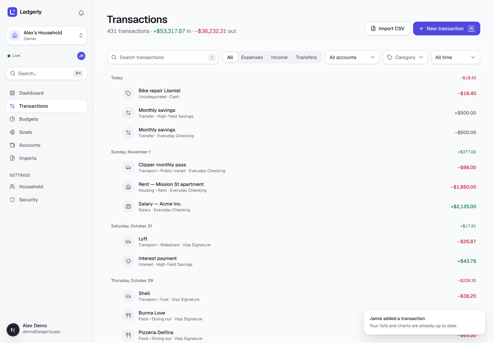
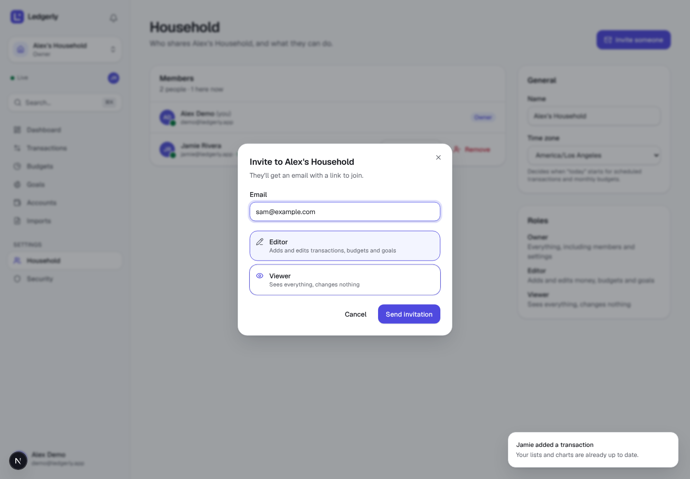
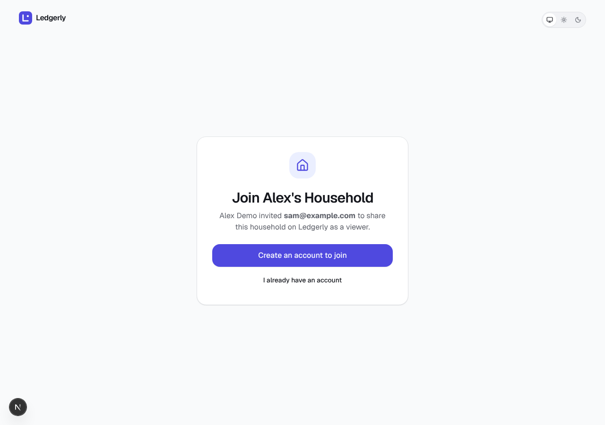
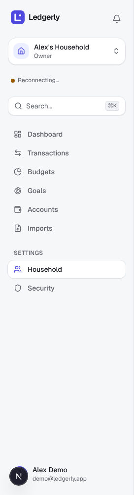
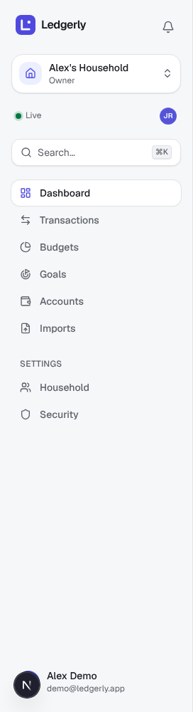
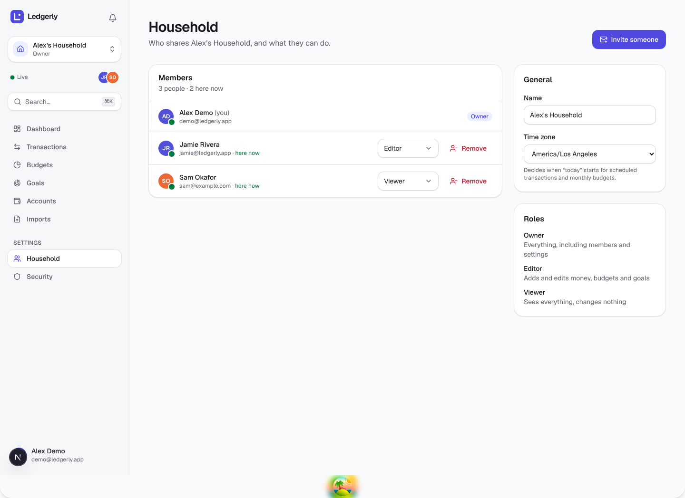
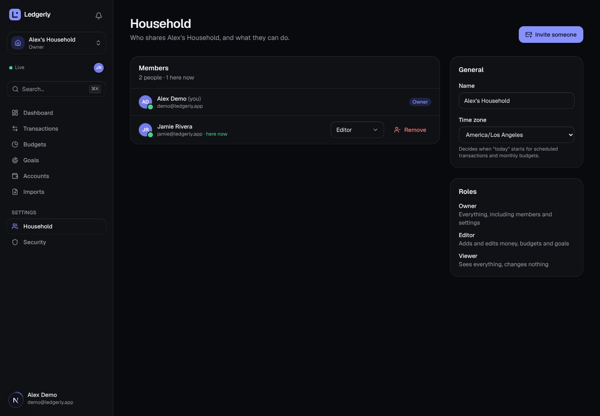
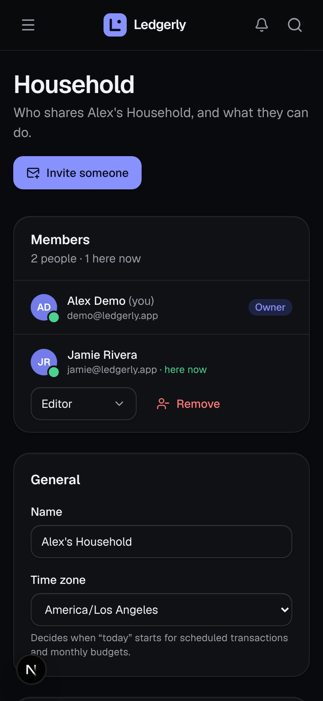

# Stage 11 — Households & Real-time

> **Goal of this stage:** make Ledgerly genuinely **shared**, then make it **live**.
>
> - **Shared:** invite your partner by email, manage who can do what, and leave or remove people safely.
> - **Live:** when anyone changes something, every member's screen updates within about a second, without refreshing. You can also see who else is here right now.
>
> **What you'll learn:** how invitation links are made secure, how race conditions break "check-then-act" rules, and how to pick a real-time transport (polling, SSE, WebSockets). You'll also see how Postgres `LISTEN/NOTIFY` can feed Server-Sent Events across many API instances, why live events should say _what changed_ rather than carry the data, and how presence ("who's online") is built.



---

## Table of contents

1. [What we built](#1-what-we-built)
2. [Sharing a household](#2-sharing-a-household)
3. [Invitations, done safely](#3-invitations-done-safely)
4. [Real-time: choosing a transport](#4-real-time-choosing-a-transport)
5. [The live pipeline](#5-the-live-pipeline)
6. [Presence: who's here](#6-presence-whos-here)
7. [In the browser](#7-in-the-browser)
8. [What testing and looking caught](#8-what-testing-and-looking-caught)
9. [Testing](#9-testing)
10. [Run it yourself](#10-run-it-yourself)
11. [Exercises](#11-exercises)
12. [Glossary](#12-glossary)
13. [What's next](#13-whats-next)

---

## 1. What we built

| Area     | What's new                                                                                                                                                                                                               |
| -------- | ------------------------------------------------------------------------------------------------------------------------------------------------------------------------------------------------------------------------ |
| Database | `household_invitations` (hashed tokens, bound to an email, at most one open invitation per address); **change-notification triggers** on every household table; the demo now has a partner, **Jamie** (editor).          |
| API      | Members (list, change role, remove, leave), invitations (create, revoke, public preview, accept, decline), household settings and creation, and **`GET /v1/events`**: a Server-Sent Events stream with presence.         |
| Worker   | `invitation.send`: emails the invitation link (the token travels encrypted).                                                                                                                                             |
| Web      | A **Household** settings page, an **invite** dialog, a public **`/invite/[token]`** page, "New household", a **Live** indicator with **presence avatars**, and live updates everywhere, with polling only as a fallback. |

The headline numbers from the browser tests:

- Jamie's new transaction appeared on Alex's screen **~1 second** after Jamie clicked, without a refresh;
- a removed member's browser was moved out of the household within **~330 ms**;
- after the API restarted, the live stream recovered in **~3 seconds**;
- a change written through one API instance reached a browser connected to **another instance** in **22 ms**.

---

## 2. Sharing a household

### 2.1 Roles

Roles have existed since Stage 5; now they matter in practice:

| Role       | Can                                                     |
| ---------- | ------------------------------------------------------- |
| **Owner**  | Everything, including members, invitations and settings |
| **Editor** | Add and edit transactions, budgets, goals, imports      |
| **Viewer** | See everything, change nothing                          |

They're enforced in the one place every household request passes through, the household scope from Stage 5. The new routes just declare `config: { minRole: "owner" }`. Viewers can still **list** members ("who can see my spending?" is a fair question for anyone in a household).

### 2.2 The last owner, and a race condition

Rule: **a household must always have at least one owner.** The naive implementation is:

```ts
const owners = await countOwners(household); // 2
if (member.role === "owner" && owners === 1) throw lastOwner();
await setRole(member, "editor");
```

Now imagine Alex and Jamie are both owners, and at the same moment each one demotes the other. Both requests count **2 owners**, both pass the check, and both demotions succeed. The household now has **zero owners** and nobody can manage it.

This is the **check-then-act** race, one of the most common real-world bugs. The fix is to make the check and the change one atomic step. Every membership change runs inside a transaction that first **locks** the household's member rows:

```ts
const members = await tx.select(…).from(householdMembers)
  .where(eq(householdMembers.householdId, householdId))
  .for("update");             // the second request WAITS here until the first commits
```

The second request waits for the lock, then counts again, and sees only one owner left. The same locking protects "leave" and "remove".

> **Best practice:** whenever a rule depends on other rows ("at least one owner", "balance can't go negative"), check it inside the same transaction as the change, with those rows locked, or with a database constraint when one can express the rule.

### 2.3 Leaving vs removing

`DELETE /members/:userId` serves both actions. **Anyone** may remove **themselves** (leave); only owners may remove someone else. The route allows viewers through (`minRole: "viewer"`) and the service makes the finer decision, because "is this you?" is a rule about the _target_, not the caller's role.

---

## 3. Invitations, done safely

An invitation link is a password that has been emailed to someone. Each property below closes a specific attack.



### 3.1 Unguessable, and only the hash is stored

The token is 32 random bytes (256 bits) from the operating system's secure random source. That's the same as Stage 5's session tokens: guessing one isn't merely "hard", it's physically impossible. The database stores only its **SHA-256 hash**:

- **A leaked database doesn't leak working links.** You can't reverse a hash into the token.
- **A fast hash is fine here.** Slow password hashes like Argon2 exist because humans choose guessable passwords. A 256-bit random token has nothing to guess.

The raw token exists in exactly three places: in memory briefly, in the API response (**once**, so the owner can copy the link), and in the email.

### 3.2 Bound to an email address

The invitation is for `sam@example.com`. Accepting it requires being **signed in as sam@example.com**:

```ts
if (row.email.toLowerCase() !== user.email.toLowerCase()) {
  throw new AppError(403, "invitation_email_mismatch", …);
}
```

A forwarded email, a link pasted into the wrong chat, or a link captured from someone's browser history is **useless to anyone else**. The trade-off is that you can't invite someone to "whatever account they like". Most finance apps make the same choice, and ownership-sensitive products (banking, payroll, healthcare) usually go further and verify the email address too.

### 3.3 Encrypted inside the email job

The email is sent by a background job (Stage 10), and job payloads sit in the `jobs` table for days. A plain token in a payload would undo the hashing. So the job receives the token **encrypted** with the server's AES-256-GCM key, the same helper that protects 2FA secrets since Stage 5:

```ts
await enqueue(tx, "invitation.send", {
  invitationId: created.id,
  token: encrypt(token, ctx.encryptionKey), // only the worker can read it
});
```

The invitation row and its job are inserted in **one transaction** (the outbox pattern from Stage 10), so there's never an invitation without an email, or an email for an invitation that was rolled back.

### 3.4 Lifecycle

```
pending ──accept──► accepted      (member added; the link is now dead)
   │──decline────► declined
   │──revoke─────► revoked        (owner cancelled it)
   └──7 days─────► expired        (re-inviting replaces it)
```

- A dead link answers **`410 Gone`**: the resource existed, but it's permanently unavailable. That's more precise than 404, and the page uses it to explain _why_.
- **At most one open invitation per person** is enforced by a partial unique index on `(household_id, lower(email)) WHERE accepted_at IS NULL AND declined_at IS NULL AND revoked_at IS NULL`. Re-inviting someone whose invitation has expired replaces the old one instead of failing.
- Accepting **locks** the invitation row, so a double-click can't add the member twice. The member insert also uses `ON CONFLICT DO NOTHING`, so accepting is harmless if you're somehow already a member.

### 3.5 A public preview, carefully

The invite page has to show "Alex invited you to Alex's Household" **before** you have an account, so `GET /v1/invitations/:token` needs no sign-in. Three precautions:

- **Rate limited:** 30 requests a minute per IP. Tokens are unguessable, but nobody should get to try millions.
- **No hints:** a token that never existed and one that's mistyped both answer 404. Only an obviously malformed one (wrong length) is rejected earlier, with 400, by request validation.
- **The page** sets `robots: noindex` (never let a search engine index an invitation) and `referrer: no-referrer`, so the token isn't sent to other sites in the `Referer` header if the page links anywhere.



### 3.6 Three visitors, three answers

The invite page handles every case instead of failing with a confusing error:

| Visitor                       | What they see                                                                                                                             |
| ----------------------------- | ----------------------------------------------------------------------------------------------------------------------------------------- |
| Signed out                    | "Create an account to join" / "I already have an account". Both pre-fill the email and **come back** here afterwards (`?next=…&email=…`). |
| Signed in as the right person | **Join household** / No thanks                                                                                                            |
| Signed in as someone else     | "This invitation only works for sam@example.com", plus a button that signs out and returns as the right person.                           |

`next` is validated by Stage 5's `safeNext()` (only paths on our own site), so an attacker can't craft `?next=https://evil.example`.

---

## 4. Real-time: choosing a transport

Until now, other people's changes appeared on your screen only when your browser happened to refetch. There are four common ways to push updates:

| Technique                    | How it works                                              | Good for                     | Costs                                                                    |
| ---------------------------- | --------------------------------------------------------- | ---------------------------- | ------------------------------------------------------------------------ |
| **Polling**                  | Ask every N seconds                                       | Anything; works everywhere   | Delay up to N seconds; constant requests even when nothing changes       |
| **Long polling**             | Ask; the server holds the request until something happens | Old browsers                 | A new request per event; awkward to implement                            |
| **Server-Sent Events (SSE)** | One long HTTP response the server keeps writing to        | **Server → browser** updates | One direction only; plain-text messages                                  |
| **WebSockets**               | A two-way connection upgraded from HTTP                   | Chat, games, live cursors    | A separate protocol to proxy, authenticate, scale and reconnect yourself |

Ledgerly's updates flow **one way**. Browsers already send changes with ordinary HTTP requests, which carry validation, permissions and idempotency. So **SSE** is the right tool:

- **It's just HTTP.** It passes through our Next.js `/api` proxy unchanged. Before building anything, we checked with a throwaway probe that the proxy **streams** rather than buffers: five events, 400 ms apart, arrived 400 ms apart.
- **Cookies authenticate it** like any other request. There's no token to put in a URL or a first message.
- **Reconnection is built into browsers.** `EventSource` reconnects automatically, and the server can suggest the delay (`retry: 3000`).

WebSockets earn their extra complexity when the **client** streams too. If we add collaborative editing later, we'd revisit this choice.

---

## 5. The live pipeline

```
 Jamie's browser ──POST /transactions──► API instance A ──INSERT──► Postgres
                                                                       │ trigger: pg_notify('ledgerly_events',
                                                                       │   {"t":"transactions","h":…,"n":1,"a":[jamie]})
                                                                       ▼  (delivered on COMMIT)
                                    ┌──────────── LISTEN ────────────┴──────────── LISTEN ────────────┐
                              API instance A (hub)                                         API instance B (hub)
                      filters by membership                                       filters by membership
                                    │ SSE                                                        │ SSE
                             Alex's laptop                                               Alex's phone
                                    └──► invalidate ["households", h, "transactions"] …  → refetch → re-render
```

### 5.1 Events say what changed, never the data

A message is tiny: `{"type":"transactions","householdId":"…","op":"insert","count":1,"actors":["…"]}`. On receiving it, the browser **refetches** what it's showing, through the normal API. This is called **invalidation-based** real-time, and it's deliberately simple:

- **Permissions stay in one place.** The data still comes from the normal API, which checks access. The stream can't accidentally leak a row someone shouldn't see, because it never carries rows.
- **A missed event can't leave wrong data on screen.** The next refetch is correct regardless of which events arrived.
- **Messages stay small.** `pg_notify` payloads must stay under 8,000 bytes, so a 500-row import still sends one small message.

The cost is an extra request per change, per open screen, which is small at household scale. Apps with heavy traffic sometimes push the data itself (a "patch") to save that request. That's an optimisation to make once measurements show you need it.

### 5.2 The triggers

Migration `0010` adds statement-level triggers to every household table (accounts, categories, transactions, budgets, goals, rules, imports, invitations, members) plus notifications. The techniques are the same as Stage 10's budget trigger:

- **One message per household per statement.** A test inserts 1,000 rows in one statement and receives exactly **one** message.
- **Transactional.** `pg_notify` is delivered **only on commit** (a test rolls back and receives nothing), and identical messages within one transaction are delivered once.
- **Transactions name their actors** (`a: [user ids]`), so the browser can say "Jamie added a transaction".
- **Membership changes name the affected users,** because a _removed_ member must be told, even though they no longer belong to the household.

Because the database announces every change, no code path can forget to. An import, a recurring rule, a bulk edit and a manual SQL fix are all announced the same way.

### 5.3 One LISTEN per process, many browsers

Each API process holds **one** dedicated Postgres connection doing `LISTEN ledgerly_events`. Its `RealtimeHub` fans every message out to the browsers connected to **that** process, filtered by membership:

```ts
for (const s of this.subscribers) if (s.households.has(message.h)) s.send(event);
```

That's why this scales the way it does. Five thousand open tabs cost five thousand idle sockets (cheap) and still only **one** database connection per process. And because every instance listens to the same channel, a change made through instance A reaches a browser connected to instance B. **No sticky sessions, no extra message broker.** We tested it with two API processes on ports 4000 and 4001: written through `:4000`, received on `:4001` **22 ms** later.

Two cases get special handling:

- **Notifications** belong to a user, not a household, so they go only to that user's connections.
- **Membership changes** make the affected user's connection **re-read its memberships** before anything else. A removed member stops receiving that household's events immediately; a new member starts.

### 5.4 The SSE endpoint

`GET /v1/events` takes over the HTTP response and writes to it for as long as the browser keeps it open:

```
content-type: text/event-stream
cache-control: no-cache, no-transform   ← no caching, and no compression (it would buffer)
x-accel-buffering: no                  ← tells nginx-style proxies not to buffer either

retry: 3000                            ← "if we get disconnected, retry after 3 s"

event: ready
data: {"connectionId":"…","online":{"<household>":["<jamie>"]}}

data: {"type":"transactions","householdId":"…","op":"insert","count":1,"actors":["…"]}

: ping                                 ← a comment, every 25 s
```

Each of these protects against a specific real-world failure:

| Measure                                         | Prevents                                                                                                                                                                   |
| ----------------------------------------------- | -------------------------------------------------------------------------------------------------------------------------------------------------------------------------- |
| **Heartbeat** comment every 25 s                | Load balancers and proxies silently closing "idle" connections (often after 60 s).                                                                                         |
| **Re-checking the session** each heartbeat      | A stream outliving its session. After "sign out everywhere" (Stage 5), the stream sends `event: unauthorized` and closes within 25 s. Tested.                              |
| **10 connections per user** (`429` beyond that) | A buggy page or a script opening thousands of streams.                                                                                                                     |
| **Slow-client cut-off** (1 MB buffered)         | One client on a terrible network making the server hold unbounded memory. Disconnecting is safe: it reconnects and resyncs.                                                |
| **`preClose` hook** ends every stream           | A deploy hanging forever. Without it the server waits for open connections to finish, and SSE connections never do. Browsers reconnect to the new instance within seconds. |

### 5.5 Reconnecting: resync, not replay

`NOTIFY` doesn't queue messages for listeners that aren't connected. So what about events sent while a browser was reconnecting, or while an API instance was restarting?

There are two classic answers:

- **Replay:** number every event, store recent ones, and let the client ask for everything after `Last-Event-ID`. It's precise, but it needs a durable event log, a retention policy, and handling for "too far behind".
- **Resync:** after any reconnect, refetch everything that's on screen.

Since our events only ever mean "refetch this", **resync is exactly as correct**, and much simpler. The browser does it on every `ready` after the first. The hub also tells all its clients to resync when **its own** `LISTEN` connection drops and recovers.

The test: stop the API while Alex is looking at the Household page. The sidebar shows **Reconnecting…** (amber); when the API returns, it shows **Live** again about 3 seconds later, with fresh data.



### 5.6 Limits, honestly

- **HTTP/1.1 allows about 6 connections per site in a browser**, and an SSE stream uses one. Several Ledgerly tabs over HTTP/1.1 could starve each other. HTTP/2 (standard in production behind any modern load balancer) multiplexes everything over one connection, so the problem disappears. Stage 14 serves the app over HTTP/2.
- **`LISTEN/NOTIFY` lives in one Postgres primary,** and handles thousands of messages per second comfortably. Beyond that, or across regions, you'd move fan-out to a dedicated pub/sub system (Redis, NATS, or a managed service). The hub's design stays the same; only its input changes.

---

## 6. Presence: who's here

Each open tab announces itself through the **same** channel:

```
{"t":"presence","u":"<user>","c":"<connection id>","hs":["<households>"],"s":"online"}
```

The announcement is sent when the stream opens, again with every heartbeat, and with `"s":"offline"` when the stream closes.

Every API instance receives every announcement and builds the **same** presence map from it. Presence is **derived from the shared event stream**; there's no shared memory or presence table. That design decides the details:

- **Keyed by connection, not user.** Jamie with two tabs is two entries. Closing one tab doesn't make Jamie "offline", and the hub only tells others when a user's status _actually_ changes. Heartbeats and second tabs are silent.
- **Entries expire after 60 s without a heartbeat.** If an API instance crashes, it can't send "offline", but its users' entries expire and every other instance's sweep announces them offline.
- **A new connection gets a snapshot** of who's online in the `ready` event, so you see Jamie immediately rather than after their next heartbeat.



---

## 7. In the browser

### 7.1 One stream per tab

`RealtimeProvider` (in the `/app` layout) opens one `EventSource` and turns each event into the query keys it affects:

```ts
case "transactions":
  return [h(id, "transactions"), h(id, "reports"), h(id, "budgets"), h(id, "accounts"), h(id, "goals")];
case "imports":
  return [h(id, "imports")];
```

- **Coalescing.** An import sends an event per chunk, so keys are collected for 150 ms and invalidated once each. TanStack Query refetches only the queries **on screen**; everything else is just marked stale.
- **Forward compatible.** An unknown event type maps to nothing, so an older browser tab ignores a newer server's events instead of breaking.

### 7.2 Polling becomes the fallback

Stage 10 polled import progress every 700 ms and notifications every 15 s. Now both hooks ask `useIsLive()`:

```ts
refetchInterval: live ? false : 30_000,
```

While the stream is up, there's no polling at all. If a corporate proxy blocks streaming or the connection drops, the old behaviour returns automatically. **The live layer is an enhancement; the app works without it.**

### 7.3 Telling people what happened

- **Other people's changes get a quiet toast:** "Jamie added a transaction · Your lists and charts are already up to date." Your own changes don't, because you know what you did.
- **Lost access is handled.** If you're removed from the household you're looking at, you're moved to your other household with "You no longer have access to that household". In the browser test, that took **336 ms** from the owner's click.

### 7.4 The Household page



The page shows:

- **members**, with presence dots, a role select (owners only; the last owner's role is shown as a badge, since it can't change), and two-step **Remove** / **Leave**;
- **pending invitations**, with who sent them, when they expire, and **Revoke**;
- **General:** the name and the household **time zone** (Stage 10's scheduled jobs use it);
- the role descriptions in plain words.

After **Send invitation**, the dialog shows the link with **Copy link**. The link is returned once, at creation, for sharing over a messenger. **New household** in the household switcher creates a separate household, for example a side business.

When Sam accepted the invitation in **another browser**, Alex's page updated by itself: Sam appeared in Members, and the invitation disappeared from Pending, with no refresh.





---

## 8. What testing and looking caught

**1. Presence that never went offline.** A unit test for the sweep, "a crashed instance's users go offline", failed. The sweep asked "was this user online?" _after_ checking expiry. Since the entry had expired, the answer was already "no", so "no → no" looked like no change and nobody was told. The fix: an entry being removed counts as "was online". Without this unit test, the bug would have needed a crashed server and a 60-second wait to show itself.

**2. "Create an account" after creating an account.** In the first browser run, Sam signed up, came back to the invite page, and was offered sign-up **again**. The page had cached "not signed in" from its first visit, and Next.js's client-side navigation keeps the query cache. The fix: that query is always refetched when the page mounts (`staleTime: 0`, `refetchOnMount: "always"`). Caches make apps fast, and every cached fact needs a moment when it's re-checked.

**3. "2 here now" with only one other person.** On the phone screenshot, Alex's _own_ laptop tab counted as "someone here". "Here now" now means **other** people.

**4. Faces that stayed during an outage.** While the API restarted, Jamie's avatar stayed in the sidebar, which was a claim we couldn't back up. While disconnected, presence is now hidden, and the `ready` snapshot restores it after reconnecting.

**5. A screenshot mid-animation.** The first invite-page screenshot caught the card's fade-in at 50% opacity. Not a bug, but a reminder that automated screenshots need to wait for motion to finish.

**6. The seed change rippled.** Adding Jamie to the demo household broke two tests that expected one member and two recipients. Both were right to break; we updated them to the new truth. Tests that pin exact data are fine, as long as you update them consciously when the data changes on purpose.

---

## 9. Testing

| Package            | Tests | New this stage                                                                                                                                                                                                                                                                                                              |
| ------------------ | ----- | --------------------------------------------------------------------------------------------------------------------------------------------------------------------------------------------------------------------------------------------------------------------------------------------------------------------------- |
| `@ledgerly/shared` | 70    | —                                                                                                                                                                                                                                                                                                                           |
| `@ledgerly/db`     | 31    | 5: a real `LISTEN` client checks payloads, one message per 1,000-row statement, silence on rollback, membership and notification messages                                                                                                                                                                                   |
| `@ledgerly/api`    | 171   | 26: members (roles, last owner, remove/leave, rename, create); invitations (hash at rest, encrypted job, email, preview, accept, wrong email, 410s, duplicates, owners only); hub routing and presence; **SSE over a real socket** (delivery, isolation, notifications, presence, removal, revoked session, connection cap) |
| `@ledgerly/web`    | 80    | 3: event → query-key mapping                                                                                                                                                                                                                                                                                                |

The SSE tests start the API on a **real port** (`app.listen({ port: 0 })`). Fastify's in-memory `inject()` can't hold a streaming response open. A 40-line SSE client reads and parses the frames, so assertions read naturally:

```ts
const viewer = await connect(VIEWER);
await createTransaction(); // through the normal API
const seen = await viewer.next((e) => e.data.type === "transactions");
```

The browser run used **three browsers** (Alex, Jamie, and Sam with no account) on the live stack:

```
1 Alex: "Live"
2 Jamie signs in → Alex sees Jamie's avatar
3 Jamie adds "Bike repair" → on Alex's screen 1,069 ms later, toast "Jamie added a transaction"
4 Alex invites sam@example.com (viewer) → link shown once; pending list updated
5 Sam opens the link signed out → signs up (email pre-filled) → back to the invite → Join
  → lands in Alex's household; Alex's page shows Sam, pending list empty (no refresh)
6 Alex removes Sam → Sam moved out 336 ms later: "You no longer have access…"
7 API stopped → "Reconnecting…" → restarted → "Live" 2.9 s later
8 the used link now explains it was used; dark mode; mobile: no overflow; console errors: none
```

Plus the cross-instance check from §5.3, and the usual gates: `pnpm check`, the production build and the migration drift check.

---

## 10. Run it yourself

```bash
pnpm db:migrate && pnpm db:seed
```

```bash
pnpm dev
```

The demo household now has two people. Open **two different browsers**, or one normal window and one private window (sessions are per browser):

- Sign in as **demo@ledgerly.app** in one and **jamie@ledgerly.app** in the other (password `correct-horse-ledger` for both). Watch the avatars appear in each sidebar.
- Add a transaction as Jamie, with Alex's Transactions page open.
- As Alex: **Household → Invite someone**. The invitation email is printed in the **worker's** log, and the dialog shows the link too. Open it in a third, private window.
- Stop the API (Ctrl+C) and watch the sidebar say "Reconnecting…". Start it again.
- Watch the raw stream yourself while signed in: open `http://localhost:3000/api/v1/events` in a tab.

---

## 11. Exercises

1. **Watch NOTIFY in psql.** Run `LISTEN ledgerly_events;` in one `psql` session. In another, update a transaction. (psql only shows notifications after your next command, so run `SELECT 1;`.) Then try it inside `BEGIN … ROLLBACK`.
2. **Break the last-owner rule.** Remove `.for("update")` from `withLockedMembers`, then write a test that demotes two owners concurrently with `Promise.all`. Does it fail every time? Why not? (Hint: timing. Race conditions are nondeterministic, which is what makes them dangerous.)
3. **Transfer ownership.** Add a "Make owner and step down" action that does both changes in one transaction.
4. **Resend an invitation.** Design it so that the old link stops working. Which columns change? Should the 7 days restart?
5. **Typing presence.** Show "Jamie is adding a transaction…" while Jamie's sheet is open. Which direction does that data flow, and does it change the SSE-vs-WebSocket decision?
6. **Patch instead of refetch.** For a new transaction, send the row itself in the event (after a permission check) and insert it into the cached list. What new problems appear (ordering, filters, pagination)?
7. **HTTP/1.1 starvation.** Open 7 Ledgerly tabs in a browser against `http://localhost`. What happens to the 7th tab's requests, and why does HTTP/2 fix it?
8. **Replay with Last-Event-ID.** Sketch the table and retention rules you'd need to replay missed events. When would it be worth it over resync?

---

## 12. Glossary

| Term                           | Meaning                                                                                                 |
| ------------------------------ | ------------------------------------------------------------------------------------------------------- |
| **Check-then-act race**        | Two requests both check a condition, then both act, together breaking the rule each checked.            |
| **Row lock (`FOR UPDATE`)**    | Makes other transactions wait for these rows until yours finishes.                                      |
| **Bound invitation**           | One that only works for the email address it was sent to.                                               |
| **410 Gone**                   | The resource existed but is permanently unavailable (a used or expired link).                           |
| **Server-Sent Events (SSE)**   | A long HTTP response the server keeps writing `data:` messages to; read in browsers with `EventSource`. |
| **WebSocket**                  | A two-way, message-based connection upgraded from HTTP.                                                 |
| **LISTEN / NOTIFY**            | Postgres's built-in publish/subscribe; notifications are delivered on commit.                           |
| **Fan-out**                    | Delivering one message to many recipients.                                                              |
| **Invalidation-based updates** | Pushing "this changed" and letting clients refetch, instead of pushing the data.                        |
| **Heartbeat**                  | A small periodic message that keeps a connection, or a presence entry, alive.                           |
| **Resync / replay**            | After a disconnection: refetch everything, or receive the exact events missed.                          |
| **Presence**                   | Knowing who is currently connected.                                                                     |
| **Sticky sessions**            | A load balancer always sending a user to the same server (not needed here).                             |
| **Graceful degradation**       | The app keeps working, just less smoothly, when an enhancement (the live stream) is unavailable.        |

---

## 13. What's next

**Stage 12: Performance & scalability.** We've built many features; now we **measure** them. That means load testing the API (requests per second, p95 latency), reading query plans for the slowest endpoints, connection pooling, caching expensive reports, bundle-size budgets and Core Web Vitals for the front end, and a capacity estimate: how many households one server can carry, and what breaks first.
