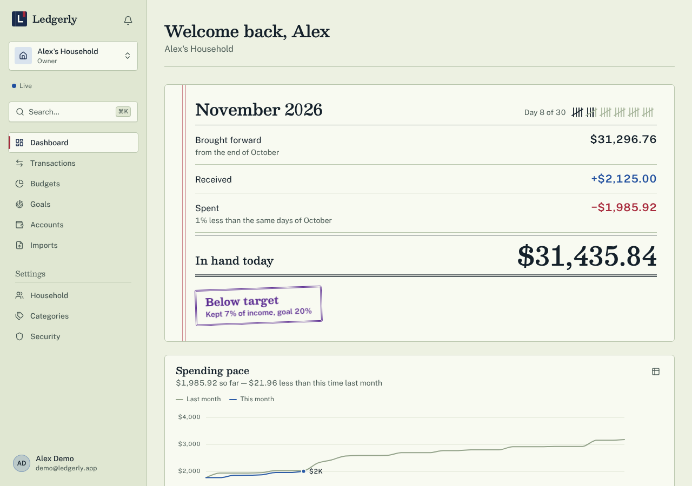
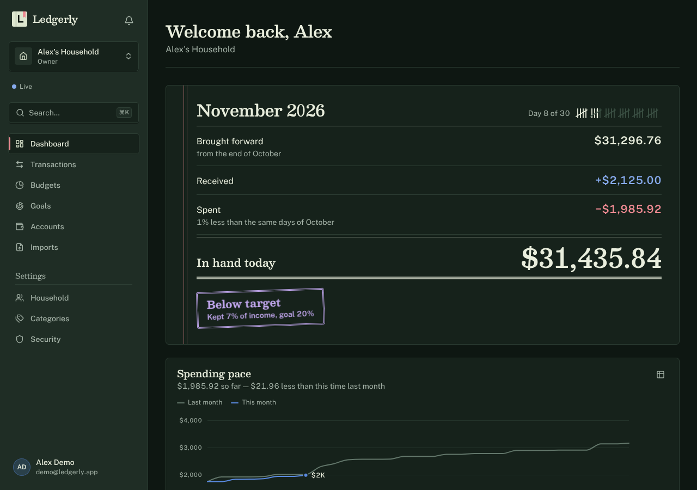
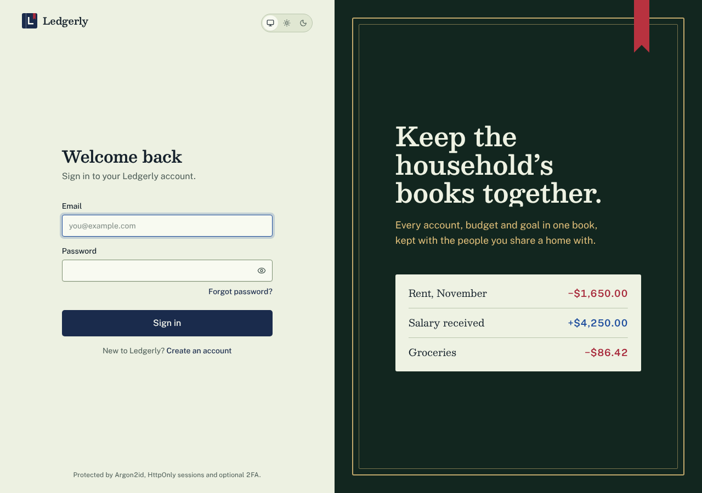
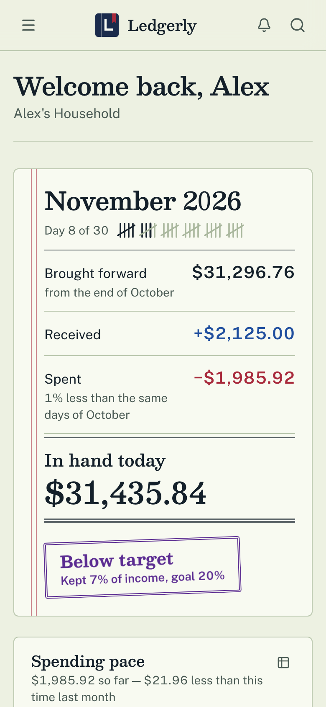

# Stage 18 — A Visual Identity

> **Goal of this stage:** give Ledgerly a look that belongs to _it_ and could not be mistaken for any other app, without changing what any page does or where anything is. The design system built in Stage 2 made this a small change instead of a rewrite: a new look is mostly new tokens.
>
> **What you'll learn:** how to start a design from the subject instead of from a template; how to choose a palette and check it with a script instead of by eye; why some animations make text fail an accessibility test, and the kind that don't; and why changing a font can change what numbers _mean_.

---

## Table of contents

1. [What we built](#1-what-we-built)
2. [Starting from the subject](#2-starting-from-the-subject)
3. [The plan, and the review of the plan](#3-the-plan-and-the-review-of-the-plan)
4. [The palette](#4-the-palette)
5. [Type: and a mistake caught by looking](#5-type-and-a-mistake-caught-by-looking)
6. [The month, written as a statement](#6-the-month-written-as-a-statement)
7. [Charts: colours that survive being colour-blind](#7-charts-colours-that-survive-being-colour-blind)
8. [Animations that can't fail an accessibility check](#8-animations-that-cant-fail-an-accessibility-check)
9. [What changed in the code](#9-what-changed-in-the-code)
10. [Results](#10-results)
11. [Run it yourself](#11-run-it-yourself)

---

## 1. What we built

| Area          | Change                                                                                                                        |
| ------------- | ----------------------------------------------------------------------------------------------------------------------------- |
| Identity      | "The household day-book": a ledger's paper, inks, rules, bookmark and stamp                                                   |
| Palette       | Pale green analysis paper; blue ink for money in, red ink for money out, violet for stamps; a green cloth cover for dark mode |
| Type          | Besley (a Clarendon, the lettering of old bookkeeping) for titles and big figures; Public Sans for everything else            |
| Dashboard     | The four stat tiles become one written statement of the month, with a tally of the days and a status stamp                    |
| Charts        | A new five-colour palette, validated by script in both themes                                                                 |
| Sign-in       | The side panel becomes the cover of the book                                                                                  |
| Motion        | Reveals that wipe instead of fading; entrances that never make text half-transparent                                          |
| Accessibility | The contrast test learns the new palette and checks the stamp and form-field colours too                                      |





---

## 2. Starting from the subject

A design that begins with "make it modern" ends up looking like every other app, because "modern" is what everyone's tools default to. So the stage began by asking what Ledgerly _is_:

- **The subject:** money kept by people who share a home.
- **The audience:** couples and families.
- **The job:** know where the month stands, and record spending quickly.

Four questions were put to the owner before any design work: how far to go (a new look on the same layout), which personality (**a kept household ledger**), where the one bold element should be (**the month at a glance**), and which colour constraints applied (none). The answers shaped everything below.

The word "ledger" is itself the design brief, because a ledger is a real object with a real vocabulary: ruled paper, columns, red and blue ink, a single rule under a subtotal and a double rule under a grand total, a ribbon marking your place, a rubber stamp.

---

## 3. The plan, and the review of the plan

The design came with a short plan (colours, type, layout, principles) and then a review of that plan _against the usual habits of generated designs_. This was the most useful step, because a "ledger" idea slides straight into the most common AI look: cream paper, a serif and a terracotta accent. Five things were changed on review:

1. **Paper, not cream.** A pale green analysis paper, and a cool crimson red instead of a warm clay.
2. **Rules only where they mean something.** A page full of hairlines reads as a newspaper. Here a light line separates rows, a single line sits above a total, a double line sits under it, and the red margin appears only on the month's statement.
3. **No soft shadows, no identical rounded cards.** Paper doesn't float. Pages sit flat, with a thin ruled edge and small corners; the statement isn't a card at all.
4. **No small caps-lock labels, no monospace labels, no arrows on buttons.** The sidebar's "SETTINGS" became "Settings" over a thin rule.
5. **One playful detail, used once.** The stamp appears only on the statement, and only to say one thing.

---

## 4. The palette

Every colour has a job, and each job comes from the ledger:

| Name          | Light     | Dark      | What it does                                  |
| ------------- | --------- | --------- | --------------------------------------------- |
| Paper         | `#edf1e2` | `#0e1712` | The page. In dark mode, the cloth cover       |
| Leaf          | `#f8faf1` | `#16221b` | A fresh page laid on the paper: cards, fields |
| Ink           | `#14202a` | `#e9eedd` | Text                                          |
| Fountain blue | `#1f4e9e` | `#86a9eb` | Money **in**                                  |
| Ledger red    | `#a82a3c` | `#ee8a92` | Money **out**, and the bookmark               |
| Stamp violet  | `#5b2c91` | `#c3a8f0` | Status stamps, nothing else                   |
| Gilt          | `#85560b` | `#e0ad52` | Heads-up messages                             |

Red for what goes out and blue for what comes in isn't a decoration: it's how accountants have written for centuries, and it means a column of figures can be read before any number is.

**The contrast test is the guard.** `src/styles/contrast.test.ts` checks every text-and-background pair in both themes against the WCAG minimums (4.5 : 1 for text, 3 : 1 for lines and controls). It only understood one colour format, so the first run with the new palette failed straight away: it couldn't read the colours at all. (A guard that fails loudly when it can't do its job is the right kind.) It now reads hex colours too, and checks the stamp and the form-field border as well: 44 checks, all passing.

---

## 5. Type: and a mistake caught by looking

Two typefaces, both stored in the app (`src/app/fonts`) and licensed under the SIL Open Font License, so no request goes to a font service:

- **Besley** for titles, the month, and large figures. It is a Clarendon: the sturdy slab-ish serif that bookkeeping was lettered in.
- **Public Sans** for everything else: a plain, sturdy face made for forms.

Both were measured before use, not judged by eye. Money must line up in columns, which needs every digit to be the same width. A small script rendered each digit ten times and compared widths: with `tabular-nums` on, both fonts had a spread of exactly zero.

**The mistake.** The first body font was Atkinson Hyperlegible, chosen for clear letters. In the screenshots every zero had a slash through it, so `$2,125.00` looked like `$2,125.00` with strike-throughs. That's deliberate in that font (it makes 0 and O different), and it is wrong for money. The fix wasn't a setting: the slash is part of the font's shapes, and every OpenType feature was tried. It took changing the typeface.

> **The lesson:** a font isn't only a style. It decides how numbers read. Look at real figures, in the real layout, before choosing.



---

## 6. The month, written as a statement

The top of the dashboard used to be four tiles: net worth, income, spending, savings rate. Four numbers side by side say little about how they relate. Written as a bookkeeper would, they become one sum you can check with a pencil:

```
November 2026                                    Day 8 of 30   ||||| |||
─────────────────────────────────────────────────────────────────────
Brought forward, from the end of October                  $31,296.76
Received                                                   +$2,125.00
Spent, 1% less than the same days of October               −$1,985.92
─────────────────────────────────────────────────────────────────────
In hand today                                              $31,435.84
═════════════════════════════════════════════════════════════════════
[ Below target: kept 7% of income, goal 20% ]
```

`31,296.76 + 2,125.00 − 1,985.92 = 31,435.84`. The statement is built so it always adds up: if something other than income and spending changed the balance (an account added mid-month, say), it gets its own line instead of making the arithmetic wrong.

> **Correction (Stage 19).** That last sentence described the bug, not a safeguard. The "adjusted" line hid the fact that the four figures came from three different calculations, so a bill dated tomorrow or an archived account produced made-up money (for example "Net worth −$550" for someone who had $950). The statement now comes from one server calculation, the line is gone, and "In hand today" is "Net worth today", because a loan or card lowers it. See [Stage 19, section 4](./stage-19-launch-blockers-again.md#4-a-statement-that-didnt-add-up). The mock-up above is kept as it was drawn.

- **The tally** is the days of the month in groups of five, four strokes and a diagonal, with days gone inked and days to come faint. It is an SVG with a text label for screen readers.
- **The stamp** gives one verdict: on target, below target, or spent more than came in. It is the only decoration on the page that isn't structure, and it appears nowhere else.
- **The margin**, two thin red lines at the left, is ruled into this one page only.



---

## 7. Charts: colours that survive being colour-blind

Charts need several colours that can be told apart, including by the one man in twelve who is colour-blind. That is computable, so it was computed: the project's data-visualisation skill ships a validator that checks, for a palette in a given theme, the lightness range, whether each colour is vivid enough to read as a colour, how distinguishable neighbours are under simulated colour blindness, and contrast against the page.

The first palette **failed**, in both themes: the green was too grey in light mode, and the dark colours were too light and two were hard to tell apart. Re-ordering and adjusting took several rounds. The order matters as much as the colours: blue first, then red (income and spending), then violet, then green and ochre, with green never next to red, because red and green are exactly what the commonest kind of colour blindness merges. The final palette passes every gating check in both themes. The five colours and their order are recorded next to the tokens in `globals.css`.

---

## 8. Animations that can't fail an accessibility check

Accessibility tests measure the colour a person would see _at that moment_. A fade is dangerous for that: halfway through a fade-in, text is half-transparent, and its contrast against the background is nowhere near its real value. The sign-in page failed the check at random for this reason, depending on whether the test ran before or after a 600 ms fade finished. (The old palette had enough margin to survive it; the new one didn't, which is how the problem showed up.)

Two rules came out of it:

- **Move or wipe, never fade.** Entrances now slide or reveal left to right, and text is always fully opaque.
- **CSS, not JavaScript.** The statement writes itself in with CSS animations that start the moment the page's HTML arrives. A JavaScript animation would leave the top of the dashboard blank until the scripts loaded, which Stage 12 had already shown is slow on a phone.

The accessibility checks now pass **32 out of 32** when repeated eight times. Anyone who asks their device for less motion sees the final state at once.

---

## 9. What changed in the code

Because Stage 2 put every colour behind a named token and every component behind shared classes, most of the work was in a few places:

- `src/app/globals.css`: the colour tokens, the radius scale (small, like a page corner), flat "edge" elevations, the type scale and the reveal animations.
- `src/app/layout.tsx` and `src/app/fonts/`: the two fonts, replacing the old font package.
- `src/components/dashboard/month-statement.tsx`: the new statement, replacing the four tiles. The old tile, meter and sparkline components were deleted because nothing used them any more.
- `src/components/auth/auth-showcase.tsx`: the book cover. The gradient wash and the floating glass cards, two of the commonest generated looks, are gone.
- A handful of small edits: the logo (a closed ledger with a ribbon), badges, the sidebar's bookmark and section label, and the page header's rule.

No page was moved, and no behaviour changed: the 29 browser tests that drive the app through real browsers passed unchanged.

---

## 10. Results

| What                                      | Before                          | After                                                |
| ----------------------------------------- | ------------------------------- | ---------------------------------------------------- |
| Look                                      | Indigo, rounded cards, shadows  | A day-book: paper, inks, rules, a bookmark           |
| Dashboard top                             | Four tiles                      | One statement that adds up                           |
| Chart palette                             | Checked once, in Stage 8        | Re-checked by script in both themes                  |
| Palette contrast checks                   | 34, reading one colour format   | **44**, reading hex too, plus stamp and field edge   |
| Accessibility sweep, run 8 times in a row | Passed by timing                | **32 / 32**, and can't depend on timing              |
| Fonts                                     | One package, from a font vendor | Two bundled files, ~63 KB together                   |
| Tests                                     | 482                             | **492** (db 35, api 222, shared 89, web 117, e2e 29) |

---

## 11. Run it yourself

```bash
pnpm db:up && pnpm db:migrate && pnpm db:seed
pnpm dev
```

Open http://localhost:3000 and sign in as the demo user. The living style guide at http://localhost:3000/design shows every token and component in the new look, and the light and dark themes are one click apart.

To check the palette yourself, run the contrast test, then try making `--muted-foreground` lighter and watch it fail:

```bash
pnpm --filter @ledgerly/web exec vitest run src/styles/contrast.test.ts
```
